# Diagrama de clases — app Android

> Generado automáticamente por `scripts/docs/build-diagrams.mjs`. No editar a mano.

Clases Kotlin de la app organizadas por capa (arquitectura en capas + DDD). Patrones: State (`EstadoActividad`), Builder (`ActividadBuilder`), Prototype (`PlanEstudio.clonar`), Strategy (`EstrategiaPlanificacion`), Abstract Factory (`FabricaServiciosIA`), Repository, Singleton (`AppDatabase`), Observer (`ObservadorUso`) y Facade (`Nube`).

| Capa | Clases |
|---|---|
| `dominio` | `ActividadAcademica`, `Recordatorio`, `EventoCalendario`, `ActividadBuilder`, `Carpeta`, `ContenidoAcademico`, `Apunte`, `Anotacion`, `Curso`, `Eliminable`, `TipoContenido`, `TipoActividad`, `OrigenActividad`, `EstadoPlan`, `TipoFranja`, `EstadoActividad`, `PendienteValidar`, `Confirmada`, `Sincronizada`, `Completada`, `Estudiante`, `Abreviatura`, `Prioridad`, `FechaLimite`, `FranjaHoraria`, `PlanEstudio`, `SesionEstudio`, `ActividadRepository`, `CursoRepository`, `ContenidoRepository`, `PlanRepository`, `EstudianteRepository`, `DetectorDuplicados`, `ClasificadorContenido` |
| `aplicacion` | `Dependencias`, `GestorActividades`, `GestorAlertas`, `GestorAnalisisIA`, `ResultadoAula`, `GestorAulaVirtual`, `GestorCursos`, `GestorIngesta`, `GestorPapelera`, `GestorPlanificacion`, `GestorSincronizacion`, `MigracionDatos`, `ObservadorUso` |
| `ia` | `ComunIA`, `AiConfig`, `AiSettings`, `ClienteCompatibleOpenAI`, `EstrategiaPlanificacion`, `PlanificacionConIA`, `PlanificacionLocalPorPrioridad`, `ExtractorLocal`, `FabricaProveedorA`, `ExtractorParametrosGemini`, `GeneradorPlanGemini`, `FabricaProveedorB`, `ExtractorParametrosCompatibleOpenAI`, `GeneradorPlanCompatibleOpenAI`, `FabricaServiciosIA`, `ReconocedorOCRMLKit`, `ReconocedorOCR`, `ExtractorParametros`, `GeneradorPlanIA` |
| `infraestructura` | `AppDatabase`, `CalendarioGateway`, `GoogleCalendarAdapter`, `ProgramadorNotificaciones`, `AlarmManagerNotificaciones`, `LocalCursoRepository`, `LocalContenidoRepository`, `LocalActividadRepository`, `LocalPlanRepository`, `LocalEstudianteRepository` |
| `remoto` | `ErrorApi`, `ApiTareia`, `CalendarioAulaRemoto`, `ColaTelemetria`, `MapeoNube`, `Nube` |

```mermaid
classDiagram
  direction LR
  namespace dominio {
    class ActividadAcademica {
      +id : String
      +tipo : TipoActividad
      +origen : OrigenActividad
      +idExterno : String
      +idContenidoOrigen : String?
      +confirmar()
      +sincronizar()
      +completar()
      +reabrir()
      +cambiarEstado()
      +esConfirmable()
      +estaCompletada()
      +estaPendienteDeValidar()
      +editar()
    }
    class Recordatorio {
      +id : String
      +idActividad : String
      +fechaHora : LocalDateTime
      +activo : Boolean
    }
    class EventoCalendario {
      +idExterno : String
      +ultimaSincronizacion : LocalDateTime
      +cuenta : String
    }
    class ActividadBuilder {
      +conTitulo()
      +conFechaLimite()
      +conCurso()
      +conTipo()
      +desdeIA()
      +conId()
      +conDescripcion()
      +conNombreCursoDetectado()
      +conContenidoOrigen()
      +desdeIntegracion()
      +build()
    }
    class Carpeta {
      +id : String
      +nombre : String
    }
    class ContenidoAcademico {
      +id : String
      +titulo : String
      +tipo : TipoContenido
      +textoReconocido : String
      +fechaRegistro : LocalDateTime
      +estaSinClasificar()
      +asignarCarpeta()
      +etiquetaPapelera()
      +enviarAPapelera()
      +restaurar()
    }
    class Apunte {
      +texto()
      +actualizarTexto()
    }
    class Anotacion {
      +contenido : String
      +texto()
      +actualizarTexto()
    }
    class Curso {
      +id : String
      +abreviatura : Abreviatura
      +prioridad : Prioridad
      +dificultad : Int
      +activo : Boolean
      +carpeta : Carpeta
      +renombrar()
      +etiquetaPapelera()
      +enviarAPapelera()
      +restaurar()
    }
    class Eliminable {
      <<interface>>
      +etiquetaPapelera()
      +enviarAPapelera()
      +restaurar()
      +estaEnPapelera()
    }
    class TipoContenido {
      <<enumeration>>
    }
    class TipoActividad {
      <<enumeration>>
    }
    class OrigenActividad {
      <<enumeration>>
    }
    class EstadoPlan {
      <<enumeration>>
    }
    class TipoFranja {
      <<enumeration>>
    }
    class EstadoActividad {
      <<interface>>
      +confirmar()
      +sincronizar()
      +completar()
      +reabrir()
      +nombre()
    }
    class PendienteValidar {
      +confirmar()
      +sincronizar()
      +completar()
      +reabrir()
      +nombre()
    }
    class Confirmada {
      +confirmar()
      +sincronizar()
      +completar()
      +reabrir()
      +nombre()
    }
    class Sincronizada {
      +confirmar()
      +sincronizar()
      +completar()
      +reabrir()
      +nombre()
    }
    class Completada {
      +confirmar()
      +sincronizar()
      +completar()
      +reabrir()
      +nombre()
    }
    class Estudiante {
      +id : String
      +nombre : String
      +correo : String
      +calendarioVinculado : Boolean
      +franjasDisponibles()
      +agregarFranja()
      +quitarFranja()
    }
    class Abreviatura {
      +valor : String
    }
    class Prioridad {
      +nivel : Int
    }
    class FechaLimite {
      +valor : LocalDate
      +esFutura()
      +toString()
    }
    class FranjaHoraria {
      +dia : DayOfWeek
      +inicio : LocalTime
      +fin : LocalTime
      +tipo : TipoFranja
      +etiqueta : String
      +seSolapaCon()
    }
    class PlanEstudio {
      +id : String
      +estado : EstadoPlan
      +fechaGeneracion : LocalDateTime
      +clonar()
      +sesionesDe()
      +reemplazarSesionesDe()
      +quitarSesionesDe()
    }
    class SesionEstudio {
      +id : String
      +idActividad : String
      +tituloActividad : String
      +inicio : LocalDateTime
      +fin : LocalDateTime
      +clonar()
      +seCruzaCon()
    }
    class ActividadRepository {
      <<interface>>
      +guardar()
      +buscarPorId()
      +buscarPor()
      +listarPendientes()
      +listarTodas()
      +listarEnPapelera()
      +buscarPorIdExterno()
      +eliminar()
    }
    class CursoRepository {
      <<interface>>
      +guardar()
      +listarActivos()
      +buscarPorId()
      +buscarPorNombre()
      +listarEnPapelera()
      +eliminar()
    }
    class ContenidoRepository {
      <<interface>>
      +guardar()
      +listarSinClasificar()
      +listarTodos()
      +buscarPorId()
      +listarEnPapelera()
      +eliminar()
      +guardarCarpeta()
      +listarCarpetas()
    }
    class PlanRepository {
      <<interface>>
      +guardar()
      +obtenerVigente()
    }
    class EstudianteRepository {
      <<interface>>
      +obtener()
      +guardar()
    }
    class DetectorDuplicados {
      -repositorio : ActividadRepository
      +esDuplicada()
    }
    class ClasificadorContenido {
      +clasificar()
      -contienePalabra()
    }
  }
  namespace aplicacion {
    class Dependencias {
      +estrategiaConIA()
      +estrategiaLocal()
      +gestorSincronizacion()
      +recargarFabricaIA()
      +migrarDatosAnteriores()
    }
    class GestorActividades {
      -actividades : ActividadRepository
      -detector : DetectorDuplicados
      -alertas : GestorAlertas
      -gestorCursos : GestorCursos
      -avisar()
      +listar()
      +buscar()
      +crearManual()
      +registrarPropuestas()
      +importarDeIntegracion()
      +editar()
      +cambiarFecha()
      +confirmar()
      +marcarCompletada()
    }
    class GestorAlertas {
      -programador : ProgramadorNotificaciones
      +programarPorDefecto()
      +reprogramar()
      +cancelar()
      +reprogramarTodas()
    }
    class GestorAnalisisIA {
      -fabrica : FabricaServiciosIA
      -cursos : CursoRepository
      -extractorSinIA : ExtractorLocal
      +procesarOCR()
      +extraerParametros()
      +sugerirSinIA()
    }
    class ResultadoAula {
      +leidos : Int
      +nuevas : Int
      +cambiosDeFecha : List~CambioFechaAula~
      +pasados : Int
      -actividades : GestorActividades
      +sincronizar()
      -aBuilder()
      +aplicarCambio()
    }
    class GestorAulaVirtual {
      -actividades : GestorActividades
      +sincronizar()
      -aBuilder()
      +aplicarCambio()
    }
    class GestorCursos {
      -cursos : CursoRepository
      +listar()
      +buscar()
      +guardar()
      +obtenerOCrear()
      -iniciales()
    }
    class GestorIngesta {
      -context : Context
      -contenidos : ContenidoRepository
      -cursos : CursoRepository
      -clasificador : ClasificadorContenido
      +importarArchivo()
      +importarFoto()
      +recibirCompartido()
      +guardarApunte()
      +guardarAnotacion()
      +crearCarpeta()
      +listarContenido()
      +listarCarpetasLibres()
      +buscar()
      +contenidoEnRevision()
    }
    class GestorPapelera {
      -actividades : ActividadRepository
      -cursos : CursoRepository
      -contenidos : ContenidoRepository
      -alertas : GestorAlertas
      -planificacion : GestorPlanificacion
      +listar()
      +buscar()
      +enviar()
      +restaurar()
      +eliminarDefinitivo()
      -guardar()
    }
    class GestorPlanificacion {
      -planes : PlanRepository
      -cursos : CursoRepository
      -estudiantes : EstudianteRepository
      +setEstrategia()
      +obtenerEstudiante()
      +actualizarDatosEstudiante()
      +planVigente()
      +generarPropuesta()
      +reorganizar()
      +confirmarPlan()
      +quitarSesionesDe()
      +agregarFranja()
      +quitarFranja()
    }
    class GestorSincronizacion {
      -calendario : CalendarioGateway
      -actividades : ActividadRepository
      +sincronizar()
      +eliminarEvento()
      +enlace()
    }
    class MigracionDatos {
      -context : Context
      -db : AppDatabase
      -dep : Dependencias
      +ejecutar()
      -migrar()
    }
    class ObservadorUso {
      <<interface>>
      +alOcurrir()
    }
  }
  namespace ia {
    class ComunIA {
      <<object>>
      +promptExtraccion()
      +leerExtraccion()
      +promptPlan()
      +leerPlan()
      -limpiarJson()
    }
    class AiConfig {
      +endpoint : String
      +model : String
      +apiKey : String
      +estaCompleta()
    }
    class AiSettings {
      <<object>>
      +load()
      +save()
      +clearKey()
    }
    class ClienteCompatibleOpenAI {
      <<object>>
      +completar()
    }
    class EstrategiaPlanificacion {
      <<interface>>
      +planificar()
    }
    class PlanificacionConIA {
      -generador : GeneradorPlanIA
      +planificar()
    }
    class PlanificacionLocalPorPrioridad {
      +planificar()
      -sesionesPara()
    }
    class ExtractorLocal {
      +extraer()
      +extraerAhora()
      -leerFecha()
    }
    class FabricaProveedorA {
      -context : Context
      +crearReconocedorOCR()
      +crearExtractor()
      +crearGeneradorPlan()
    }
    class ExtractorParametrosGemini {
      +extraer()
    }
    class GeneradorPlanGemini {
      +generar()
    }
    class FabricaProveedorB {
      -context : Context
      -config : AiConfig
      +crearReconocedorOCR()
      +crearExtractor()
      +crearGeneradorPlan()
    }
    class ExtractorParametrosCompatibleOpenAI {
      -config : AiConfig
      +extraer()
    }
    class GeneradorPlanCompatibleOpenAI {
      -config : AiConfig
      +generar()
    }
    class FabricaServiciosIA {
      <<interface>>
      +crearReconocedorOCR()
      +crearExtractor()
      +crearGeneradorPlan()
    }
    class ReconocedorOCRMLKit {
      -context : Context
      +reconocer()
      -leerTexto()
      -reconocerPdf()
    }
    class ReconocedorOCR {
      <<interface>>
      +reconocer()
    }
    class ExtractorParametros {
      <<interface>>
      +extraer()
    }
    class GeneradorPlanIA {
      <<interface>>
      +generar()
    }
  }
  namespace infraestructura {
    class AppDatabase {
      -context : Context
      +leerTabla()
      +escribirTabla()
      +guardarFila()
      +borrarFila()
      +estaVacia()
    }
    class CalendarioGateway {
      <<interface>>
      +crearEvento()
      +actualizarEvento()
      +eliminarEvento()
      +enlaceEvento()
    }
    class GoogleCalendarAdapter {
      -token : String
      -uid : String
      +cuenta : String
      +crearEvento()
      +actualizarEvento()
      +eliminarEvento()
      +enlaceEvento()
      -datos()
    }
    class ProgramadorNotificaciones {
      <<interface>>
      +programar()
      +cancelar()
    }
    class AlarmManagerNotificaciones {
      -context : Context
      +programar()
      +cancelar()
      -intentPendiente()
    }
    class LocalCursoRepository {
      -db : AppDatabase
      +guardar()
      +listarActivos()
      +buscarPorId()
      +buscarPorNombre()
      +listarEnPapelera()
      +eliminar()
      -todos()
      -aJson()
      -desdeJson()
    }
    class LocalContenidoRepository {
      -db : AppDatabase
      -cursos : CursoRepository
      +guardar()
      +listarSinClasificar()
      +listarTodos()
      +buscarPorId()
      +listarEnPapelera()
      +eliminar()
      +guardarCarpeta()
      +listarCarpetas()
      -carpetasConocidas()
      -todos()
      -aJson()
      -desdeJson()
    }
    class LocalActividadRepository {
      -db : AppDatabase
      -cursos : CursoRepository
      +guardar()
      +buscarPorId()
      +buscarPor()
      +listarPendientes()
      +listarTodas()
      +listarEnPapelera()
      +buscarPorIdExterno()
      +eliminar()
      -todas()
      -aJson()
      -desdeJson()
    }
    class LocalPlanRepository {
      -db : AppDatabase
      +guardar()
      +obtenerVigente()
      -aJson()
      -desdeJson()
    }
    class LocalEstudianteRepository {
      -db : AppDatabase
      +obtener()
      +guardar()
    }
  }
  namespace remoto {
    class ErrorApi {
      +codigo : Int
      -baseUrl : String
      -pedir()
      +iniciarSesionGoogle()
      +cerrarSesion()
      +sincronizar()
      +enviarEventos()
      +enviarLogs()
    }
    class ApiTareia {
      -baseUrl : String
      -pedir()
      +iniciarSesionGoogle()
      +cerrarSesion()
      +sincronizar()
      +enviarEventos()
      +enviarLogs()
    }
    class CalendarioAulaRemoto {
      <<object>>
      +validar()
      +url()
      +guardar()
      +desvincular()
      +ultimaSincronizacion()
      +marcarSincronizado()
      +tocaSincronizar()
      +descargar()
    }
    class ColaTelemetria {
      -capacidad : Int
      -tamanoLote : Int
      +agregar()
      +tomarLote()
      +devolver()
    }
    class MapeoNube {
      <<object>>
      +codigoEstado()
      +instante()
      +curso()
      +actividad()
      +lote()
    }
    class Nube {
      <<object>>
      +iniciar()
      -token()
      +iniciarSesion()
      -obtenerIdToken()
      +cerrarSesion()
      +sincronizar()
      +registrar()
      +advertir()
      +error()
      -log()
      +vaciarEnSegundoPlano()
      -vaciar()
      +estado()
    }
  }
  Eliminable <|-- ActividadAcademica
  ActividadAcademica --> TipoActividad
  ActividadAcademica --> OrigenActividad
  Eliminable <|-- ContenidoAcademico
  ContenidoAcademico --> TipoContenido
  ContenidoAcademico <|-- Apunte
  Eliminable <|-- Curso
  Curso --> Abreviatura
  Curso --> Prioridad
  Curso --> Carpeta
  EstadoActividad <|-- PendienteValidar
  EstadoActividad <|-- Confirmada
  EstadoActividad <|-- Sincronizada
  EstadoActividad <|-- Completada
  FranjaHoraria --> TipoFranja
  EstadoPlan <|-- PlanEstudio
  DetectorDuplicados --> ActividadRepository
  GestorCursos <|-- GestorActividades
  GestorActividades --> ActividadRepository
  GestorActividades --> DetectorDuplicados
  GestorActividades --> GestorAlertas
  GestorAlertas --> ProgramadorNotificaciones
  CursoRepository <|-- GestorAnalisisIA
  GestorAnalisisIA --> FabricaServiciosIA
  GestorAnalisisIA --> ExtractorLocal
  ResultadoAula --> GestorActividades
  GestorAulaVirtual --> GestorActividades
  GestorCursos --> CursoRepository
  ClasificadorContenido <|-- GestorIngesta
  GestorIngesta --> ContenidoRepository
  GestorIngesta --> CursoRepository
  GestorPlanificacion <|-- GestorPapelera
  GestorPapelera --> ActividadRepository
  GestorPapelera --> CursoRepository
  GestorPapelera --> ContenidoRepository
  GestorPapelera --> GestorAlertas
  EstudianteRepository <|-- GestorPlanificacion
  GestorPlanificacion --> PlanRepository
  GestorPlanificacion --> CursoRepository
  ActividadRepository <|-- GestorSincronizacion
  GestorSincronizacion --> CalendarioGateway
  Dependencias <|-- MigracionDatos
  MigracionDatos --> AppDatabase
  EstrategiaPlanificacion <|-- PlanificacionConIA
  PlanificacionConIA --> GeneradorPlanIA
  EstrategiaPlanificacion <|-- PlanificacionLocalPorPrioridad
  ExtractorParametros <|-- ExtractorLocal
  FabricaServiciosIA <|-- FabricaProveedorA
  ExtractorParametros <|-- ExtractorParametrosGemini
  GeneradorPlanIA <|-- GeneradorPlanGemini
  FabricaServiciosIA <|-- FabricaProveedorB
  FabricaProveedorB --> AiConfig
  ExtractorParametros <|-- ExtractorParametrosCompatibleOpenAI
  ExtractorParametrosCompatibleOpenAI --> AiConfig
  GeneradorPlanIA <|-- GeneradorPlanCompatibleOpenAI
  GeneradorPlanCompatibleOpenAI --> AiConfig
  ReconocedorOCR <|-- ReconocedorOCRMLKit
  CalendarioGateway <|-- GoogleCalendarAdapter
  ProgramadorNotificaciones <|-- AlarmManagerNotificaciones
  CursoRepository <|-- LocalCursoRepository
  LocalCursoRepository --> AppDatabase
  ContenidoRepository <|-- LocalContenidoRepository
  LocalContenidoRepository --> AppDatabase
  LocalContenidoRepository --> CursoRepository
  ActividadRepository <|-- LocalActividadRepository
  LocalActividadRepository --> AppDatabase
  LocalActividadRepository --> CursoRepository
  PlanRepository <|-- LocalPlanRepository
  LocalPlanRepository --> AppDatabase
  EstudianteRepository <|-- LocalEstudianteRepository
  LocalEstudianteRepository --> AppDatabase
```

