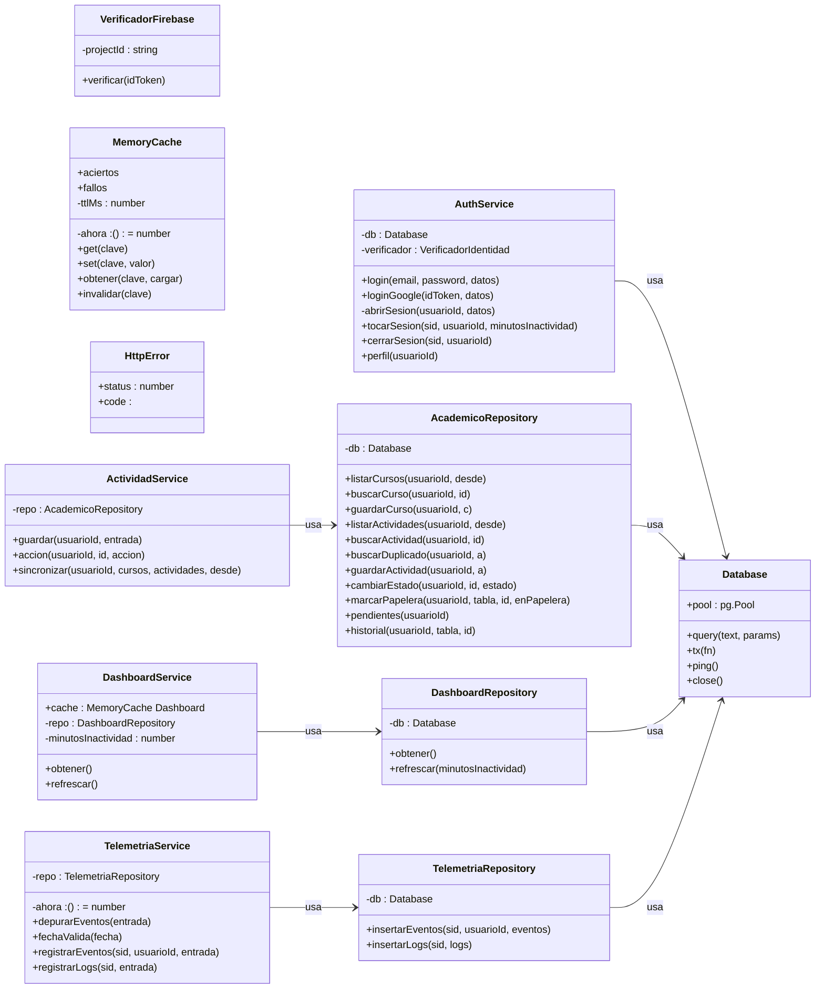

# Diagrama de clases

> Generado automáticamente por `scripts/docs/build-diagrams.mjs`. No editar a mano.

Clases de la API (Fastify). Las flechas indican dependencias inyectadas por constructor (repositorios → servicios → rutas).

| Clase | Archivo | Miembros |
|---|---|---|
| `AuthService` | `backend/src/auth/AuthService.ts` | 8 |
| `VerificadorFirebase` | `backend/src/auth/VerificadorGoogle.ts` | 2 |
| `MemoryCache` | `backend/src/cache/MemoryCache.ts` | 8 |
| `Database` | `backend/src/db/Database.ts` | 5 |
| `HttpError` | `backend/src/errors.ts` | 2 |
| `AcademicoRepository` | `backend/src/repositories/AcademicoRepository.ts` | 12 |
| `DashboardRepository` | `backend/src/repositories/DashboardRepository.ts` | 3 |
| `TelemetriaRepository` | `backend/src/repositories/TelemetriaRepository.ts` | 3 |
| `ActividadService` | `backend/src/services/ActividadService.ts` | 4 |
| `DashboardService` | `backend/src/services/DashboardService.ts` | 5 |
| `TelemetriaService` | `backend/src/services/TelemetriaService.ts` | 6 |

