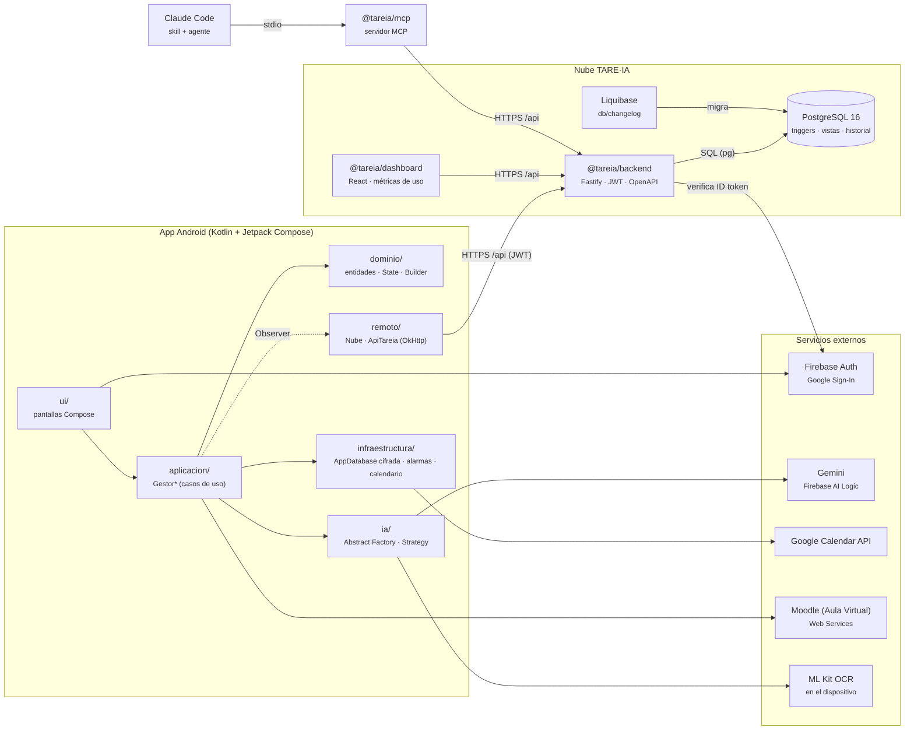

# Diagrama de componentes

> Generado automáticamente por `scripts/docs/build-diagrams.mjs`. No editar a mano.

Capas de la app Android, servicios externos y componentes de la nube de TARE·IA. La app funciona sin conexión con su base local cifrada; la nube agrega respaldo, sesiones, telemetría y el dashboard de uso.

