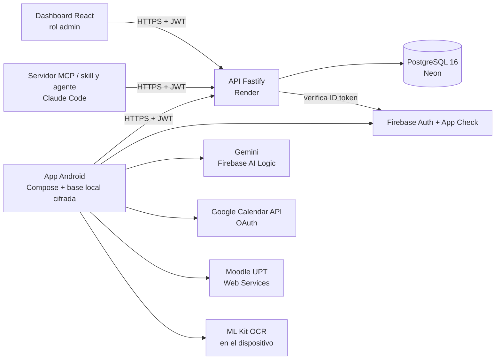

# Control de versiones

| Versión | Hecha por | Revisada por | Aprobada por | Fecha | Motivo |
|---|---|---|---|---|---|
| 1.0 | Adriana Laos y Antony Solorzano | Ing. Patrick Cuadros Quiroga (pendiente) | (pendiente) | 2026-11-21 | Versión inicial para la Unidad II de SI-784 Calidad y Pruebas de Software. Toma como antecedente el Documento de Visión del curso Soluciones Móviles I (`docs/referencias/FD02_DOCUMENTO_VISION.md`) |

> **Universidad Privada de Tacna · Facultad de Ingeniería · Escuela Profesional de Ingeniería de Sistemas**
> Curso: SI-784 Calidad y Pruebas de Software · Docente: Ing. Patrick Cuadros Quiroga · Semestre 2026-II
> Repositorio: https://github.com/Laos19/TareaIA

---

# 1. Introducción

## 1.1 Propósito

Definir la visión de **TARE·IA**, un asistente académico Android que convierte apuntes, PDF, capturas y
tareas del aula virtual Moodle de la UPT en actividades con fecha, planes de estudio y recordatorios, con
apoyo de inteligencia artificial (Gemini) y Google Calendar. El documento establece el problema, los
interesados, las características (RF-01 a RF-26), los requisitos no funcionales, las integraciones, las
restricciones y los niveles de calidad que guían el desarrollo y las pruebas en el curso SI-784.

## 1.2 Alcance

| N.° | Descripción | Incluye | No incluye (trabajo futuro) |
|---|---|---|---|
| 001 | App Android nativa (Kotlin, Jetpack Compose, Material 3), Android 9 (API 28) o superior. | ✔ | |
| 002 | Inicio de sesión con Google (Firebase Authentication) y PIN local para el perfil del dispositivo. | ✔ | |
| 003 | Importación de fotos, PDF, capturas y texto compartido; OCR en el dispositivo (ML Kit). | ✔ | |
| 004 | Extracción de actividades con IA (Gemini vía Firebase AI Logic) y validación obligatoria por el estudiante. | ✔ | |
| 005 | Lectura de cursos y tareas del aula virtual Moodle mediante Web Services (solo lectura). | ✔ | |
| 006 | Sincronización de actividades confirmadas con Google Calendar (REST API con OAuth). | ✔ | |
| 007 | Planes de estudio por sesiones (IA o planificador local), horario, prioridades y recordatorios. | ✔ | |
| 008 | Cursos, apuntes en carpetas, contenido sin clasificar, papelera y reporte PDF. | ✔ | |
| 009 | API REST en la nube (Node 22 + Fastify 5) con PostgreSQL 16: sesiones, historial, sincronización, telemetría y logs. | ✔ | |
| 010 | Dashboard web de utilización (React 18 + Vite), solo rol administrador. | ✔ | |
| 011 | Pruebas automatizadas (unitarias, mutación, integración, sistema, UI, aceptación) y análisis estático (SonarQube, Semgrep, Snyk). | ✔ | |
| 012 | Infraestructura como código (Terraform) con pruebas y reporte de costos. | ✔ | |
| 013 | Reto: servidor MCP, skill y agente de Claude Code, e integraciones externas. | ✔ | |
| 014 | Versión iOS. | | ✔ |
| 015 | Publicación en Google Play Store (en esta versión el APK se distribuye en GitHub Releases). | | ✔ |
| 016 | Escritura en Moodle (entregar tareas desde la app). | | ✔ |
| 017 | Sincronización bidireccional continua con Google Calendar (cambios hechos en Calendar no vuelven a la app). | | ✔ |
| 018 | Integración con sistemas académicos de la UPT distintos de Moodle (el antiguo RF-27 queda fuera del alcance RF-01–RF-26). | | ✔ |

### 1.2.1 Objetivos SMART

**Objetivo general:** desarrollar, probar y documentar en 16 semanas TARE·IA, logrando que al menos el 50 %
de las actividades lleguen por IA o Moodle y que al menos el 80 % de las completadas se cierren antes de su
fecha, con mutación ≥ 60 % y sin bugs ni vulnerabilidades críticas.

| ID | Objetivo | Indicador | Línea base | Meta | Instrumento | Plazo |
|---|---|---|---|---|---|---|
| OS-1 | Actividades que no se escriben a mano | % con origen IA o Moodle | Sin medición previa | ≥ 50 % | `v_origen_actividades` | S14 |
| OS-2 | Registro rápido | Mediana `importacion_iniciada` → `actividad_confirmada` | Registro manual (OI-2) | ≤ 60 s; ≥ 50 % menos | Tabla `evento` | S12 |
| OS-3 | Completar a tiempo | % COMPLETADAS antes de `fecha_limite` | Sistema nuevo | ≥ 80 % | Tabla `actividad` | S15 |
| OS-4 | Validación humana | SINCRONIZADAS sin CONFIRMADA | Trigger de transición | 0 | `historial_cambio` | S6 |
| OS-5 | Sin duplicados | Grupos duplicados normalizados | Defecto corregido | 0 | Consulta SQL | S6 |
| OS-6 | Uso recurrente | Sesiones/usuario/semana | Sistema nuevo | ≥ 3 | Tabla `sesion` | S15 |
| OS-7 | Estabilidad | % sesiones con log ERROR | Sistema nuevo | ≤ 5 % | `log_cliente` | S15 |
| OS-8 | Pruebas eficaces | Puntaje de mutación | 93,8 % API; 68,4 % dominio | ≥ 60 %; ≥ 50 % | `mutacion.yml` | S6 |
| OS-9 | Pruebas en verde | % que pasa | 99 + 35 + 14 + 16 + 18 escenarios en verde | 100 % | `ci.yml`, `android.yml` | S6–S16 |
| OS-10 | Código seguro | Críticos en SonarQube/Semgrep/Snyk | Pendiente de primera ejecución | 0; quality gate aprobado | Workflows de análisis | S2 |
| OS-11 | Costo cero | USD/mes de infraestructura | S/ 720/mes (versión previa) | USD 0 | Reporte de `infra.yml` | S16 |
| OI-3 | Usabilidad percibida | SUS promedio | Sistema nuevo | ≥ 70 | Cuestionario SUS | S14 |

Fórmulas y objetivos de investigación completos: `docs/investigacion/problema-y-objetivos.md`.

## 1.3 Definiciones, siglas y abreviaturas

| Término | Descripción |
|---|---|
| Actividad | Tarea, examen, entregable o proyecto con curso y fecha límite. Estados: PENDIENTE_VALIDAR → CONFIRMADA → SINCRONIZADA → COMPLETADA (con opción de reabrir). |
| Apunte | Nota del estudiante (texto u OCR) clasificada por curso y carpeta. |
| Plan de estudio | Conjunto de sesiones de estudio para una o más actividades; al confirmar una propuesta, el plan vigente queda REEMPLAZADO. |
| Franja horaria | Bloque semanal de disponibilidad del estudiante (sin cruces, RN16). |
| OCR | Reconocimiento óptico de caracteres; en TARE·IA lo hace ML Kit en el dispositivo. |
| LMS / Moodle | Sistema de gestión del aprendizaje; el aula virtual de la UPT es Moodle. |
| API | Interfaz REST/JSON entre la app, el dashboard y la base de datos. |
| JWT | *JSON Web Token*; credencial de la API (7 días) ligada a un id de sesión. |
| OAuth 2.0 | Protocolo con el que el estudiante autoriza a la app a escribir en su Google Calendar. |
| Telemetría | Eventos de uso sin datos personales (pantalla vista, actividad creada, etc.). |
| MCP | *Model Context Protocol*; protocolo para exponer herramientas y datos a agentes de IA. |
| Skill / agente | Instrucciones y subagente de Claude Code que trabajan sobre el repositorio y la API. |
| RN | Regla de negocio (RN01, RN02, RN05, RN09, RN13, RN14, RN16). |
| SUS | *System Usability Scale*, cuestionario de usabilidad de 10 ítems (0–100). |
| CI/CD | Integración y despliegue continuos (GitHub Actions). |

## 1.4 Referencias

Documentos del proyecto: FD01 v1.0 Informe de Factibilidad; `docs/investigacion/problema-y-objetivos.md`;
matriz `docs/historico/MATRIZ_RF01_RF26.md`; diccionario de datos `docs/database/diccionario-de-datos.md`;
diagramas `docs/diagramas/`. Fuentes externas: secciones 17 y 18.

# 2. Posicionamiento

## 2.1 Oportunidad de negocio

Las apps de notas (Goodnotes, Notability, OneNote) guardan los apuntes pero no crean actividades; las
agendas y gestores de tareas genéricos exigen escribir todo a mano; y el aula virtual Moodle muestra las
tareas de cada curso, pero no las ordena junto con las fechas que aparecen en apuntes, sílabos y capturas.
La evidencia indica que tener una herramienta no basta: lo que reduce la procrastinación es fijar metas y
prioridades y sentir control del tiempo (Garzón Umerenkova & Gil Flores, 2017).

TARE·IA ocupa ese espacio: **lee lo que el estudiante ya tiene** (foto, PDF, captura, Moodle), **propone**
las actividades con IA, **pide validación** y luego **ordena, recuerda y planifica**. Es gratuita, está en
español, funciona sin conexión y se apoya en servicios que el estudiante ya usa (cuenta Google y Google
Calendar).

## 2.2 Definición del problema

### 2.2.1 El problema

Entre el 80 % y el 95 % de los universitarios procrastina según las estimaciones recogidas por Steel
(2007); la procrastinación se asocia con menor rendimiento (Kim & Seo, 2015) y la gestión del tiempo con
mejor logro y bienestar (Aeon et al., 2021). En universitarios peruanos se reportan niveles altos de estrés
académico, con la sobrecarga de tareas entre los estresores principales (Estrada Araoz et al., 2021). En la
EPIS-UPT, además, las actividades llegan por varios canales y se copian a mano al calendario.

| Elemento | Descripción |
|---|---|
| El problema de | registrar y organizar a mano actividades académicas que llegan dispersas |
| afecta a | estudiantes de pregrado de la EPIS-UPT |
| cuyo impacto es | olvidos, entregas tardías, estudio de última hora y estrés |
| una solución exitosa sería | un asistente móvil que lea apuntes y Moodle, proponga actividades con IA, pida validación y las lleve al calendario con recordatorios y planes |

### 2.2.2 A quiénes afecta

- **Estudiantes de pregrado**, que pierden tiempo copiando fechas y olvidan entregas.
- **Docentes**, que reciben entregas tardías y consultas sobre fechas ya publicadas.
- **La Escuela Profesional**, interesada en reducir el bajo rendimiento y la interrupción de estudios.

# 3. Impacto

- **Tiempo:** se espera reducir al menos 50 % el tiempo de registrar una tarea (OS-2, OI-2).
- **Puntualidad:** meta de 80 % de actividades completadas antes de su fecha (OS-3).
- **Control y confianza:** la IA propone, el estudiante decide; nada llega al calendario sin validar (OS-4).
- **Datos para mejorar:** el dashboard muestra cómo se usa la app sin exponer datos personales.
- **Calidad demostrable:** pruebas automatizadas, mutación y análisis estático en cada cambio.

# 4. La solución

El estudiante entra con su cuenta Google. En **Importar** toma una foto, elige un PDF o una captura, o
comparte un texto desde otra app; ML Kit reconoce el texto en el teléfono y Gemini propone actividades con
título, curso y fecha. También puede leer sus tareas de **Moodle**. Todo lo que viene de la IA o de Moodle
llega como **pendiente de validar**: el estudiante revisa, corrige y confirma (título y fecha obligatorios).
Las actividades confirmadas se envían a **Google Calendar** con un identificador estable que evita
duplicados, y la app programa **recordatorios**. En **Plan**, la app propone sesiones de estudio según
fecha límite, prioridad, dificultad y horario disponible, con IA o con el planificador local si la IA no
responde. Cursos, apuntes, papelera y reporte PDF completan la organización.

En segundo plano, la app abre una **sesión** en la API, sincroniza datos, envía **telemetría** sin datos
personales y sube **logs** de advertencia y error. El administrador ve la utilización en el **dashboard**.

# 5. Descripción de los interesados y usuarios

## 5.1 Resumen de los interesados

| Interesado | Descripción |
|---|---|
| Docente del curso | Ing. Patrick Cuadros Quiroga. Orienta y evalúa el proyecto en SI-784 Calidad y Pruebas de Software. |
| Equipo de desarrollo | Adriana Rafaela Laos González y Antony Piero Solorzano Zegarra: análisis, desarrollo, pruebas, despliegue y documentación (roles rotativos). |
| Estudiantes de la EPIS-UPT | Usuarios principales y beneficiarios directos. |
| Administrador del aula virtual (Moodle UPT) | Habilita o no los Web Services que permiten leer cursos y tareas. |
| Docentes de la EPIS | Beneficiarios indirectos: más entregas a tiempo. |
| Proveedores externos | Google (Firebase, Gemini, Calendar, ML Kit), Neon, Render y GitHub, cuyos términos y límites condicionan el producto. |

## 5.2 Resumen de los usuarios

| Usuario | Descripción | Frecuencia de uso | Objetivo principal |
|---|---|---|---|
| Estudiante | Importa, valida, organiza, planifica y completa actividades desde la app Android. | Diaria o varias veces por semana | Cumplir sus entregas sin copiar fechas a mano. |
| Administrador | Consulta el dashboard de utilización (rol admin). | Semanal | Medir el uso y los objetivos SMART. |
| Desarrollador / agente | Usa el servidor MCP y la skill/agente de Claude Code sobre la API y el repositorio. | Ocasional | Consultar y mantener el sistema con herramientas de IA. |

## 5.3 Entorno de usuario

### 5.3.1 Entorno físico

| Aspecto | Descripción |
|---|---|
| Ubicación | Campus, transporte, casa; sesiones breves entre clases. |
| Equipo | Celular Android de gama media con cámara. |
| Sistema operativo | Android 9 (API 28) o superior; probado en emulador API 34. |
| Conectividad | Intermitente (datos móviles o Wi-Fi institucional). |

### 5.3.2 Entorno técnico

| Aspecto | Descripción |
|---|---|
| Instalación | APK publicado en GitHub Releases. |
| Datos locales | Base local cifrada con Android Keystore; funciona sin conexión. |
| Servicios | API en Render, PostgreSQL en Neon, Firebase (Auth, App Check, AI Logic), Google Calendar API, Moodle de la UPT. |
| Permisos | Cámara, notificaciones, micrófono (dictado) y autorización OAuth de Calendar, pedidos solo cuando se usan. |
| Seguridad | HTTPS, JWT con id de sesión, tokens cifrados, App Check. |

## 5.4 Perfiles de los interesados

**Interesado 1: Docente del curso**

| Atributo | Descripción |
|---|---|
| Rol | Supervisor y evaluador |
| Organización | Universidad Privada de Tacna – Facultad de Ingeniería – EPIS |
| Responsabilidades | Guiar el proyecto, aprobar FD01–FD04 y evaluar pruebas, análisis estático y reportes. |
| Expectativas | Calidad medible, automatizaciones funcionando y documentación coherente con el código. |
| Influencia | Alta |
| Participación | Semanal |
| Comunicación | Clases, correo institucional, GitHub |

**Interesado 2: Equipo de desarrollo**

| Atributo | Descripción |
|---|---|
| Rol | Equipo de dos integrantes con roles rotativos |
| Integrantes | **Laos González, Adriana Rafaela (2023077474)** y **Solorzano Zegarra, Antony Piero (2023078696)** |
| Organización | UPT – Estudiantes de Ingeniería de Sistemas |
| Responsabilidades | Diseñar, implementar, probar, desplegar y documentar TARE·IA. |
| Expectativas | Aplicar los contenidos de SI-784 (pruebas de todos los niveles, mutación, análisis estático) en un producto real. |
| Influencia | Alta |
| Participación | Diaria |
| Comunicación | GitHub (issues, pull requests), correo institucional |

**Interesado 3: Administrador del aula virtual**

| Atributo | Descripción |
|---|---|
| Rol | Habilitador de la integración con Moodle |
| Responsabilidades | Habilitar Web Services y funciones de solo lectura. |
| Expectativas | Acceso seguro, de solo lectura y con el token del propio estudiante. |
| Influencia | Media |

## 5.5 Perfiles de los usuarios

**Usuario 1: Estudiante**

| Atributo | Descripción |
|---|---|
| Edad típica | 17 a 25 años |
| Conocimientos previos | Uso diario del celular, cuenta Google, aula virtual Moodle. |
| Tareas típicas | Importar foto o PDF, validar propuestas de la IA, leer tareas de Moodle, sincronizar con Calendar, generar un plan, marcar completadas. |
| Necesidades | Pocos pasos, textos claros, control sobre lo que propone la IA, funcionamiento sin conexión, accesibilidad. |

**Usuario 2: Administrador**

| Atributo | Descripción |
|---|---|
| Conocimientos previos | Gestión de sistemas web y métricas. |
| Tareas típicas | Revisar KPIs, sesiones por día, funciones y pantallas más usadas, origen × estado de actividades. |
| Necesidades | Datos agregados, rápidos (con caché) y sin información personal. |

### 5.5.1 Necesidades de los interesados y usuarios

| Necesidad | Prioridad | Solución propuesta |
|---|---|---|
| No copiar fechas a mano | Alta | OCR + IA + Moodle que proponen actividades |
| Confiar en lo que se registra | Alta | Validación obligatoria (RN09, RN05) y bloqueo de sincronización sin validar (RN01) |
| No olvidar entregas | Alta | Google Calendar + recordatorios locales |
| Saber qué hacer primero | Alta | Urgencia por días restantes, prioridad por curso y plan de estudio |
| Privacidad | Alta | Datos mínimos, tokens cifrados, telemetría sin datos personales |
| Uso sin conexión | Media | Base local cifrada y colas de envío por lotes |
| Medir el uso | Media | Telemetría y dashboard de utilización |

# 6. Vista general del producto

## 6.1 Perspectiva del producto

TARE·IA es un sistema independiente formado por: (1) la **app Android** con base local cifrada; (2) la
**API REST** (rutas → servicios → repositorios → PostgreSQL); (3) la **base de datos PostgreSQL 16** con
11 tablas, 6 vistas, 7 funciones y 7 triggers (el trigger de transición replica el patrón State); (4) el
**dashboard web**; (5) las **automatizaciones** de GitHub Actions; y (6) las **integraciones del reto**
(servidor MCP, skill y agente de Claude Code). Depende de servicios externos de Google, de Neon y de Render,
y del aula virtual Moodle, pero no los reemplaza.

## 6.2 Resumen de capacidades

| Capacidad | Beneficio |
|---|---|
| Importación multimodal (foto, PDF, captura, texto compartido) | Usa lo que el estudiante ya tiene. |
| Extracción con IA y validación | Menos escritura, sin perder el control. |
| Lectura de Moodle | Las tareas del aula virtual entran sin copiarlas. |
| Sincronización con Google Calendar | Las fechas aparecen donde el estudiante ya mira. |
| Planificación de estudio (IA o local) | Sesiones concretas según fecha, prioridad y horario. |
| Recordatorios | Alertas antes de cada entrega. |
| Cursos, apuntes, sin clasificar, papelera, reporte PDF | Organización completa del semestre. |
| Sesiones, historial, caché, logs y telemetría | Seguridad, trazabilidad, rendimiento y medición. |
| Dashboard de utilización | Medición de los objetivos SMART. |
| Servidor MCP y skill/agente de Claude Code | Acceso a la API desde herramientas de IA para desarrollo. |

## 6.3 Suposiciones y dependencias

**Suposiciones:** el estudiante tiene una cuenta Google y un celular Android 9 o superior; acepta revisar
las propuestas de la IA; la UPT mantiene Moodle como aula virtual; el piloto cuenta con al menos 30
estudiantes voluntarios.

**Dependencias:**

| Dependencia | Para qué | Condición o límite |
|---|---|---|
| Firebase Authentication | Inicio de sesión con Google | Plan Spark sin costo (Firebase, s. f.-a) |
| Firebase AI Logic + Gemini | Extracción y planificación con IA | Capa gratuita de la Gemini Developer API en plan Spark; modelos y cuotas limitados (Firebase, s. f.-b) |
| Google Calendar REST API | Crear, actualizar y borrar eventos | Sin costo adicional; límites por minuto por proyecto y por usuario (Google for Developers, s. f.) |
| Moodle Web Services | Leer cursos y tareas | Requiere que el administrador habilite `core_webservice_get_site_info`, `core_enrol_get_users_courses` y `mod_assign_get_assignments` (Moodle, s. f.) |
| ML Kit Text Recognition | OCR | En el dispositivo; descarga de modelos con Google Play Services |
| Neon / Render | Base de datos y API | Capas gratuitas; Render suspende la API tras 15 min sin tráfico (Render, s. f.) |
| GitHub | Código, Actions, Pages, Releases | Repositorio público |

## 6.4 Costos y precios

| Concepto | Costo (S/) |
|---|---|
| Costos generales (depreciación de 2 laptops) | 633,33 |
| Costos operativos | 184,64 |
| Costos del ambiente (capas gratuitas) | 0,00 |
| Costos de personal (320 h × S/ 15) | 4 800,00 |
| **Total general del proyecto** | **5 617,97** |

Para el estudiante el uso es **gratuito**. Una arquitectura de pago equivalente en AWS o Azure costaría
≈ US$ 38/mes (S/ 1 573,20/año). Detalle y análisis financiero (VAN, B/C, TIR) en el FD01 v1.0.

## 6.5 Licenciamiento e instalación

- **Distribución:** APK firmado publicado en GitHub Releases por `release.yml` (release-please), junto con
  la API, el dashboard y el paquete del servidor MCP.
- **Infraestructura:** Terraform crea la base en Neon y los servicios en Render; Liquibase aplica las
  migraciones; los *deploy hooks* de Render y una prueba de humo cierran el release.
- **Terceros:** Android Jetpack, Firebase SDK y ML Kit (Apache 2.0 y términos de Google), Fastify y React
  (MIT), PostgreSQL License, fuentes tipográficas con licencia OFL (`docs/licencias/`).
- **Licencia del código propio:** por definir con el docente (se propone MIT).

# 7. Características del producto

Requisitos funcionales vigentes RF-01 a RF-26 (matriz `docs/historico/MATRIZ_RF01_RF26.md`), agrupados por
módulo. "Presente en código" no equivale a "aceptado": la aceptación se registra con las pruebas y las
historias de usuario HU-01 a HU-05.

### 7.1 Acceso, perfil y permisos

| RF | Característica | Descripción en la versión 1.0 |
|---|---|---|
| RF-01 | Gestionar autenticación de usuario | Inicio de sesión con Google (Firebase Authentication y Credential Manager); la app canjea el ID token por un JWT de la API. PIN local para proteger el perfil del dispositivo. |
| RF-12 | Permisos del dispositivo | Centro de permisos (cámara, micrófono, notificaciones); cada permiso se pide al usarse y se maneja la denegación. |
| RF-13 | Personalizar perfil | Datos académicos básicos guardados localmente y sincronizados con `/perfil`. |

### 7.2 Ingesta y extracción con IA

| RF | Característica | Descripción |
|---|---|---|
| RF-03 | Reconocimiento OCR multimodal | ML Kit reconoce texto de fotos, imágenes y PDF en el dispositivo; Gemini interpreta el texto. |
| RF-04 | Extraer parámetros académicos | Gemini devuelve título, curso y fecha con un esquema JSON; extractor local de respaldo. |
| RF-05 | Formulario de validación | Revisión y edición antes de confirmar; confirmar exige título y fecha (RN05). |
| RF-15 | Compartir desde otras apps | Recepción de texto, imágenes y PDF desde el menú Compartir de Android. |
| RF-22 | Importar PDF, imágenes y capturas | Selector de archivos y cámara; formatos inválidos se rechazan con mensaje. |
| RF-26 | Integración Moodle | Lectura de identidad, cursos y tareas por Web Services; importación como pendientes de validar (RN09); deduplicación por `id_externo`; token cifrado. |

### 7.3 Actividades y calendario

| RF | Característica | Descripción |
|---|---|---|
| RF-02 | Autorizar acceso a Google Calendar | Autorización OAuth; manejo de acceso denegado o revocado. |
| RF-06 | Creación manual de actividades | La actividad manual con fecha nace CONFIRMADA (ActividadBuilder). |
| RF-08 | Sincronizar con Google Calendar | Solo actividades validadas (RN01); identificador de evento estable para actualizar sin duplicar. |
| RF-09 | Notificaciones y alertas | Recordatorios locales antes de la fecha; reprogramación tras reiniciar el teléfono. |
| RF-10 | Seguimiento académico por curso | Inicio con próximas entregas, urgencia por días restantes y filtros por curso y estado. |
| RF-11 | Prevenir duplicados | Detección por título + curso + fecha normalizados (RN02), en la app y en PostgreSQL. |
| RF-25 | Generar reporte PDF | Exportación filtrada por estado; el estudiante elige dónde guardarlo. |

### 7.4 Planificación del estudio

| RF | Característica | Descripción |
|---|---|---|
| RF-07 | Generar y confirmar plan con IA | Estrategia con IA o local por prioridad (patrón Strategy); si la IA falla se usa la local; el plan propuesto es un clon (Prototype) que reemplaza al vigente al confirmarse. |
| RF-17 | Configurar horario | Franjas semanales de disponibilidad sin cruces (RN16). |
| RF-18 | Personalizar priorización | Prioridad y dificultad por curso alimentan el planificador. |
| RF-19 | Gestionar cambios de cronograma | Al cambiar una fecha se puede recalcular el plan. |
| RF-24 | Planificación mediante audio | Dictado con el reconocedor de voz del dispositivo; la transcripción se edita y se propone un plan. |

### 7.5 Cursos, apuntes y papelera

| RF | Característica | Descripción |
|---|---|---|
| RF-14 | Configurar cursos y abreviaturas | Alta, edición y baja; abreviaturas únicas usadas para clasificar. |
| RF-16 | Asignar apuntes en carpetas | Apuntes por curso y carpeta; clasificación por curso (RN13). |
| RF-20 | Contenido sin clasificar | Bandeja para entradas sin curso confirmado. |
| RF-21 | Papelera | Restaurar o eliminar definitivamente cursos, actividades y apuntes (RN14); endpoint `restaurar` en la API. |
| RF-23 | Gestionar anotaciones | Crear, editar, mover y borrar apuntes. |

### 7.6 Capacidades de plataforma (no numeradas como RF)

| Código | Característica | Descripción |
|---|---|---|
| CP-01 | Sincronización con la nube | Endpoint `/sync`; fachada `Nube` en la app. |
| CP-02 | Dashboard de utilización | KPIs; sesiones, eventos y actividades por día (con tooltip y vista de tabla); funciones más usadas; pantallas más visitadas; tabla origen × estado. Solo rol admin. |
| CP-03 | Documentación de la API | OpenAPI/Swagger en `/api/docs`. |
| CP-04 | Integraciones del reto | Servidor MCP y skill/agente de Claude Code (sección 9.2). |

# 8. Requisitos no funcionales

Se describen tal como están implementados; son los aspectos no funcionales que evalúa la rúbrica.

| Código | Aspecto | Implementación |
|---|---|---|
| RNF-01 | **Manejo de sesiones** | Al entrar con Google, la app canjea el ID token de Firebase por un JWT de la API (7 días) que lleva un id de sesión. Cada inicio abre una fila en `sesion` con origen (android, web, mcp), dispositivo y versión. Cada petición renueva `ultima_actividad`. La sesión se cierra con `/auth/logout` o por 30 min de inactividad (`fn_cerrar_sesiones_inactivas`). El JWT se guarda cifrado con Android Keystore. |
| RNF-02 | **Historial** | El trigger `fn_registrar_historial` guarda el estado antes y después (JSONB) de cada alta, cambio o borrado de cursos, actividades y apuntes en `historial_cambio`; se consulta en `/actividades/{id}/historial`. Los planes REEMPLAZADOS se conservan. Liquibase guarda el historial del esquema. |
| RNF-03 | **Caché** | Caché en memoria con TTL para el dashboard en la API (cabecera `x-cache` HIT/MISS; aciertos y fallos visibles en `/api/health`); vista materializada `mv_uso_diario` (refresco con `/dashboard/refrescar`); caché HTTP de 5 MB de OkHttp en la app; caché inmutable de los recursos del dashboard en el CDN de Render. |
| RNF-04 | **Logs** | Logs JSON estructurados (pino) con datos sensibles ocultos (`authorization`, `password`, `idToken`). La app sube logs WARN y ERROR por lotes a `log_cliente`, con correos y tokens enmascarados. |
| RNF-05 | **Telemetría** | La app registra eventos de uso (pantalla vista, actividad creada/confirmada/completada, importación con IA, Moodle, plan, calendario, reporte, recordatorio, error) mediante el patrón Observer, en una cola de hasta 200 eventos que se envía en lotes de 20 a `/api/eventos`. Se quitan los datos personales. Los eventos alimentan el dashboard. |
| RNF-06 | Seguridad | Verificación del ID token de Firebase con `jose` y las JWKS de Google; helmet; CORS restringido; rate limit (300/min general, 10/min login); Firebase App Check; tokens cifrados. |
| RNF-07 | Integridad de datos | Reglas en la BD además de la app: transición de estados (`fn_actividad_transicion`, réplica del patrón State), duplicados normalizados (`fn_normalizar`), confirmación con fecha (restricción `ck_actividad_confirmable`). |
| RNF-08 | Disponibilidad sin conexión | Base local cifrada; colas de telemetría y logs; la API puede tardar ≈ 1 min en despertar en el plan gratuito. |
| RNF-09 | Usabilidad y accesibilidad | Material 3, contraste WCAG AA verificado por prueba (`ContrasteTest`), áreas táctiles y semántica probadas en las pruebas Compose. |
| RNF-10 | Mantenibilidad | Arquitectura por capas, patrones de diseño, documentación Dokka (Kotlin) y TypeDoc (TypeScript) en GitHub Pages. |
| RNF-11 | Portabilidad de infraestructura | Módulos Terraform; referencia AWS/Azure lista para migrar; PostgreSQL 16 en cualquier nube. |

# 9. Integraciones externas y reto del curso

## 9.1 Integraciones externas

| Integración | Uso en TARE·IA | Seguridad | RF |
|---|---|---|---|
| **Firebase Authentication** | Google Sign-In con Credential Manager; la API verifica el ID token. | Tokens de corta vida; verificación con JWKS de Google. | RF-01 |
| **Gemini (Firebase AI Logic)** | Extracción de actividades y propuesta de planes con respuesta en esquema JSON. Proveedor A de la Abstract Factory; proveedor B compatible con OpenAI como alternativa. | Firebase App Check; solo se envía el texto que el estudiante importa. | RF-03, RF-04, RF-07, RF-24 |
| **Google Calendar REST API** | Crear, actualizar y borrar eventos de actividades confirmadas. | OAuth 2.0 con el consentimiento del estudiante; verificación de que el evento remoto pertenece a la actividad. | RF-02, RF-08 |
| **Moodle Web Services (aula virtual UPT)** | Lectura de cursos y tareas (`mod_assign`). | Token del propio estudiante cifrado; solo lectura; HTTPS. | RF-26 |
| **ML Kit Text Recognition** | OCR de fotos, imágenes y PDF en el dispositivo. | La imagen no sale del teléfono. | RF-03, RF-22 |

## 9.2 Reto del curso

La rúbrica pide integrar la app con tres aplicaciones externas o de otros equipos, o crear un plugin con
skills y agente. TARE·IA cubre el reto con:

1. **Servidor MCP** (`integrations/mcp/`): expone la API de TARE·IA a agentes de IA mediante el *Model
   Context Protocol*. Se autentica contra la API con JWT; sus sesiones quedan registradas con origen `mcp`
   en la tabla `sesion`, de modo que su uso también aparece en el dashboard. Se publica como paquete en
   GitHub Releases.
2. **Skill y agente de Claude Code** (`.claude/`): instrucciones y subagente que usan el servidor MCP y el
   repositorio para consultar actividades y el uso del sistema y apoyar el mantenimiento.
3. **Integraciones externas** de la sección 9.1: Firebase Authentication, Gemini, Google Calendar y Moodle
   (más ML Kit), que superan las tres aplicaciones externas pedidas.

# 10. Restricciones

| Código | Restricción |
|---|---|
| RES-01 | Solo Android 9 (API 28) o superior; sin versión iOS. |
| RES-02 | Stack fijado: Kotlin 2.3.21 + Compose; Node 22 + Fastify 5 + TypeScript; PostgreSQL 16 + Liquibase; React 18 + Vite; Terraform; GitHub Actions. |
| RES-03 | Infraestructura en capas gratuitas (Neon, Render, Firebase Spark, GitHub) durante el desarrollo y el piloto. |
| RES-04 | Dos integrantes y 16 semanas. |
| RES-05 | La IA nunca confirma ni sincroniza por sí sola (RN01, RN09). |
| RES-06 | Moodle solo en lectura y sujeto a que el administrador habilite los Web Services. |
| RES-07 | Las claves y tokens reales nunca se suben al repositorio (GitHub Secrets; Semgrep con reglas de secretos). |
| RES-08 | Datos personales tratados conforme a la Ley 29733 y el D. S. 016-2024-JUS. |
| RES-09 | Las cuotas de la capa gratuita de Gemini y de Google Calendar limitan el volumen de uso. |

# 11. Rangos de calidad

| N.° | Atributo | Métrica verificable | Prioridad |
|---|---|---|---|
| RC-01 | Corrección funcional | 100 % de pruebas en verde: 99 API, 35 JVM, 16 Compose, 16 Playwright, 18 escenarios (76 pasos) | Alta |
| RC-02 | Eficacia de las pruebas | Mutación ≥ 60 % en la API (medido 93,8 %) y ≥ 50 % en el dominio (medido 68,4 %) | Alta |
| RC-03 | Seguridad del código | 0 bugs y 0 vulnerabilidades críticas en SonarQube; quality gate aprobado; 100 % de hotspots revisados; 0 hallazgos críticos o altos sin atender en Semgrep y Snyk | Alta |
| RC-04 | Validación humana | 0 actividades sincronizadas sin confirmar | Alta |
| RC-05 | Integridad | 0 actividades duplicadas | Alta |
| RC-06 | Usabilidad | SUS ≥ 70; registro de una tarea ≤ 60 s | Alta |
| RC-07 | Estabilidad | ≤ 5 % de sesiones con log ERROR | Media |
| RC-08 | Rendimiento del dashboard | Respuestas repetidas servidas desde caché (`x-cache: HIT`) | Media |
| RC-09 | Privacidad | 0 datos personales en `evento.datos`; logs con datos sensibles ocultos | Alta |
| RC-10 | Costo | USD 0/mes en desarrollo y piloto | Media |

# 12. Precedencia y prioridad

| Código | Funcionalidad | RF | Prioridad | Justificación |
|---|---|---|---|---|
| PR-01 | Autenticación y sesiones | RF-01, RNF-01 | Alta | Base de la seguridad y de la medición. |
| PR-02 | Ingesta, OCR y extracción con IA | RF-03, RF-04, RF-15, RF-22 | Alta | Ataca la causa principal: copiar a mano. |
| PR-03 | Validación y estados | RF-05, RF-06 | Alta | Garantiza que la IA no decida sola. |
| PR-04 | Calendario y recordatorios | RF-02, RF-08, RF-09 | Alta | Lleva las fechas donde el estudiante mira. |
| PR-05 | Duplicados | RF-11 | Alta | Evita ruido en el calendario. |
| PR-06 | Moodle | RF-26 | Alta | Fuente principal de tareas en la UPT. |
| PR-07 | Telemetría, logs, historial y caché | RNF-02 a RNF-05 | Alta | Evaluados en la rúbrica; base del dashboard. |
| PR-08 | Seguimiento y cursos | RF-10, RF-13, RF-14 | Media | Organización diaria. |
| PR-09 | Planificación | RF-07, RF-17, RF-18, RF-19, RF-24 | Media | Valor agregado; depende de PR-03. |
| PR-10 | Apuntes, sin clasificar, papelera | RF-16, RF-20, RF-21, RF-23 | Media | Organización complementaria. |
| PR-11 | Dashboard de utilización | CP-02 | Media | Mide los objetivos SMART. |
| PR-12 | Reporte PDF y permisos | RF-25, RF-12 | Baja | Útil pero no crítico. |
| PR-13 | Reto (MCP, skill y agente) | CP-04 | Baja | Valor agregado para el curso y para desarrolladores. |

# 13. Otros requerimientos del producto

## 13.1 Estándares legales

- **Ley N.° 29733**, Ley de Protección de Datos Personales (Congreso de la República del Perú, 2011).
- **D. S. N.° 016-2024-JUS**, Reglamento de la Ley 29733 (Ministerio de Justicia y Derechos Humanos, 2024).
- **Términos de servicio de Firebase y de las API de Google** (Firebase, s. f.-c; Google, s. f.).
- **D. Leg. N.° 822**, Ley sobre el Derecho de Autor, y licencias de terceros.

## 13.2 Estándares de comunicación

- Toda comunicación entre app, dashboard, MCP y API usa HTTPS con JSON.
- Mensajes cortos, en español claro y orientados a la acción ("Revisa la fecha antes de confirmar").
- Las propuestas de la IA se marcan como tales y se diferencian de lo confirmado.

## 13.3 Estándares de cumplimiento de la plataforma

- Material Design 3 y lineamientos de Android; compatibilidad desde API 28.
- API documentada con OpenAPI; código documentado con Dokka y TypeDoc en GitHub Pages.
- Cambios de esquema solo mediante Liquibase.
- Los workflows deben pasar aunque falten *secrets* opcionales (se omiten los pasos que los requieren).

## 13.4 Estándares de calidad y seguridad

| Código | Estándar |
|---|---|
| ECS-01 | Pruebas unitarias, de integración, de sistema, de interfaz (Compose y Playwright) y de aceptación (Cucumber) en CI. |
| ECS-02 | Pruebas de mutación con Stryker y Pitest y umbrales definidos (`mutacion.yml`). |
| ECS-03 | Análisis estático con SonarQube Cloud, Semgrep y Snyk en GitHub Actions. |
| ECS-04 | Infraestructura validada con `terraform validate`, tflint, checkov y `terraform test`. |
| ECS-05 | Consultas parametrizadas y validación de entradas con esquemas en la API. |
| ECS-06 | Secretos solo en GitHub Secrets; nunca en el repositorio. |
| ECS-07 | Revisión contra OWASP Top 10 (OWASP Foundation, 2025). |

# 14. Requisitos de documentación

| Documento | Contenido | Ubicación / generación |
|---|---|---|
| FD01–FD04 | Factibilidad, visión, SRS y arquitectura (SAD) | `docs/fd/` |
| Problema y objetivos | Problema con fuentes, árbol de problemas, objetivos SMART | `docs/investigacion/problema-y-objetivos.md` |
| README | Diccionario de datos, diagramas ER, de clases, de componentes y de despliegue | Raíz del repositorio y `docs/`; generado por `docs.yml` |
| Diccionario de datos | Tablas, columnas, vistas, funciones y triggers | `docs/database/diccionario-de-datos.md` |
| Documentación de código | Cada clase, método y propiedad (Dokka para Kotlin, TypeDoc para TypeScript) | GitHub Pages (`pages.yml`): https://laos19.github.io/TareaIA/ |
| Reportes de pruebas | Cobertura, mutación, aceptación, UI | Artefactos de GitHub Actions y GitHub Pages |
| Reportes de análisis estático | Bugs, vulnerabilidades, hotspots, hallazgos | SonarQube Cloud, Code Scanning (SARIF), Snyk |
| Reporte de infraestructura | Pruebas de Terraform y costos (Infracost) | *Job summary* y artefacto `reporte-costos` de `infra.yml` |
| Manual de usuario y presentación | Uso de la app y del dashboard | GitHub Pages |

# 15. Conclusiones

1. TARE·IA responde a un problema documentado: la procrastinación es frecuente, se asocia con menor
   rendimiento, y la sobrecarga de tareas es un estresor central en universitarios peruanos.
2. La solución reduce el trabajo de registrar (OCR, IA, Moodle) sin quitar el control al estudiante
   (validación obligatoria) y lleva las fechas a Google Calendar con recordatorios y planes.
3. Los requisitos no funcionales que evalúa el curso (sesiones, historial, caché, logs y telemetría) están
   implementados en la app, la API y la base de datos.
4. Los objetivos son SMART y se miden con lo que el sistema ya registra; la calidad se respalda con pruebas
   automatizadas en verde y puntajes de mutación de 93,8 % y 68,4 %.

# 16. Recomendaciones

1. Ejecutar los workflows de SonarQube, Semgrep y Snyk y atender los hallazgos antes de cerrar la semana 2.
2. Aplicar la encuesta de línea base (OI-1) y la prueba cronometrada (OI-2) antes del piloto.
3. Gestionar con la UPT la habilitación de los Web Services de Moodle para la lectura de tareas.
4. Publicar una política de privacidad en lenguaje sencillo y revisar las condiciones vigentes de la capa
   gratuita de Gemini.
5. Mantener la coherencia de FD01–FD04 con el código (nombre, alcance, costos y objetivos).

# 17. Bibliografía

Aeon, B., Faber, A., & Panaccio, A. (2021). Does time management work? A meta-analysis. *PLOS ONE, 16*(1), e0245066. https://doi.org/10.1371/journal.pone.0245066

Congreso de la República del Perú. (2011). *Ley N.° 29733, Ley de Protección de Datos Personales*. https://www.gob.pe/institucion/congreso-de-la-republica/normas-legales/243470-29733

Estrada Araoz, E. G., Mamani Roque, M., Gallegos Ramos, N. A., Mamani Uchasara, H. J., & Zuloaga Araoz, M. C. (2021). Estrés académico en estudiantes universitarios peruanos en tiempos de la pandemia del COVID-19. *Archivos Venezolanos de Farmacología y Terapéutica, 40*(1). https://saber.ucv.ve/ojs/index.php/rev_aavft/article/view/22351

Garzón Umerenkova, A., & Gil Flores, J. (2017). Gestión del tiempo y procrastinación en la educación superior. *Universitas Psychologica, 16*(3), 1–13. https://doi.org/10.11144/Javeriana.upsy16-3.gtpe

Kim, K. R., & Seo, E. H. (2015). The relationship between procrastination and academic performance: A meta-analysis. *Personality and Individual Differences, 82*, 26–33. https://doi.org/10.1016/j.paid.2015.02.038

Ministerio de Justicia y Derechos Humanos. (2024). *Decreto Supremo N.° 016-2024-JUS que aprueba el Reglamento de la Ley N.° 29733*. https://www.congreso.gob.pe/Docs/DGP/DIDP/files/ds_016-2024-jus.pdf

Presidencia del Consejo de Ministros. (1996). *Decreto Legislativo N.° 822, Ley sobre el Derecho de Autor*. https://www.gob.pe/institucion/indecopi/normas-legales/1670023-822

Steel, P. (2007). The nature of procrastination: A meta-analytic and theoretical review of quintessential self-regulatory failure. *Psychological Bulletin, 133*(1), 65–94. https://doi.org/10.1037/0033-2909.133.1.65

# 18. Webgrafía

Firebase. (s. f.-a). *Firebase pricing plans*. Recuperado el 21 de noviembre de 2026, de https://firebase.google.com/pricing

Firebase. (s. f.-b). *Pricing for Firebase AI Logic*. Recuperado el 21 de noviembre de 2026, de https://firebase.google.com/docs/ai-logic/pricing

Firebase. (s. f.-c). *Firebase terms of service*. Recuperado el 21 de noviembre de 2026, de https://firebase.google.com/terms

Google. (s. f.). *Google APIs terms of service*. Recuperado el 21 de noviembre de 2026, de https://developers.google.com/terms

Google for Developers. (s. f.). *Manage quotas — Google Calendar API*. Recuperado el 21 de noviembre de 2026, de https://developers.google.com/workspace/calendar/api/guides/quota

Moodle. (s. f.). *Web services*. MoodleDocs. Recuperado el 21 de noviembre de 2026, de https://docs.moodle.org/en/Web_services

OWASP Foundation. (2025). *OWASP Top Ten web application security risks*. https://owasp.org/www-project-top-ten/

Render. (s. f.). *Deploy for free*. https://render.com/docs/free
