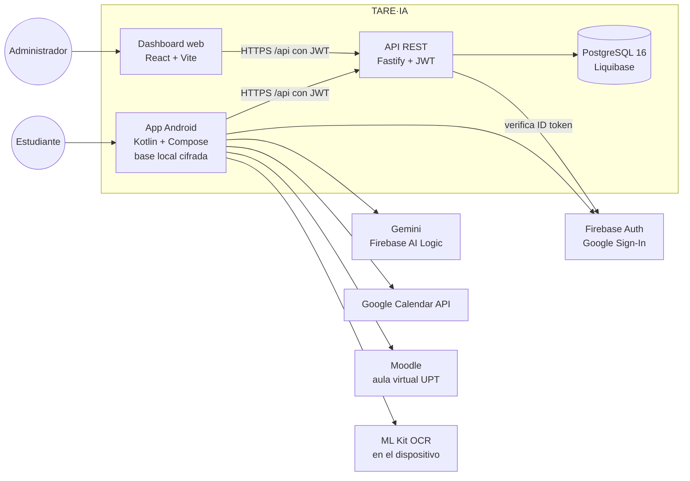
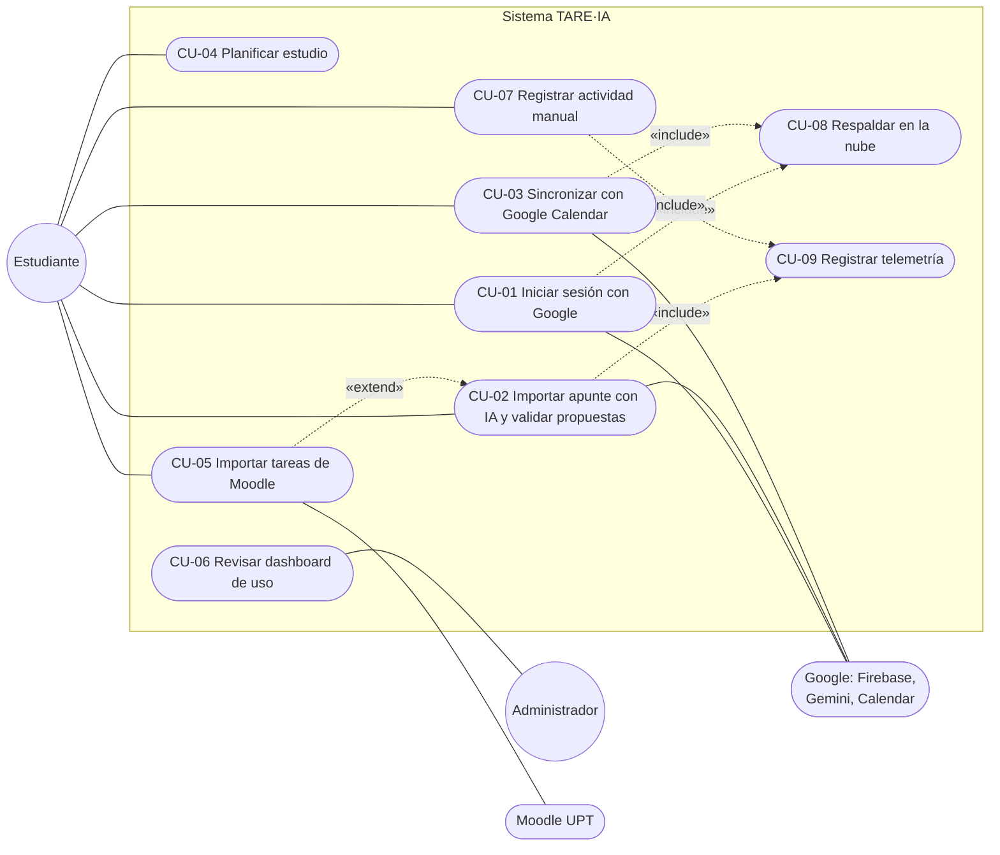
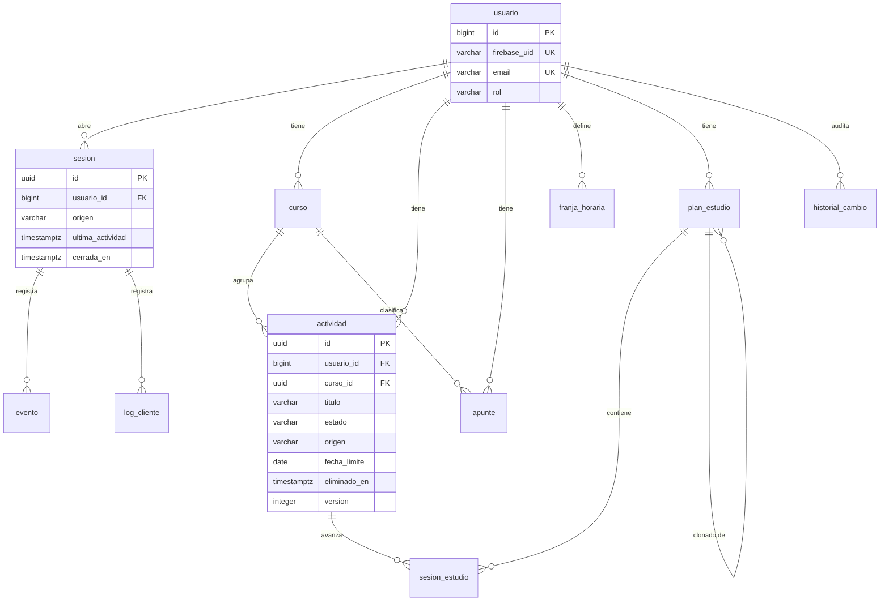

# Control de versiones

| Versión | Hecha por | Revisada por | Aprobada por | Fecha | Motivo |
|---|---|---|---|---|---|
| 1.0 | Adriana Laos y Antony Solorzano | Ing. Patrick Cuadros Quiroga (pendiente) | (pendiente) | 2026-11-21 | Primera versión del SRS de TARE·IA para la Unidad II de SI-784, trazada contra la implementación real (app Android, API, base de datos y pruebas automatizadas) |

---

# Introducción

Este documento especifica los requerimientos de software de **TARE·IA: asistente académico Android que
convierte apuntes, PDF, capturas y tareas del aula virtual en actividades con fecha, planes de estudio y
recordatorios, con apoyo de inteligencia artificial (Gemini) y Google Calendar**. Sigue la estructura recomendada
por la norma IEEE 830-1998, adaptada a la plantilla FD03 de la Escuela Profesional de Ingeniería de Sistemas
(EPIS) de la Universidad Privada de Tacna, y se elabora en el curso **SI-784 Calidad y Pruebas de Software**
(docente: Ing. Patrick Cuadros Quiroga, semestre 2026-II).

Cada requerimiento de esta versión está **trazado contra el código existente**: la clase Kotlin de la app
(`android/app/src/main/java/com/tareia/app/...`), el *endpoint* de la API (`backend/src/routes/index.ts`), el objeto
de la base de datos (`db/changelog/sql/*.sql`) y la prueba automatizada que lo verifica. Cuando un requerimiento
está implementado pero no tiene prueba automatizada, o su alcance es menor que el texto original, se indica de forma
explícita.

## Propósito

- Definir de forma verificable **qué** debe hacer TARE·IA (requerimientos funcionales), **con qué calidad**
  (requerimientos no funcionales) y **bajo qué reglas** (reglas de negocio).
- Servir de acuerdo entre el equipo de desarrollo, el docente del curso y los estudiantes usuarios.
- Ser la base del diseño (FD04 – Documento de Arquitectura de Software) y del plan de pruebas automatizadas de
  la Unidad II (unitarias, mutación, integración, sistema, interfaz y aceptación).

## Alcance

TARE·IA está formado por cuatro piezas que comparten un mismo modelo de dominio:

1. **App Android nativa** (Kotlin 2.3.21, Jetpack Compose + Material 3, minSdk 28, targetSdk 35). Funciona sin
   conexión con una base local cifrada con Android Keystore. Importa apuntes (PDF, imágenes, capturas, texto
   compartido), reconoce el texto con ML Kit en el dispositivo, extrae actividades con Gemini (Firebase AI Logic) o
   con un proveedor compatible con OpenAI, exige que el estudiante **valide** cada propuesta, planifica sesiones de
   estudio, programa recordatorios, sincroniza con Google Calendar e importa tareas de Moodle (aula virtual UPT).
2. **API REST** (Node 22 + Fastify 5 + TypeScript): sesiones con JWT, respaldo y sincronización de cursos y
   actividades, historial de cambios, telemetría de uso, logs de la app y datos del dashboard.
3. **Base de datos PostgreSQL 16** versionada con Liquibase: 11 tablas, 6 vistas (una materializada), 7 funciones y
   7 *triggers*; el *trigger* de transición replica en la BD el patrón State de la app.
4. **Dashboard web de utilización** (React 18 + Vite), solo para el rol administrador.

**Incluye:** RF-01 a RF-26 (sección 2.1) y los requerimientos de la nube RFN-01 a RFN-06 (sección 2.2).
**No incluye:** sincronización bidireccional continua con Google Calendar, importación automática de horarios
institucionales desde archivo, integración con sistemas UPT distintos de Moodle (el antiguo RF-27 queda fuera de
alcance) y respaldo en la nube de apuntes, horario y planes (el esquema existe, la API todavía no lo expone; ver
sección 6).

## Definiciones, siglas y abreviaturas

| Término | Descripción |
|---|---|
| RF / RFN / RNF / RN | Requerimiento funcional / funcional de la nube / no funcional / regla de negocio. |
| CU | Caso de uso. |
| Actividad académica | Tarea, examen, entregable o proyecto con fecha límite (`ActividadAcademica`, tabla `actividad`). |
| Propuesta | Actividad que sugiere la IA o Moodle y que todavía no valida el estudiante (estado *Pendiente de validar*). |
| Estado de actividad | *Pendiente de validar* → *Confirmada* → *Sincronizada* → *Completada* (patrón State). |
| Plan de estudio | Conjunto de sesiones de estudio; estados PROPUESTA, VIGENTE y REEMPLAZADO (patrón Prototype). |
| Franja horaria | Bloque semanal del horario (clase o disponible para estudiar). |
| Papelera | Eliminación lógica: el elemento se marca con fecha de eliminación y puede restaurarse. |
| OCR | Reconocimiento óptico de caracteres (ML Kit Text Recognition, en el dispositivo). |
| Gemini | Modelo de lenguaje de Google usado mediante Firebase AI Logic (modelo `gemini-3.5-flash-lite`). |
| JWT | JSON Web Token emitido por la API; incluye el id de usuario (`sub`), el rol y el id de sesión (`sid`). |
| ID token | Token de identidad que Firebase Authentication entrega tras el inicio de sesión con Google. |
| Moodle WS | Web Services de Moodle (`core_webservice_get_site_info`, `core_enrol_get_users_courses`, `mod_assign_get_assignments`). |
| Telemetría | Eventos de uso sin datos personales que alimentan el dashboard. |
| TTL | *Time to live*: tiempo de vida de una entrada de caché. |
| WCAG | *Web Content Accessibility Guidelines* 2.2 (W3C); nivel AA. |
| OWASP | *Open Worldwide Application Security Project*. |

## Referencias

- IEEE. (1998). *IEEE Std 830-1998*.
- FD01 Informe de Factibilidad y FD02 Documento de Visión de TARE·IA (`docs/referencias/FD02_DOCUMENTO_VISION.md`).
- FD04 v1.0 Documento de Arquitectura de Software (`docs/fd/FD04-Informe-SAD.md`).
- Matriz funcional histórica `docs/historico/MATRIZ_RF01_RF26.md` y `docs/historico/README_IMPLEMENTACION.md`.
- Diccionario de datos `docs/database/diccionario-de-datos.md` y diagramas generados desde el código
  (`docs/diagramas/*.md`).
- Bibliografía y webgrafía completas al final del documento.

## Visión general del documento

La sección 1 describe el producto, sus usuarios, restricciones y supuestos; la 2, los requerimientos funcionales; la
3, las reglas de negocio y dónde se implementan; la 4, los requerimientos no funcionales, con una sección dedicada a
sesiones, historial, caché, logs y telemetría; la 5, los casos de uso; la 6, el modelo de datos resumido; la 7, la
trazabilidad hacia las pruebas automatizadas; y luego conclusiones, recomendaciones y referencias.

# 1. Descripción general

## 1.1 Perspectiva del producto

TARE·IA nace como una app Android local (perfil con PIN, persistencia en el dispositivo) y en esta versión se
amplía con una **nube propia** para sesiones, respaldo, historial, telemetría y un dashboard de utilización. La app
sigue siendo *offline-first*: todo caso de uso del estudiante funciona sin la API; la nube agrega respaldo y
medición.

*Figura 1. Contexto del producto.*

## 1.2 Funciones del producto

| Grupo | Funciones | RF |
|---|---|---|
| Acceso y perfil | Inicio de sesión con Google (y PIN local de respaldo), perfil académico, permisos del dispositivo. | RF-01, RF-12, RF-13 |
| Ingesta de contenido | Importar PDF, imágenes, fotos y contenido compartido; OCR; anotaciones; carpetas por curso; bandeja Sin clasificar. | RF-03, RF-15, RF-16, RF-20, RF-22, RF-23 |
| IA y validación | Extraer tareas, fechas y cursos; formulario de validación antes de usar cualquier propuesta. | RF-04, RF-05 |
| Actividades | Registro manual, control de duplicados, seguimiento por curso y urgencia, papelera, reporte PDF. | RF-06, RF-10, RF-11, RF-21, RF-25 |
| Planificación | Cursos con prioridad y dificultad, horario semanal, plan de estudio con IA o local, replanificación, dictado. | RF-07, RF-14, RF-17, RF-18, RF-19, RF-24 |
| Integraciones | Autorizar y sincronizar Google Calendar, recordatorios locales, importar tareas de Moodle. | RF-02, RF-08, RF-09, RF-26 |
| Nube | Sesión en la API, sincronización y respaldo, historial, telemetría y logs, dashboard, salud y OpenAPI. | RFN-01 a RFN-06 |

## 1.3 Usuarios y actores

| Actor | Tipo | Descripción | Rol en la BD |
|---|---|---|---|
| Estudiante | Humano | Estudiante universitario (piloto: EPIS-UPT) que usa la app Android para organizar sus actividades. Entra con Google. | `usuario.rol = 'estudiante'`, `firebase_uid` no nulo |
| Administrador | Humano | Responsable del producto (el equipo). Entra al dashboard con correo y contraseña y ve métricas de uso agregadas. | `usuario.rol = 'admin'`, `password_hash` bcrypt |
| Firebase / Google | Sistema externo | Autentica la cuenta Google, provee Gemini y App Check; Google Calendar recibe los eventos. | — |
| Moodle UPT | Sistema externo | Fuente de tareas (`/mod/assign`) mediante Web Services y un *token* del estudiante. | `actividad.id_externo` |
| Integración MCP | Sistema | Servidor MCP (`integrations/mcp`) que consume la API para asistentes de programación. | `sesion.origen = 'mcp'` o `'claude'` |
| GitHub Actions | Sistema | Ejecuta pruebas, análisis estático, migraciones, *release* y documentación. | — |

**Perfiles:**

| Perfil | Características | Necesidades de la interfaz | Permisos |
|---|---|---|---|
| Estudiante | 17–30 años; celular Android 9 o superior; conectividad variable. | Flujos cortos, lenguaje claro, funcionamiento sin conexión, TalkBack, áreas táctiles de 48 dp, contraste AA. | Todo lo de la app; en la API solo sus propios datos. |
| Administrador | Equipo de desarrollo. | Indicadores agregados, tabla accesible, uso en escritorio y móvil. | `GET /api/dashboard`, `POST /api/dashboard/refrescar`. |

## 1.4 Restricciones

| ID | Restricción |
|---|---|
| RES-01 | App Android nativa en Kotlin con Jetpack Compose; minSdk 28 (Android 9), targetSdk 35; no es una *webview*. |
| RES-02 | *Stack* de la nube fijo: Node 22 + Fastify 5 + TypeScript, PostgreSQL 16, Liquibase, Terraform, GitHub Actions. |
| RES-03 | Capas gratuitas: Render Free (el servicio se suspende sin tráfico), Neon Free, Firebase (plan gratuito), GitHub Pages y Releases. Costo objetivo USD 0/mes. |
| RES-04 | Dos integrantes; un semestre académico. |
| RES-05 | Moodle exige que el administrador del aula virtual habilite los Web Services y que el estudiante tenga un *token*; la app no puede habilitarlos. |
| RES-06 | Google Calendar exige consentimiento OAuth del estudiante (alcance `calendar.events`). |
| RES-07 | Datos personales conforme a la Ley N.° 29733 y su reglamento (D. S. 016-2024-JUS): minimización, consentimiento y cifrado. |
| RES-08 | Cambios de esquema solo mediante *changesets* Liquibase con *rollback*. |
| RES-09 | Ningún secreto (claves, *tokens*, `google-services.json` de producción) se guarda en el repositorio. |

## 1.5 Supuestos y dependencias

- El estudiante tiene una cuenta Google y, para Calendar, acepta el permiso solicitado.
- Gemini y Google Calendar están disponibles; si la IA falla, la app usa el extractor local (expresiones regulares) y
  la planificación local.
- El servicio de voz (`SpeechRecognizer`) lo provee Android o el fabricante; puede operar en la nube según el
  dispositivo.
- La API puede tardar en responder tras un periodo sin tráfico (arranque en frío de Render Free); la app no
  depende de ella para funcionar.
- Las URL de producción previstas son `https://tareia-api.onrender.com` (Swagger en `/api/docs`) y
  `https://tareia-dashboard.onrender.com`; su disponibilidad depende de que el *workflow* de *release* se ejecute con
  los *secrets* configurados.

# 2. Requerimientos funcionales

Prioridad: **Alta** (imprescindible), **Media** (importante), **Baja** (deseable). Estado: ✔ implementado y con
prueba automatizada · ◐ implementado sin prueba automatizada (verificación manual en dispositivo) o con alcance
parcial respecto al texto original. Los nombres de prueba se detallan en la sección 7.

## 2.1 Requerimientos de la app (RF-01 a RF-26)

| ID | Nombre | Descripción e implementación | Prioridad | Criterio de aceptación verificable | Estado |
|---|---|---|---|---|---|
| RF-01 | Gestionar autenticación de usuario | El estudiante entra con Google (Credential Manager + Firebase Auth, `GoogleAuthManager`); la app canjea el ID token por una sesión de la API (`Nube.iniciarSesion` → `POST /api/auth/google`). Se conserva un PIN local (hash con sal) como acceso sin conexión. Cerrar sesión cierra la sesión en el servidor. | Alta | Con un ID token válido la API responde 200 con `token` y `sesionId`; con uno inválido, 401 `TOKEN_GOOGLE`; tras `logout`, el mismo JWT recibe 401. Si el correo de Google difiere del perfil local, la app rechaza el ingreso. | ✔ |
| RF-02 | Autorizar acceso a Google Calendar | `GoogleCalendarAccess` solicita el alcance `https://www.googleapis.com/auth/calendar.events` con la API de autorización de Google Identity; el *token* se usa solo en memoria para la sesión de sincronización. | Alta | Al conceder, la pantalla Calendario muestra la cuenta conectada; al denegar o cancelar, muestra un mensaje y no se crea ningún evento. | ◐ |
| RF-03 | Procesar reconocimiento OCR | `ReconocedorOCRMLKit` reconoce texto de imágenes y de PDF (cada página se renderiza como imagen; máximo 30 páginas). Lo crea la fábrica de IA elegida (`FabricaServiciosIA.crearReconocedorOCR`). **Alcance:** el OCR es en el dispositivo; Gemini recibe el texto reconocido, no la imagen. | Alta | Un PDF de ≤ 30 páginas produce texto editable; uno de más de 30 páginas muestra «Divide el documento e inténtalo de nuevo». | ◐ |
| RF-04 | Extraer parámetros académicos | `GestorAnalisisIA.extraerParametros` pide al extractor de la familia (Gemini con esquema JSON `title`, `course`, `dueDate`; o API compatible con OpenAI) una lista de `ActividadBuilder`. Sin IA, `ExtractorLocal` sugiere por fechas y palabras clave. | Alta | Un texto con «Informe de laboratorio … 15/12» produce al menos una propuesta con título y fecha; ninguna propuesta se guarda sin pasar por RF-05; toda propuesta nace *Pendiente de validar* (RN09). | ◐ |
| RF-05 | Formulario de validación | La pantalla Importar muestra cada propuesta con título, curso y fecha editables; el estudiante descarta, corrige o confirma. `GestorActividades.registrarPropuestas` guarda solo las revisadas y confirma automáticamente las que tienen curso y fecha. | Alta | Descartar una propuesta conserva el documento; descartar todas pide confirmación; una propuesta sin fecha no puede confirmarse (RN05) y no puede enviarse a Calendar (RN01). | ✔ |
| RF-06 | Creación manual de actividades | `GestorActividades.crearManual` construye la actividad con `ActividadBuilder` (sin IA). El Builder exige título y fecha. | Alta | Una actividad manual con fecha nace *Confirmada* y persiste tras reiniciar la app; en la API, `PUT /api/actividades/:id` con origen MANUAL responde 200 con estado `CONFIRMADA`. | ✔ |
| RF-07 | Generar y confirmar plan de estudio | `GestorPlanificacion.generarPropuesta` clona el plan vigente (Prototype) y aplica la estrategia elegida (Strategy): `PlanificacionConIA` o `PlanificacionLocalPorPrioridad`. Si la IA no devuelve sesiones válidas, la app cambia a la local y lo avisa. `confirmarPlan` deja la propuesta VIGENTE y el anterior REEMPLAZADO. | Alta | La propuesta no modifica el plan vigente hasta confirmar; las sesiones propuestas no se cruzan entre sí ni con las existentes; al confirmar solo existe un plan VIGENTE. | ✔ |
| RF-08 | Sincronizar con Google Calendar | `GestorSincronizacion` crea o actualiza el evento mediante `GoogleCalendarAdapter` → `GoogleCalendarApi` (REST v3, calendario `primary`) con un id de evento determinista por cuenta y tarea. Solo sincroniza actividades confirmadas (RN01); si Google falla, la actividad vuelve a su estado anterior. No sobrescribe eventos de otra cuenta. | Alta | Una actividad *Pendiente de validar* no se envía (mensaje RN01); una *Confirmada* pasa a *Sincronizada* y guarda el id del evento; reenviar la misma actividad actualiza el evento sin duplicarlo. | ✔ |
| RF-09 | Notificaciones y alertas | `GestorAlertas` programa por defecto un recordatorio el día anterior a la entrega a las 09:00 (`AlarmManagerNotificaciones`); se cancela al completar o enviar a la papelera y se reprograma tras reiniciar el teléfono (`BOOT_COMPLETED`). | Media | Al editar la fecha se reprograma; tras reiniciar el dispositivo el aviso sigue programado; en Android 13+ sin permiso de notificaciones la app lo indica en Permisos. | ◐ |
| RF-10 | Seguimiento académico por curso | Inicio y Tareas muestran actividades por curso, estado y urgencia (CRITICA ≤ 1 día, ALTA ≤ 3, MEDIA ≤ 7, BAJA, VENCIDA, SIN_FECHA). En la nube, `GET /api/actividades/pendientes` usa la vista `v_actividad_pendiente`. | Alta | Una actividad a 1, 3, 6 y 20 días aparece con urgencia CRITICA, ALTA, MEDIA y BAJA respectivamente; las completadas y las de la papelera no aparecen como pendientes. | ✔ |
| RF-11 | Prevenir duplicados | `DetectorDuplicados` (app) y `AcademicoRepository.buscarDuplicado` con `fn_normalizar` (BD) rechazan una actividad con el mismo título normalizado, curso y fecha (RN02); también dentro de un mismo lote importado y por id externo de Moodle. | Alta | Registrar «EXPOSICIÓN   final» cuando existe «Exposición final» con el mismo curso y fecha devuelve 409 `DUPLICADO`; editar la misma actividad no cuenta como duplicado. | ✔ |
| RF-12 | Permisos del dispositivo | La pantalla Permisos centraliza micrófono, calendario y notificaciones; cámara y selector de archivos se piden en el momento de uso. | Media | Con un permiso denegado la función relacionada muestra una explicación y un acceso a Ajustes; la app no se cierra. | ◐ |
| RF-13 | Personalizar perfil | Perfil académico local (nombre, correo, código, semestre) cifrado; en la nube, `GET /api/perfil` devuelve nombre, correo, rol y último acceso. La pantalla Perfil muestra el estado de la conexión con la nube. | Media | Los cambios persisten tras reiniciar; `GET /api/perfil` con JWT válido responde 200 con el correo del usuario. | ✔ |
| RF-14 | Configurar cursos y abreviaturas | `GestorCursos` crea, edita y elimina cursos con abreviatura (objeto de valor `Abreviatura`, ≤ 12 caracteres, mayúsculas), prioridad 1–5 y dificultad 1–5. La abreviatura es única (RN12). En la nube, `PUT /api/cursos/:id`. | Alta | Una abreviatura repetida se rechaza; prioridad fuera de 1–5 se rechaza; el curso se sincroniza con `prioridad` y `dificultad` válidas. | ✔ |
| RF-15 | Compartir desde otras apps | `MainActivity` recibe `ACTION_SEND` de texto, PDF e imágenes; `GestorIngesta.recibirCompartido` crea el contenido y abre Importar. | Media | Compartir un PDF desde otra app abre Importar con el documento cargado. | ◐ |
| RF-16 | Asignar apuntes a carpetas | Cada curso tiene su carpeta; `ClasificadorContenido` ubica el apunte en la carpeta del curso cuya abreviatura o nombre aparece como palabra completa (RN13). | Media | Un apunte que contiene «PS» va a la carpeta del curso PS; «lapso» no coincide con «PS». | ✔ |
| RF-17 | Configurar horario | La pantalla Horario registra franjas semanales (clase o disponible para estudiar); `Estudiante.agregarFranja` rechaza cruces (RN16). **Alcance:** carga manual; no importa horarios desde archivo. | Media | Una franja con inicio ≥ fin se rechaza; una franja que se cruza con otra del mismo día se rechaza; las franjas de distinto día no chocan. | ✔ |
| RF-18 | Personalizar priorización de estudio | La planificación local ordena por prioridad del curso y calcula de 2 a 6 sesiones de 60 min según prioridad y dificultad (RN04). | Media | Con dos actividades equivalentes, la del curso de mayor prioridad se planifica primero. | ✔ |
| RF-19 | Gestionar cambios de cronograma | Al cambiar fecha, prioridad o disponibilidad, `GestorPlanificacion.reorganizar` genera una nueva propuesta clonando el plan vigente; el estudiante confirma o descarta. | Media | Descartar la propuesta deja intacto el plan vigente (copia profunda de sesiones). | ✔ |
| RF-20 | Contenido sin clasificar | La bandeja Sin clasificar lista apuntes sin carpeta y actividades sin curso; al asignar curso salen de la bandeja. | Media | Un apunte sin curso aparece en Sin clasificar; al asignarle un curso deja de aparecer. | ✔ |
| RF-21 | Papelera | `GestorPapelera` envía a la papelera, restaura y elimina definitivamente cualquier `Eliminable` (curso, actividad, apunte) (RN14). En la nube: `DELETE /api/actividades/:id`, `POST /api/actividades/:id/restaurar`, `DELETE /api/cursos/:id`. | Media | Una actividad en la papelera no aparece en pendientes y al restaurarla vuelve; la eliminación definitiva no se puede deshacer. | ✔ |
| RF-22 | Importar PDF, imágenes y capturas | `GestorIngesta.importarArchivo` elige el importador por tipo MIME (`ImportadorPDF`, `ImportadorImagen`); `importarFoto` guarda la foto de la cámara como PNG temporal. | Alta | PDF, JPG y PNG se importan; un formato no soportado muestra un mensaje y no se guarda. | ◐ |
| RF-23 | Gestionar anotaciones | `GestorIngesta.guardarAnotacion` crea y edita notas propias y las ubica en la carpeta elegida. | Baja | Una nota creada, editada y movida persiste tras reiniciar. | ◐ |
| RF-24 | Planificación mediante audio | En Plan, el estudiante dicta actividad, curso y fecha (`SpeechRecognizer`); edita la transcripción y obtiene una propuesta de plan. **Alcance:** la extracción del dictado es local; el plan puede generarse con IA o localmente. | Baja | Sin servicio de voz en el dispositivo el botón de dictado no se ofrece; con voz, la transcripción es editable antes de proponer. | ◐ |
| RF-25 | Generar reporte PDF | `PdfReport.write` genera un PDF con las tareas filtradas por estado en el destino que elige el estudiante. | Baja | El PDF se abre y contiene título, curso, fecha y estado de cada tarea filtrada. | ◐ |
| RF-26 | Integración con Moodle | `MoodleClient.fetchAssignments` consulta identidad, cursos y tareas por Web Services con un *token* cifrado; `GestorActividades.importarDeIntegracion` omite las ya importadas (por id externo o RN02) y crea las nuevas como *Pendiente de validar* (RN09). Solo lectura. | Media | Repetir la importación no crea duplicados; toda tarea importada nace `PENDIENTE_VALIDAR`; con un *token* inválido se muestra el error de Moodle. | ◐ |

## 2.2 Requerimientos de la nube (RFN)

| ID | Nombre | Descripción e implementación | Prioridad | Criterio de aceptación verificable | Estado |
|---|---|---|---|---|---|
| RFN-01 | Sesión en la API | `POST /api/auth/google` verifica el ID token de Firebase (firma con el JWKS de Google, emisor, audiencia y vencimiento) y crea o actualiza el usuario por UID y luego por correo en minúsculas. `POST /api/auth/login` (administración y demo, bcrypt). Ambos abren una fila en `sesion` y devuelven un JWT de 7 días con `sub`, `rol` y `sid`. `POST /api/auth/logout` cierra la sesión. `app.autenticar` exige JWT válido **y** sesión abierta en cada petición. | Alta | Un segundo inicio con la misma cuenta Google reutiliza el usuario; tras `logout` o 30 min de inactividad el JWT recibe 401 `SESION_CERRADA`. | ✔ |
| RFN-02 | Sincronización y respaldo | La app envía cursos y actividades como máximo cada 2 minutos (`Nube.sincronizar` → `POST /api/sync`). La API fusiona registro por registro: gana el cambio más reciente (`actualizadoEn`) y, ante empate, la versión mayor; un error no detiene el lote. Devuelve aplicados, conservados, rechazados y los cambios del servidor desde `desde`. CRUD individual: `GET/PUT/DELETE /api/cursos`, `GET/PUT /api/actividades`, `POST /api/actividades/:id/estado`. | Alta | Un cambio antiguo no pisa uno más reciente; un id que no es UUID devuelve 400; el estado enviado respeta las transiciones del *trigger*. | ✔ |
| RFN-03 | Historial de cambios | El *trigger* `fn_registrar_historial` guarda el antes y el después (JSONB) de cada alta, cambio o borrado de cursos, actividades y apuntes. `GET /api/actividades/:id/historial` lo devuelve al dueño. | Media | Tras crear y editar una actividad, el historial tiene al menos dos registros (`I`, `U`) con `antes` y `despues`. | ✔ |
| RFN-04 | Telemetría y logs | `POST /api/eventos` recibe lotes de eventos de uso (máx. 100 por lote, 15 tipos permitidos, fechas de los últimos 7 días); `POST /api/logs` recibe solo WARN y ERROR. La API quita claves personales y enmascara correos y *tokens*. | Media | Un evento de tipo desconocido se descarta; un correo dentro de `datos` no se guarda; un log INFO se descarta. | ✔ |
| RFN-05 | Dashboard de utilización | `GET /api/dashboard` (solo admin) devuelve KPI, serie diaria de 30 días (sesiones, usuarios, eventos, actividades creadas y completadas), funciones más usadas, pantallas más visitadas y origen × estado de las actividades; usa caché con TTL (cabecera `x-cache`). `POST /api/dashboard/refrescar` recalcula `mv_uso_diario` y cierra sesiones inactivas. El dashboard React muestra gráficos con *tooltip* accesible por teclado y una vista de tabla. | Alta | Un estudiante recibe 403; el administrador ve 30 días; la segunda consulta responde `x-cache: HIT` y tras refrescar vuelve a `MISS`. | ✔ |
| RFN-06 | Estado del servicio y documentación | `GET /api/health` informa estado de la BD, versión y métricas de caché; OpenAPI/Swagger en `/api/docs`. | Media | `/api/health` responde `estado: ok` con la BD conectada; Swagger UI responde 200. | ✔ |

# 3. Reglas de negocio

Las reglas críticas se implementan **en dos o tres capas**: en el dominio Kotlin de la app (que funciona sin
conexión), en la API (`backend/src/dominio`) y, cuando es posible, en PostgreSQL, de modo que ningún cliente —app,
dashboard o MCP— pueda saltárselas.

| ID | Regla | App Android (clase Kotlin) | API | Base de datos (*trigger*, función o restricción) | Prueba |
|---|---|---|---|---|---|
| RN01 | Una actividad **no se sincroniza con Google Calendar sin validar**: desde *Pendiente de validar* `sincronizar()` lanza error. | `PendienteValidar.sincronizar` (`dominio/EstadoActividad.kt`); `GestorSincronizacion.sincronizar` | `aplicarAccion` en `dominio/estado.ts` → 409 `RN01` | `fn_transicion_valida` + *trigger* `tg_actividad_transicion` (`fn_actividad_transicion`): no existe la transición PENDIENTE_VALIDAR → SINCRONIZADA | `EstadoActividadTest`, `PatronesTest.state_noSeSincronizaSinConfirmar`, `estado.test.ts`, integración «lo que viene de la IA nace PENDIENTE_VALIDAR y no se puede sincronizar», `hu03-validacion-ia.feature` |
| RN02 | **Sin duplicados**: dos actividades son la misma si coinciden título, curso y fecha, sin distinguir mayúsculas, tildes ni espacios repetidos. | `DetectorDuplicados.esDuplicada` (`dominio/ServiciosDominio.kt`); control por lote en `GestorActividades.registrarPropuestas` | `ActividadService.guardar` → 409 `DUPLICADO`; `claveDuplicado` | `fn_normalizar` (IMMUTABLE, `unaccent`) usada por `AcademicoRepository.buscarDuplicado`; índice único `ux_actividad_externa` para ids de Moodle | `ServiciosDominioTest`, `PatronesTest.repository_noRegistraDuplicados`, `sincronizacion.test.ts`, `actividadService.test.ts`, integración RN02, `hu02-actividades.feature` |
| RN05 | **Confirmar exige título y fecha límite**. | `ActividadAcademica.esConfirmable`, `PendienteValidar.confirmar`; `ActividadBuilder.build` exige título (y fecha si es manual) | `esConfirmable` → 409 `RN05` | `CHECK ck_actividad_confirmable (estado = 'PENDIENTE_VALIDAR' OR fecha_limite IS NOT NULL)`; `CHECK (btrim(titulo) <> '')` | `EstadoActividadTest.pendienteSinFechaNoSeConfirma`, `estado.test.ts`, `hu03` «Una propuesta sin fecha no se puede validar» |
| RN09 | Lo que viene de la **IA o de Moodle nace *Pendiente de validar***; lo manual con fecha nace *Confirmada*. Tampoco se completa lo no validado. | `ActividadBuilder.build` (`desdeIA`, `desdeIntegracion`); `PendienteValidar.completar` | `estadoInicial`, `aplicarAccion('completar')` → 409 `RN09` | `DEFAULT 'PENDIENTE_VALIDAR'` en `actividad.estado`; el *trigger* no permite PENDIENTE_VALIDAR → COMPLETADA | `ConstruccionYValorTest.builderManualConFechaNaceConfirmada`, `PatronesTest.builder_desdeIANacePendienteDeValidar`, `estado.test.ts` «IA y Moodle nacen pendientes», `hu03` |
| RN13 | **Clasificación de apuntes por curso**: si el título o el texto contiene la abreviatura o el nombre del curso como palabra completa, el apunte va a su carpeta; si no, queda Sin clasificar. | `ClasificadorContenido.clasificar` usado por `GestorIngesta.guardarApunte` | — (los apuntes no se exponen todavía en la API) | `apunte.curso_id` nulo = bandeja Sin clasificar (comentario de tabla, RF-20) | `ServiciosDominioTest.clasificaPorAbreviaturaONombreConPalabraCompleta`, `PatronesTest.clasificador_usaLaAbreviaturaDelCurso` |
| RN14 | **Papelera**: eliminar no borra, marca la fecha de eliminación; se puede restaurar; la eliminación definitiva es explícita. Al eliminar un curso, sus elementos van a la papelera; al eliminar una actividad se cancelan sus avisos y se quitan sus sesiones del plan. | Interfaz `Eliminable`; `GestorPapelera` | `AcademicoRepository.marcarPapelera`; rutas `DELETE` y `/restaurar` | Columna `eliminado_en` en `curso`, `actividad` y `apunte`; índices parciales `WHERE eliminado_en IS NULL` (`ux_curso_nombre`, `ux_actividad_externa`, `ix_actividad_pendiente`); `v_actividad_pendiente` excluye la papelera | `ServiciosDominioTest.cursoEnPapelera`, `ConstruccionYValorTest.editarActualizaDatosYPapeleraMarcaFecha`, integración «papelera: enviar oculta de pendientes y restaurar la recupera» |
| RN16 | **Franjas sin cruces**: la hora de inicio es anterior a la de fin y dos franjas del mismo día no se superponen; las sesiones de estudio tampoco se cruzan. | `FranjaHoraria` (`init`, `seSolapaCon`), `Estudiante.agregarFranja`, `SesionEstudio.seCruzaCon`, `PlanificacionConIA` descarta sesiones cruzadas | — | `CHECK ck_franja_orden (hora_fin > hora_inicio)`. **Nota:** el no solapamiento entre franjas se controla solo en la app (la API todavía no recibe franjas). | `ConstruccionYValorTest.franjasSeSolapanSoloElMismoDiaYConCruce`, `estudianteNoAceptaFranjasCruzadasYFiltraDisponibles`, `sesionesSeCruzanYValidanHoras` |

Reglas complementarias que el código también aplica: **RN04** (la planificación da más sesiones a cursos de mayor
prioridad, `PlanificacionLocalPorPrioridad`), **RN12** (abreviatura de curso obligatoria y única, `GestorCursos`) y la
regla de **Prototype** (un solo plan VIGENTE por usuario: `ux_plan_vigente` y `fn_confirmar_plan`).

# 4. Requerimientos no funcionales

## 4.1 Cuadro de requerimientos no funcionales

| ID | Atributo | Requerimiento | Métrica / criterio | Cómo se verifica | Prioridad |
|---|---|---|---|---|---|
| RNF-01 | Seguridad – autenticación | Identidad delegada en Google: la API verifica el ID token de Firebase con las claves públicas de Google (`jose`, JWKS), emisor `securetoken.google.com/<proyecto>` y audiencia. JWT HS256 de 7 días con secreto ≥ 32 caracteres (validado al iniciar, *fail fast*) y con id de sesión. Administración con bcrypt. Firebase App Check (Play Integrity en *release*). | 100 % de rutas privadas exigen JWT **y** sesión abierta; token de Google inválido → 401; JWT tras logout → 401. | Integración (`api.test.ts`: «rechaza un token de Google inválido», «logout cierra la sesión y el mismo token deja de servir»); `hu01-sesion.feature` | Alta |
| RNF-02 | Seguridad – autorización | Cada consulta SQL de datos académicos filtra por `usuario_id` del JWT; el dashboard exige rol `admin` (`requiereRol`). | Recurso de otro usuario → 404 (no revela existencia); estudiante en `/api/dashboard` → 403. | Integración «404 para recursos de otro usuario o inexistentes», «protege rutas privadas y de administración»; `hu05-dashboard.feature`; e2e «una cuenta de estudiante no puede ver el dashboard» | Alta |
| RNF-03 | Seguridad – entrada y transporte | Consultas parametrizadas (`$1…`); validación con JSON Schema (Ajv, `removeAdditional`); Helmet; CORS con lista de orígenes; *rate limit* 300/min global, 10/min en `/auth/login`, 20/min en `/auth/google`, 60/min en `/eventos`, 30/min en `/logs`; solo HTTPS en la app (`usesCleartextTraffic="false"`). | 0 hallazgos de inyección SQL en Semgrep (`p/sql-injection`); cuerpo inválido → 400; el undécimo login en un minuto → 429. | Sistema (`flujo-completo.test.ts`: CORS, helmet, *rate limit*); integración «valida el cuerpo de las peticiones (400)»; `semgrep.yml`, `snyk.yml`, `sonarqube.yml` | Alta |
| RNF-04 | Privacidad | Datos locales cifrados con AES-GCM y clave no exportable de Android Keystore (`SecureTokenStore`): base local, JWT y *token* de Moodle. Telemetría sin datos personales; logs con correos y *tokens* enmascarados en la API. La IA recibe solo el texto que el estudiante decide analizar. | 0 correos o *tokens* en `evento.datos` y `log_cliente.mensaje`. | `privacidad.test.ts`, `telemetria.test.ts`; `hu05` «La telemetría no guarda datos personales» | Alta |
| RNF-05 | Rendimiento | La interfaz nunca espera a la nube: todo envío es en segundo plano (corrutinas) con tiempos de espera de 10 s (conexión) y 20 s (lectura). Dashboard con caché en memoria (TTL 60 s por defecto) y vista materializada. | Objetivo: `GET /api/dashboard` en caché < 100 ms y p95 de la API < 500 ms con el servicio activo. **Medición de carga pendiente.** | Integración «el dashboard usa caché (MISS → HIT)»; medición con herramienta de carga (pendiente) | Media |
| RNF-06 | Disponibilidad | *Offline-first*: la app funciona sin conexión con su base local; la cola de telemetría conserva hasta 200 eventos; la API expone `/api/health`. | Todas las funciones del estudiante operan sin red (excepto IA, Calendar y Moodle); tras desplegar, el *smoke test* de `/api/health` debe responder `ok`. | Prueba manual en modo avión; `ColaTelemetriaTest`; paso «Smoke test GET /api/health» de `release.yml` | Alta |
| RNF-07 | Usabilidad y accesibilidad (WCAG 2.2 AA) | Contraste de texto ≥ 4,5:1 en tema claro y oscuro; áreas táctiles ≥ 48 dp; semántica para TalkBack (estados, cinta de entregas, progreso indeterminado); dashboard navegable por teclado, *tooltip* al enfocar, vista de tabla alternativa al gráfico y sin desplazamiento horizontal en móvil. | 100 % de los pares de color de la paleta ≥ 4,5:1; 0 elementos clicables < 48 dp en los componentes probados; 0 desbordes horizontales en Pixel 7. | `ContrasteTest` (JVM); `ComponentesTest`, `CamposTest` (Compose en emulador); `dashboard/e2e/dashboard.spec.ts` en escritorio y Pixel 7 | Alta |
| RNF-08 | Mantenibilidad | Capas explícitas (ui → aplicación → dominio ← infraestructura; rutas → servicios → repositorios); TypeScript `strict`; KDoc/TSDoc publicados con Dokka y TypeDoc; esquema 100 % en *changesets* Liquibase con *rollback*; diagramas y diccionario generados desde el código. | Mutación: Stryker ≥ 60 % (umbral de corte) y Pitest ≥ 50 %; *quality gate* de SonarQube aprobado. | `mutacion.yml`, `sonarqube.yml`, `docs.yml`, `pages.yml` | Media |
| RNF-09 | Portabilidad | Android 9 a 15 (minSdk 28, targetSdk 35); API sin dependencias nativas (`bcryptjs`, `jose`); infraestructura en Terraform modular con referencia de costos en AWS y Azure. | Compila con `assembleDebug`; `terraform validate` y `terraform test` en verde para cada módulo. | `android.yml`, `infra.yml` | Media |
| RNF-10 | Costo | Operación en capas gratuitas. | USD 0/mes en Render Free, Neon Free, Firebase gratuito y GitHub. | Reporte de costos de `infra.yml` (Infracost) | Media |
| RNF-11 | Interoperabilidad | Contrato OpenAPI generado desde los esquemas de las rutas; integraciones por HTTPS/JSON. | 100 % de rutas documentadas en `/api/docs`. | Integración «OpenAPI documenta las rutas principales»; sistema «Swagger UI está disponible» | Baja |

## 4.2 Sesiones, historial, caché, logs y telemetría

Esta sección responde a los aspectos no funcionales que se evalúan en la Unidad II.

| Aspecto | Requerimiento | Implementación | Verificación |
|---|---|---|---|
| **Sesiones** | Toda petición autenticada pertenece a una sesión identificable que se puede cerrar. | Al entrar con Google la app canjea el ID token de Firebase por un JWT de la API (`Nube.iniciarSesion`). Cada inicio abre una fila en `sesion` con `origen` (`android`, `web`, `mcp`, `claude`), `dispositivo` y `version_app`. `AuthService.tocarSesion` renueva `ultima_actividad` (como mucho una vez por minuto) y cierra la sesión si lleva más de 30 min inactiva (`SESION_INACTIVIDAD_MIN`). `fn_cerrar_sesiones_inactivas` cierra en lote las abandonadas (al refrescar el dashboard). `logout` registra `motivo_cierre = 'logout'`. En la app el JWT se guarda cifrado con Android Keystore; en el dashboard, en `sessionStorage` (se borra al cerrar la pestaña). | Integración «logout cierra la sesión…»; sistema «5. consulta su historial y cierra sesión»; `hu01` «Después de cerrar sesión el acceso queda bloqueado»; e2e «la sesión persiste al recargar; cerrar sesión vuelve al login» |
| **Historial** | Todo cambio de datos académicos es trazable. | *Trigger* `fn_registrar_historial` (AFTER INSERT/UPDATE/DELETE en `curso`, `actividad`, `apunte`) guarda `antes` y `despues` en JSONB en `historial_cambio`; `GET /api/actividades/:id/historial`. Los planes reemplazados se conservan con estado REEMPLAZADO y `origen_id`. Liquibase guarda el historial del esquema (`databasechangelog`). | Integración «guarda el historial de cambios con antes y después» |
| **Caché** | Las consultas pesadas no se recalculan en cada petición. | `MemoryCache` con TTL (60 s por defecto) en `DashboardService`, cabecera `x-cache: HIT/MISS` y aciertos/fallos en `/api/health`; vista materializada `mv_uso_diario` (refresco concurrente); caché HTTP en disco de 5 MB de OkHttp en la app; recursos del dashboard con `Cache-Control: public, max-age=31536000, immutable` en Render. | `cache.test.ts`; integración «el dashboard usa caché (MISS → HIT) y se invalida al refrescar» |
| **Logs** | Los errores se diagnostican sin exponer datos sensibles. | API: logs JSON estructurados (pino) con `req.headers.authorization`, `body.password` y `body.idToken` ocultos; errores 500 sin detalles internos. App: `Nube.advertir`/`Nube.error` escriben en Logcat y suben por lotes (cola de 50, lotes de 10) solo WARN y ERROR a `POST /api/logs`; la API los recorta y enmascara correos y *tokens* antes de guardarlos en `log_cliente`. | `telemetria.test.ts` «solo guarda logs WARN y ERROR»; integración «guarda solo logs WARN/ERROR» |
| **Telemetría** | El uso del producto se mide sin datos personales. | `ColaTelemetria` en la app: cola en memoria de hasta 200 eventos, envío en lotes de 20 a `POST /api/eventos`; si falla, el lote vuelve al frente de la cola. Los eventos los emite el patrón Observer (`ObservadorUso`) desde `GestorActividades` y el *shell* de la app (pantalla vista, app abierta, actividad creada/confirmada/completada, importación de Moodle). La API acepta 15 tipos, descarta claves personales (`email`, `nombre`, `token`, `titulo`, `texto`…) y fechas fuera de los últimos 7 días. Alimentan las vistas `v_uso_por_funcion`, `v_uso_por_pantalla`, `v_resumen_sesiones` y `mv_uso_diario`. | `ColaTelemetriaTest`, `ObservadorUsoTest`, `telemetria.test.ts`, `privacidad.test.ts`; `hu05-dashboard.feature` |

# 5. Casos de uso

## 5.1 Diagrama de casos de uso

Mermaid no tiene diagrama de casos de uso; se aproxima con un diagrama de flujo: actores a los lados, casos de uso
dentro del límite del sistema, `«include»` y `«extend»` con línea punteada.

*Figura 2. Diagrama de casos de uso. CU-05 extiende a CU-02 porque reutiliza la validación de propuestas.*

## 5.2 Especificación de casos de uso

**CU-01 — Iniciar sesión con Google**

| Campo | Descripción |
|---|---|
| Actores | Estudiante (principal); Firebase Authentication y API de TARE·IA (secundarios). |
| Requerimientos | RF-01, RF-13, RFN-01; RNF-01, RNF-04. |
| Precondiciones | Cuenta Google en el dispositivo; app instalada; para la sesión en la nube, `BuildConfig.API_URL` configurada. |
| Postcondiciones | Estudiante autenticado en la app; si hay red, fila abierta en `sesion` y JWT guardado cifrado; primera sincronización disparada; evento `app_abierta`. |
| Flujo básico | 1. El estudiante pulsa «Continuar con Google». 2. Credential Manager muestra el selector de cuentas. 3. Firebase Auth devuelve el usuario. 4. La app comprueba que el correo coincide con el del perfil local y actualiza nombre y correo. 5. En segundo plano, `Nube.iniciarSesion` obtiene el ID token y llama a `POST /api/auth/google` con `origen`, `dispositivo` y `versionApp`. 6. La API verifica el token con el JWKS de Google, crea o actualiza el usuario y abre la sesión. 7. La API responde `token`, `sesionId` y `usuario`. 8. La app guarda el JWT cifrado, registra `app_abierta` y sincroniza. 9. Se muestra Inicio. |
| Flujos alternos | A1. El estudiante cancela el selector → «Cancelaste el inicio de sesión con Google». A2. No hay cuenta Google → mensaje y opción de acceso local con PIN. A3. El correo no coincide con el perfil local → se cierra la sesión de Firebase y se explica por qué (protección de datos). A4. Sin red o API dormida → el estudiante entra igual; se registra un WARN y la sesión en la nube se intenta en el siguiente inicio. A5. Token rechazado por la API → 401 `TOKEN_GOOGLE`; la app sigue en modo local. |

**CU-02 — Importar apunte con IA y validar propuestas**

| Campo | Descripción |
|---|---|
| Actores | Estudiante (principal); ML Kit, Gemini o proveedor compatible con OpenAI (secundarios). |
| Requerimientos | RF-03, RF-04, RF-05, RF-11, RF-15, RF-16, RF-22; RN02, RN05, RN09, RN13. |
| Precondiciones | Sesión iniciada en la app. Para la IA, conexión a internet (el OCR funciona sin red). |
| Postcondiciones | Apunte guardado y clasificado en la carpeta de su curso o en Sin clasificar; actividades validadas guardadas sin duplicados, con recordatorio por defecto; evento `actividad_creada` con origen IA. |
| Flujo básico | 1. El estudiante abre Importar y elige un PDF, una imagen, una foto o recibe contenido compartido. 2. `GestorIngesta` elige el importador por tipo MIME. 3. `GestorAnalisisIA.procesarOCR` reconoce el texto (ML Kit). 4. El estudiante revisa o corrige el texto. 5. Pulsa analizar: `extraerParametros` pide a la fábrica de IA el extractor y obtiene una lista de `ActividadBuilder`. 6. La pantalla muestra cada propuesta con título, curso y fecha editables y el sello «por validar». 7. El estudiante corrige, descarta o acepta. 8. `registrarPropuestas` construye cada actividad, descarta duplicados (RN02, también dentro del lote), confirma las que tienen curso y fecha (RN05) y deja el resto *Pendiente de validar* (RN09). 9. El sistema informa cuántas se guardaron y cuántas eran duplicadas. 10. El apunte se guarda y se clasifica (RN13). |
| Flujos alternos | A1. La IA falla o no está configurada → `sugerirSinIA` (expresiones regulares) propone actividades sin internet. A2. PDF de más de 30 páginas → se pide dividirlo. A3. Formato no soportado → mensaje y no se importa. A4. Descartar todas las propuestas → se pide confirmación y el documento se conserva. A5. Propuesta sin fecha → queda *Pendiente de validar* y no puede enviarse a Calendar (RN01). |

**CU-03 — Sincronizar con Google Calendar**

| Campo | Descripción |
|---|---|
| Actores | Estudiante (principal); Google Calendar API (secundario). |
| Requerimientos | RF-02, RF-08; RN01. |
| Precondiciones | Actividad en estado *Confirmada* o *Sincronizada*; permiso `calendar.events` concedido. |
| Postcondiciones | Evento creado o actualizado en el calendario `primary`; actividad *Sincronizada* con el id del evento, la fecha y la cuenta; evento de uso. |
| Flujo básico | 1. El estudiante pulsa «Enviar a Google Calendar» en una actividad. 2. Si no hay autorización vigente, la app la solicita (RF-02). 3. `Dependencias.gestorSincronizacion` crea el gestor con el *token* OAuth de ese momento. 4. `GestorSincronizacion.sincronizar` comprueba que el evento previo, si existe, sea de la misma cuenta. 5. `a.sincronizar()` aplica el patrón State. 6. `GoogleCalendarAdapter` crea o actualiza el evento con un id determinista. 7. Se guarda el vínculo y la actividad queda *Sincronizada*. 8. La app ofrece abrir el evento. |
| Flujos alternos | A1. Actividad *Pendiente de validar* → «Confirma o corrige primero esta actividad… (RN01)». A2. Evento de otra cuenta Google → no se sobrescribe. A3. Error de Google o sin red → la actividad vuelve a su estado anterior y se muestra el error. A4. Permiso denegado → no se crea nada. A5. Actividad completada que se reabre → vuelve a *Sincronizada* si tenía evento. |

**CU-04 — Planificar estudio**

| Campo | Descripción |
|---|---|
| Actores | Estudiante (principal); Gemini (secundario, opcional). |
| Requerimientos | RF-07, RF-17, RF-18, RF-19, RF-24; RN04, RN16. |
| Precondiciones | Al menos una actividad con fecha futura. Recomendable: franjas disponibles en Horario. |
| Postcondiciones | Nuevo plan VIGENTE; el anterior queda REEMPLAZADO; las sesiones no se cruzan. |
| Flujo básico | 1. El estudiante abre Plan y elige una actividad (o la dicta, RF-24). 2. Elige «con IA» o «local». 3. `GestorPlanificacion.setEstrategia` fija la estrategia. 4. `generarPropuesta` clona el plan vigente (Prototype) y reemplaza solo las sesiones de esa actividad. 5. La estrategia propone sesiones de 60 min dentro de las franjas disponibles, sin cruces. 6. La app muestra la propuesta. 7. El estudiante confirma. 8. `confirmarPlan` marca la propuesta VIGENTE y el plan anterior REEMPLAZADO. |
| Flujos alternos | A1. La IA no devuelve sesiones válidas → la app cambia a la estrategia local en tiempo de ejecución y avisa. A2. No hay franjas registradas → se reparten las sesiones a las 18:00 entre hoy y la entrega. A3. No caben sesiones → «No se pudo proponer sesiones. Revisa la fecha y el horario disponible». A4. El estudiante descarta → el plan vigente queda intacto. |

**CU-05 — Importar tareas de Moodle**

| Campo | Descripción |
|---|---|
| Actores | Estudiante (principal); Moodle del aula virtual UPT (secundario). |
| Requerimientos | RF-26, RF-05, RF-11; RN02, RN09. |
| Precondiciones | URL HTTPS de Moodle y *token* de Web Services configurados en Más > Integraciones (el *token* se guarda cifrado); funciones `core_webservice_get_site_info`, `core_enrol_get_users_courses` y `mod_assign_get_assignments` habilitadas. |
| Postcondiciones | Tareas nuevas registradas como *Pendiente de validar* con `id_externo`; evento `moodle_importado` con la cantidad de nuevas. |
| Flujo básico | 1. El estudiante pulsa «Importar de Moodle». 2. `MoodleClient` consulta identidad, cursos y tareas. 3. Cada tarea se convierte en `ActividadBuilder.desdeIntegracion(idEnMoodle)`. 4. `importarDeIntegracion` omite las que ya existen por id externo o por RN02. 5. Las nuevas nacen *Pendiente de validar* (RN09) con recordatorio. 6. El estudiante las valida como en CU-02. |
| Flujos alternos | A1. *Token* inválido o función no habilitada → se muestra el error de Moodle. A2. Sin red → mensaje; no cambia nada. A3. Reimportar → 0 nuevas, sin duplicados. |

**CU-06 — Revisar dashboard de uso**

| Campo | Descripción |
|---|---|
| Actores | Administrador (principal). |
| Requerimientos | RFN-05, RFN-04, RFN-01; RNF-02, RNF-07. |
| Precondiciones | Cuenta con rol `admin`; API disponible. |
| Postcondiciones | Sesión de administración abierta (`origen = 'web'`). |
| Flujo básico | 1. El administrador abre el dashboard e ingresa correo y contraseña. 2. `POST /api/auth/login` valida con bcrypt y devuelve el JWT. 3. El dashboard pide `GET /api/dashboard`. 4. La API comprueba el rol y responde desde la caché o desde las vistas. 5. Se muestran KPI, barras diarias de 30 días (sesiones, eventos, actividades) con *tooltip*, funciones más usadas, pantallas más visitadas y la tabla origen × estado. 6. El administrador alterna la serie o la vista de tabla. |
| Flujos alternos | A1. Contraseña incorrecta → «Correo o contraseña incorrectos». A2. Cuenta de estudiante → 403 y mensaje de que su rol no permite ver el dashboard. A3. Pulsa «Recalcular métricas» → `POST /api/dashboard/refrescar` refresca `mv_uso_diario`, cierra sesiones inactivas e invalida la caché. A4. Más de 10 intentos de login por minuto → 429. |

# 6. Modelo de datos resumido

El modelo en la nube es una copia del dominio de la app (los UUID los genera la app para poder crear sin conexión)
más las tablas de seguridad, historial y telemetría. Detalle de cada columna en `docs/database/diccionario-de-datos.md`.

*Figura 3. Modelo de datos resumido (11 tablas).*

| Grupo | Tablas | Notas |
|---|---|---|
| Seguridad y sesiones | `usuario`, `sesion` | Correo único sin distinguir mayúsculas (`ux_usuario_email`); `ck_usuario_credencial` exige UID de Firebase o hash. |
| Académico | `curso`, `actividad`, `apunte` | `version` y `actualizado_en` para la fusión de la sincronización; `eliminado_en` = papelera. |
| Planificación | `franja_horaria`, `plan_estudio`, `sesion_estudio` | Un solo plan VIGENTE por usuario (`ux_plan_vigente`). **Esquema listo; la API aún no expone estos datos.** |
| Auditoría | `historial_cambio` | Antes/después en JSONB. |
| Telemetría | `evento`, `log_cliente` | *Append-only*, índices BRIN por fecha. |

Objetos programables: **6 vistas** (`v_actividad_pendiente`, `mv_uso_diario` materializada, `v_uso_por_funcion`,
`v_uso_por_pantalla`, `v_origen_actividades`, `v_resumen_sesiones`), **7 funciones** (`fn_normalizar`,
`fn_transicion_valida`, `fn_actividad_transicion`, `fn_tocar_version`, `fn_registrar_historial`,
`fn_cerrar_sesiones_inactivas`, `fn_confirmar_plan`) y **7 triggers** (`tg_actividad_transicion`, tres `tg_*_version` y
tres `tg_*_historial`). Todo se crea con Liquibase en 11 archivos SQL (`001` a `010` de esquema y `900` de datos
demo con contexto `demo`), cada *changeset* con su *rollback*.

# 7. Trazabilidad requisito → prueba automatizada

## 7.1 Matriz

Rutas abreviadas: `bu/` = `backend/test/unit/`, `bi/` = `backend/test/integracion/api.test.ts`,
`bs/` = `backend/test/sistema/flujo-completo.test.ts`, `e2e/` = `dashboard/e2e/dashboard.spec.ts`,
`acc/` = `acceptance/features/`, `at/` = `android/app/src/test/java/com/tareia/app/`,
`ait/` = `android/app/src/androidTest/java/com/tareia/app/ui/`.

| Requisito / regla | Pruebas unitarias | Integración / sistema | Interfaz | Aceptación |
|---|---|---|---|---|
| RF-01, RFN-01 | — | `bi/` «inicia sesión con Google…», «un segundo inicio con Google reutiliza el usuario», «rechaza un token de Google inválido», «login de administración…», «logout cierra la sesión…»; `bs/` «1. inicia sesión con Google» | `e2e/` «rechaza una contraseña incorrecta…», «la sesión persiste al recargar…» | `acc/hu01-sesion.feature` (3 escenarios) |
| RF-04, RN09 | `bu/estado.test.ts` «estadoInicial…»; `at/PatronesTest` `builder_desdeIANacePendienteDeValidar` | `bi/` «lo que viene de la IA nace PENDIENTE_VALIDAR…» | — | `acc/hu03-validacion-ia.feature` «Lo que propone la IA queda pendiente de validar» |
| RF-05, RN05 | `at/dominio/EstadoActividadTest` `pendienteSinFechaNoSeConfirma`; `bu/estado.test.ts` «rechaza confirmar sin fecha (RN05)» | `bs/` «3. valida la propuesta…» | `ait/ImportarFlowTest` (2), `ait/CamposTest` (selector de fecha y curso) | `acc/hu03` «Una propuesta sin fecha no se puede validar (RN05)» |
| RF-06 | `at/dominio/ConstruccionYValorTest` `builderManualConFechaNaceConfirmada`, `builderValidaTituloYFechaSoloParaManual`; `at/PatronesTest` `builder_manualCompletoNaceConfirmada` | `bi/` «crea un curso y una actividad manual que nace CONFIRMADA» | — | `acc/hu02-actividades.feature` «Una actividad manual con fecha queda confirmada» |
| RF-07, RF-19 | `at/PatronesTest` `prototype_laPropuestaNoTocaElPlanVigente`, `strategy_seCambiaEnTiempoDeEjecucion`; `at/dominio/ConstruccionYValorTest` `prototypeClonaElPlanEnProfundidad` | — | — | — |
| RF-08, RN01 | `at/dominio/EstadoActividadTest` (7); `at/GoogleCalendarIdTest` (2); `bu/estado.test.ts` «no sincroniza lo pendiente de validar (RN01)» | `bi/` «recorre el ciclo confirmar → sincronizar → completar → reabrir», «el trigger de la BD bloquea una transición inválida aunque se salte la API» | `ait/ComponentesTest` `estadoPorValidarLlevaSelloIA` | `acc/hu03` «No se puede enviar al calendario sin validar (RN01)», «Validada, se envía al calendario y se completa» |
| RF-10 | `at/ui/components/UrgenciaTest` (14); `bu/urgencia.test.ts` | — | `ait/ComponentesTest` `cintaResumeEntregasParaTalkBack` | `acc/hu02` esquema «La urgencia depende de los días que faltan» (4 ejemplos) |
| RF-11, RN02 | `at/dominio/ServiciosDominioTest` `duplicadaSoloSiExisteOtraConDistintoId`; `at/PatronesTest` `repository_noRegistraDuplicados`; `bu/sincronizacion.test.ts` «claveDuplicado (RN02)»; `bu/actividadService.test.ts` «rechaza duplicados al crear (RN02)…» | `bi/` «rechaza un duplicado con distinta capitalización y tildes (RN02)» | — | `acc/hu02` «No se puede registrar dos veces la misma actividad» |
| RF-13 | — | `bs/` flujo de la estudiante | — | `acc/hu01` «La estudiante inicia sesión y ve su perfil» |
| RF-14, RN12 | `at/PatronesTest` `abreviaturaUnica`; `at/dominio/ConstruccionYValorTest` `abreviaturaYPrioridadSeValidan` | `bi/` «crea un curso…» | `ait/ComponentesTest` `celdaDeCursoSeAnunciaCompleta` | — |
| RF-16, RF-20, RN13 | `at/dominio/ServiciosDominioTest` `clasificaPorAbreviaturaONombreConPalabraCompleta`, `contenidoSinCarpetaQuedaSinClasificarYVaALaPapelera`; `at/PatronesTest` `clasificador_usaLaAbreviaturaDelCurso` | — | — | — |
| RF-17, RF-18, RN04, RN16 | `at/dominio/ConstruccionYValorTest` `franjasSeSolapanSoloElMismoDiaYConCruce`, `estudianteNoAceptaFranjasCruzadasYFiltraDisponibles`, `sesionesSeCruzanYValidanHoras`; `at/PatronesTest` `strategy_seCambiaEnTiempoDeEjecucion` | — | — | — |
| RF-21, RN14 | `at/dominio/ServiciosDominioTest` `cursoEnPapelera`; `at/dominio/ConstruccionYValorTest` `editarActualizaDatosYPapeleraMarcaFecha`; `bu/actividadService.test.ts` «404 si no existe o está en la papelera» | `bi/` «papelera: enviar oculta de pendientes y restaurar la recupera» | — | — |
| RF-26 | `bu/estado.test.ts` «IA y Moodle nacen pendientes aunque tengan fecha» | — | — | — |
| RFN-02 | `bu/sincronizacion.test.ts` «decidirFusion»; `bu/actividadService.test.ts` «ActividadService.sincronizar»; `at/remoto/MapeoNubeTest` (7) | `bi/` «aplica cambios del cliente y devuelve los del servidor desde una fecha», «valida el lote (400…)»; `bs/` «2. sincroniza su curso y una propuesta de la IA en un solo lote» | — | `acc/hu04-sincronizacion.feature` (2) |
| RFN-03 | — | `bi/` «guarda el historial de cambios con antes y después»; `bs/` «5. consulta su historial y cierra sesión» | — | — |
| RFN-04, RNF-04 | `bu/telemetria.test.ts` (5); `bu/privacidad.test.ts` (7); `at/remoto/ColaTelemetriaTest` (5); `at/ObservadorUsoTest` (1) | `bi/` «guarda eventos válidos y descarta los desconocidos», «guarda solo logs WARN/ERROR»; `bs/` «4. envía telemetría y logs en lote» | — | `acc/hu05` «La telemetría no guarda datos personales» |
| RFN-05 | `bu/cache.test.ts` (4) | `bi/` «el dashboard usa caché (MISS → HIT)…»; `bs/` «inicia sesión y ve el dashboard con métricas de 30 días» | `e2e/` (8 pruebas × escritorio y Pixel 7) | `acc/hu05` «El administrador ve las métricas de 30 días», «Una estudiante no puede ver el dashboard» |
| RFN-06, RNF-11 | — | `bi/` «GET /api/health responde ok…», «OpenAPI documenta las rutas principales»; `bs/` «Swagger UI está disponible», «responde 404 en JSON…» | — | — |
| RNF-02 | — | `bi/` «protege rutas privadas y de administración», «404 para recursos de otro usuario o inexistentes» | `e2e/` «una cuenta de estudiante no puede ver el dashboard» | `acc/hu05` |
| RNF-03 | — | `bi/` «valida el cuerpo de las peticiones (400)»; `bs/` «CORS solo permite el origen configurado», «helmet agrega cabeceras de seguridad», «limita los intentos de login (10 por minuto)» | — | — |
| RNF-07 | `at/ui/theme/ContrasteTest` (5); `at/ui/util/TiempoTest` (4) | — | `ait/ComponentesTest` (áreas táctiles de 48 dp, semántica), `ait/CamposTest`; `e2e/` «el tooltip aparece al enfocar una barra con el teclado», «cambia la serie… vista de tabla accesible», «no hay desplazamiento horizontal» | — |

Requisitos sin prueba automatizada (verificación manual en dispositivo): RF-02, RF-03, RF-09, RF-12, RF-15, RF-22,
RF-23, RF-24, RF-25 y la llamada real a Moodle de RF-26, porque dependen de hardware, permisos del sistema o
credenciales de terceros.

## 7.2 Resumen de resultados

| Nivel | Herramienta | Ubicación | Resultado verificado |
|---|---|---|---|
| Unitarias API | Vitest | `backend/test/unit` (7 archivos) | 66 pruebas en verde |
| Integración API | Vitest + PostgreSQL 16 real migrado con Liquibase | `backend/test/integracion/api.test.ts` | 22 pruebas en verde |
| Sistema API | Vitest + servidor HTTP real | `backend/test/sistema/flujo-completo.test.ts` | 11 pruebas en verde |
| Mutación API | Stryker | `backend/stryker.config.json` | 93,8 % de mutantes eliminados (umbral 60 %) |
| Unitarias app | JUnit (JVM) | `android/app/src/test` | 35 pruebas del dominio y la capa remota, además de `PatronesTest`, `UrgenciaTest`, `TiempoTest`, `ContrasteTest` y `GoogleCalendarIdTest` |
| Mutación app | Pitest | `android/verificacion-jvm` (paquetes `dominio` y `remoto`) | 68,4 % (umbral 50 %) |
| Interfaz app | Compose UI Test en emulador | `android/app/src/androidTest` (`CamposTest`, `ComponentesTest`, `ImportarFlowTest`) | 14 pruebas (`connectedDebugAndroidTest`) |
| Interfaz web | Playwright | `dashboard/e2e/dashboard.spec.ts` | 8 pruebas × 2 dispositivos = 16 en verde |
| Aceptación | Cucumber + Gherkin en español | `acceptance/features` (5 historias) | 18 escenarios / 76 pasos en verde |

Las pruebas encontraron **3 defectos reales**, ya corregidos: (1) el historial fallaba al borrar un usuario en
cascada (corregido en `fn_registrar_historial`); (2) un cambio de correo con el mismo UID de Google chocaba y el
correo no se normalizaba a minúsculas (corregido en `AuthService.loginGoogle`); (3) la detección de duplicados en
PostgreSQL no unificaba espacios repetidos (corregido en `fn_normalizar`).

# Conclusiones

1. Los 26 requerimientos funcionales de la app y los 6 de la nube están trazados a clases Kotlin, *endpoints* y
   objetos de la base de datos; 15 de los 26 RF y los 6 RFN tienen pruebas automatizadas que cubren su criterio de
   aceptación, y RF-04 y RF-26 tienen cubierta su lógica de estado (no la llamada real a la IA o a Moodle).
2. Las reglas que protegen al estudiante de errores de la IA (RN01, RN05, RN09) se aplican en tres capas —dominio
   Kotlin, API y *trigger* de PostgreSQL— y están cubiertas desde pruebas unitarias hasta escenarios de aceptación.
3. Los aspectos no funcionales evaluados en la unidad (sesiones, historial, caché, logs y telemetría) tienen una
   implementación concreta y verificable, sin enviar datos personales a la nube.

# Recomendaciones

1. Exponer en la API el respaldo de apuntes, franjas y planes (las tablas, `ux_plan_vigente` y `fn_confirmar_plan`
   ya existen) y añadir una restricción de exclusión en `franja_horaria` para llevar RN16 también a la BD.
2. Automatizar pruebas instrumentadas para la importación (RF-22), los recordatorios (RF-09) y el flujo de permisos
   (RF-12), y una prueba con un servidor Moodle simulado para RF-26.
3. Medir el rendimiento de la API con una prueba de carga y fijar la métrica de RNF-05 con datos reales.
4. Emitir desde la app los eventos de telemetría que el catálogo ya admite y que aún no se registran
   (`importacion_ia`, `plan_generado`, `calendario_sincronizado`, `reporte_pdf`).

# Bibliografía

IEEE. (1998). *IEEE recommended practice for software requirements specifications* (IEEE Std 830-1998). https://doi.org/10.1109/IEEESTD.1998.88286

Congreso de la República del Perú. (2011). *Ley N.° 29733, Ley de Protección de Datos Personales*. https://www.gob.pe/institucion/congreso-de-la-republica/normas-legales/243470-29733

Ministerio de Justicia y Derechos Humanos. (2024). *Decreto Supremo N.° 016-2024-JUS que aprueba el Reglamento de la Ley N.° 29733*. https://www.congreso.gob.pe/Docs/DGP/DIDP/files/ds_016-2024-jus.pdf

# Webgrafía

Android Developers. (s. f.). *Sign in with Google (Credential Manager)*. https://developer.android.com/identity/sign-in/credential-manager-siwg

Firebase. (s. f.). *Verify ID tokens*. https://firebase.google.com/docs/auth/admin/verify-id-tokens

Firebase. (s. f.). *Firebase AI Logic*. https://firebase.google.com/docs/ai-logic

Google Developers. (s. f.). *ML Kit Text recognition v2 for Android*. https://developers.google.com/ml-kit/vision/text-recognition/v2/android

Google Developers. (s. f.). *Google Calendar API: Events*. https://developers.google.com/workspace/calendar/api/v3/reference/events

Moodle. (s. f.). *Web service API functions*. https://docs.moodle.org/dev/Web_service_API_functions

OWASP Foundation. (2025). *OWASP Top Ten web application security risks*. https://owasp.org/www-project-top-ten/

W3C. (2023). *Web Content Accessibility Guidelines (WCAG) 2.2*. https://www.w3.org/TR/WCAG22/
