# Control de versiones

| Versión | Hecha por | Revisada por | Aprobada por | Fecha | Motivo |
|---|---|---|---|---|---|
| 1.0 | Adriana Laos y Antony Solorzano | Ing. Patrick Cuadros Quiroga (pendiente) | (pendiente) | 2026-11-21 | Primera versión del SAD de TARE·IA para la Unidad II de SI-784, documentada a partir del código, la base de datos migrada, la infraestructura y los *workflows* reales |

---

# 1. Introducción

## 1.1 Propósito

Este documento describe la arquitectura de **TARE·IA: asistente académico Android con IA (Gemini) y Google
Calendar** mediante el modelo de vistas **4+1** de Kruchten (1995) —casos de uso, lógica, procesos,
implementación y despliegue— complementado con una **vista de datos**. Registra las decisiones de arquitectura en
formato ADR, los patrones de diseño aplicados, los atributos de calidad con sus tácticas, la estrategia de pruebas y
calidad estática, la seguridad y la integración y entrega continuas.

## 1.2 Alcance

Cubre el sistema tal como está en el repositorio `Laos19/TareaIA` (rama `main`): app Android (`android/`), API
(`backend/`), base de datos (`db/`), dashboard (`dashboard/`), pruebas de aceptación (`acceptance/`), servidor MCP
(`integrations/mcp/`), infraestructura (`infra/terraform/`) y automatizaciones (`.github/workflows/`). Los
requerimientos que la arquitectura satisface están en el **FD03 v1.0 (SRS)**.

## 1.3 Definiciones, siglas y abreviaturas

Se usan las del FD03. Se añaden:

| Término | Descripción |
|---|---|
| ADR | *Architecture Decision Record*: registro breve de una decisión, su contexto, alternativas y consecuencias. |
| *Offline-first* | La app funciona con sus datos locales; la red solo agrega respaldo e integraciones. |
| Fusión por versión | Regla de sincronización: gana el cambio más reciente (`actualizado_en`) y, ante empate, la mayor `version`. |
| *Cold start* | Tiempo que tarda un servicio suspendido del plan gratuito de Render en volver a responder. |
| IaC | Infraestructura como código (Terraform). |
| SAST | *Static Application Security Testing* (Semgrep, Snyk Code, SonarQube). |
| SCA | *Software Composition Analysis*: análisis de dependencias (Snyk Open Source). |

## 1.4 Organización del documento

La sección 2 presenta objetivos, restricciones y decisiones (ADR); las secciones 3 a 8, las vistas 4+1 y la de datos;
la 9, los patrones de diseño; la 10, atributos de calidad y tácticas; la 11, la estrategia de pruebas y de calidad
estática; la 12, la seguridad; la 13, CI/CD; y al final conclusiones, recomendaciones y referencias.

# 2. Objetivos y restricciones arquitectónicas

## 2.1 Objetivos (*drivers*) arquitectónicos

| ID | *Driver* | Origen | Impacto en la arquitectura |
|---|---|---|---|
| DA-01 | **La IA nunca decide sola**: ninguna propuesta se usa ni se envía a Calendar sin validación. | FD03 RN01, RN05, RN09 | Patrón State en la app, máquina de estados en la API y *trigger* en PostgreSQL. |
| DA-02 | **Funcionar sin conexión** en celulares con red irregular. | FD03 RNF-06 | Base local cifrada como fuente principal; la nube es respaldo; colas de telemetría en lotes. |
| DA-03 | **Privacidad** de datos académicos y personales. | FD03 RNF-04; Ley 29733 | Cifrado con Android Keystore; telemetría sin datos personales; consultas filtradas por usuario. |
| DA-04 | **Cambiar de proveedor de IA** sin rediseñar. | FD03 RF-03, RF-04 | Abstract Factory de servicios de IA; Strategy para la planificación con *fallback* local. |
| DA-05 | **Medir el uso** del producto (dashboard de utilización). | Rúbrica de la unidad | Telemetría → tablas `evento`/`sesion` → vistas y vista materializada → API con caché → dashboard React. |
| DA-06 | **Costo USD 0** durante el curso. | FD03 RES-03, RNF-10 | Render Free, Neon Free, Firebase gratuito, GitHub Pages/Releases; *pool* de 5 conexiones. |
| DA-07 | **Calidad verificable** en cada cambio. | Rúbrica SI-784 | Pirámide de pruebas automatizada y análisis estático en GitHub Actions; lógica pura separada de Android para probarla en la JVM. |
| DA-08 | **Equipo de dos personas** en un semestre. | FD03 RES-04 | Inyección manual de dependencias (sin *frameworks*), TypeScript en toda la nube, documentación generada desde el código. |

## 2.2 Restricciones

Se aplican RES-01 a RES-09 del FD03 §1.4. Las más influyentes: app Android nativa con Compose (minSdk 28), *stack*
de la nube fijo, capas gratuitas con suspensión por inactividad, consentimiento OAuth para Calendar y habilitación de
Web Services por el administrador de Moodle.

## 2.3 Decisiones de arquitectura (ADR)

| ADR | Contexto | Decisión | Alternativas consideradas | Consecuencias |
|---|---|---|---|---|
| ADR-01 | La app necesita cámara, OCR en el dispositivo, alarmas, *intents* de compartir, Credential Manager y acceso a Google Calendar, con buena accesibilidad. | **Kotlin nativo + Jetpack Compose + Material 3** (minSdk 28, targetSdk 35). | Flutter; React Native; PWA/*webview*. | Acceso directo a las APIs de Android y a ML Kit; pruebas Compose con semántica (TalkBack, áreas táctiles). Solo Android; la lógica de dominio se mantiene en Kotlin puro para probarla en la JVM y con Pitest. |
| ADR-02 | Los estudiantes trabajan con red irregular y los apuntes son datos personales. | **Base local cifrada** (`AppDatabase`, tablas JSON cifradas con AES-GCM y clave no exportable de Android Keystore) como fuente principal, **más respaldo en la nube** de cursos y actividades (`POST /api/sync`, como máximo cada 2 min). | Solo nube (*online*); Room/SQLite sin cifrar; Firestore. | La app nunca se bloquea por la red; la fusión por versión resuelve conflictos. El respaldo de apuntes, horario y planes queda pendiente (esquema ya creado). La base local carga tablas completas: adecuada al volumen de un estudiante, no a miles de registros. |
| ADR-03 | Hace falta una API para sesiones, respaldo, telemetría y dashboard, con documentación y bajo consumo en el plan gratuito. | **Node 22 + Fastify 5 + TypeScript** con **PostgreSQL 16**; capas rutas → servicios → repositorios; JSON Schema en cada ruta y OpenAPI en `/api/docs`. | Spring Boot; Firebase Functions + Firestore; Express. | Arranque rápido y poca memoria; un solo lenguaje con el dashboard y el MCP; PostgreSQL permite *triggers*, vistas materializadas, JSONB e índices BRIN y parciales. |
| ADR-04 | El esquema debe ser reproducible en CI, en pruebas de integración y en producción. | **Liquibase** con SQL formateado: 11 archivos, cada *changeset* con `--rollback`; datos demo con `context:demo`. | Flyway; migraciones de un ORM; scripts manuales. | CI migra una BD efímera antes de las pruebas; el diccionario y el ER se generan desde la BD migrada (`docs.yml`). Requiere disciplina: ningún cambio manual en producción. |
| ADR-05 | La regla «no sincronizar sin validar» no puede depender de que cada cliente la respete. | **Patrón State en la app y además *trigger* de transición en la BD** (`tg_actividad_transicion` + `fn_transicion_valida`), con la misma tabla replicada en `backend/src/dominio/estado.ts`. | Solo en la app; solo en la API. | Defensa en profundidad: la prueba de integración «el *trigger* de la BD bloquea una transición inválida aunque se salte la API» lo demuestra. Hay que mantener tres copias de la tabla de transiciones alineadas (las cubren pruebas en las tres capas). |
| ADR-06 | Presupuesto USD 0 y despliegue reproducible. | **Neon Free (PostgreSQL) + Render Free** (API como Web Service, dashboard como Static Site) aprovisionados con **Terraform** (módulos `database-neon` y `app-render`, estado en HCP Terraform); referencia de costos AWS/Azure con Infracost. | Railway; Fly.io; AWS Free Tier; Supabase. | Costo USD 0/mes; *cold start* de la API tras inactividad, mitigado porque la app es *offline-first*. Proveedores Terraform de terceros con versión fijada. |
| ADR-07 | Hay que cerrar sesiones (logout e inactividad) y medir sesiones de uso, sin un almacén extra. | **JWT HS256 de 7 días que incluye el id de sesión (`sid`)**; cada petición comprueba en `sesion` que siga abierta y renueva `ultima_actividad`. | JWT sin estado puro; sesiones en Redis; *refresh tokens*. | El logout y el cierre por 30 min de inactividad tienen efecto inmediato; la tabla `sesion` alimenta el dashboard. Cuesta una consulta `UPDATE` por petición (se escribe como mucho una vez por minuto). |
| ADR-08 | Las consultas del dashboard recorren 30 días de eventos. | **Caché en memoria con TTL** (`MemoryCache`, 60 s por defecto) en `DashboardService` + **vista materializada** `mv_uso_diario`; cabecera `x-cache`. | Redis; sin caché. | Respuestas inmediatas en aciertos; métricas de aciertos/fallos en `/api/health`. La caché es por instancia (suficiente con una instancia en Render Free). |
| ADR-09 | La telemetría es útil, pero no debe exponer apuntes, correos ni *tokens*. | **Telemetría sin datos personales**: la app envía tipo, pantalla y métricas simples en lotes; la API filtra 15 tipos permitidos, elimina claves sensibles (`email`, `nombre`, `token`, `titulo`, `texto`…), enmascara correos y *tokens* y descarta fechas fuera de 7 días. | Firebase Analytics; enviar eventos completos. | Cumple la minimización de la Ley 29733; el dashboard mide adopción sin contenido. Se pierde detalle (no se sabe qué tarea concreta se creó), lo cual es intencional. |
| ADR-10 | El estudiante puede preferir otro proveedor de IA o trabajar sin IA. | **Abstract Factory** (`FabricaServiciosIA`) para OCR, extractor y generador de plan; **Strategy** para la planificación, con *fallback* local. | Llamadas directas a Gemini en las pantallas. | Proveedor A (Gemini vía Firebase AI Logic) o B (API compatible con OpenAI configurada por el estudiante) sin tocar los gestores. |

# 3. Vista de casos de uso

Los casos de uso arquitectónicamente significativos son los que atraviesan varias capas o sistemas externos:

| CU | Nombre | Por qué es significativo | Vista que lo detalla |
|---|---|---|---|
| CU-01 | Iniciar sesión con Google | Integra Credential Manager, Firebase Auth, verificación JWKS en la API, sesión en la BD y cifrado local. | §5.1 |
| CU-02 | Importar apunte con IA y validar propuestas | Recorre Factory Method (importadores), Abstract Factory (IA), Builder y State. | §5.2 |
| CU-03 | Sincronizar con Google Calendar | State + Adapter + OAuth; reversión si falla Google. | §4.1, §9 |
| CU-04 | Planificar estudio | Strategy con cambio en ejecución + Prototype. | §9 |
| CU-05 | Importar tareas de Moodle | Integración externa con deduplicación por id externo. | FD03 §5.2 |
| CU-06 | Revisar dashboard de uso | Telemetría, vistas, vista materializada, caché y control de rol. | §5.4 |

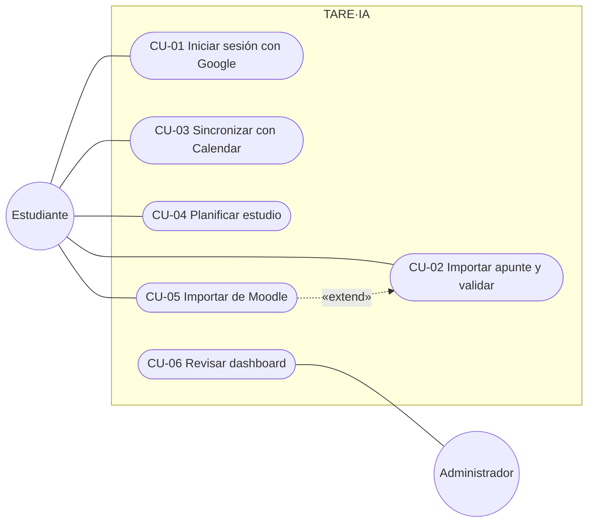

*Figura 1. Casos de uso arquitectónicamente significativos (especificación completa en FD03 §5).*

# 4. Vista lógica

## 4.1 Capas de la app Android

La app sigue una arquitectura por capas con dominio al centro (DDD). Las dependencias apuntan hacia el dominio: las
interfaces de repositorio están en `dominio/` y sus implementaciones en `infraestructura/` (inversión de dependencias).

| Paquete | Responsabilidad | Clases principales |
|---|---|---|
| `ui/` | Pantallas Compose, navegación (`Destino`), componentes y tema de marca. No accede a datos directamente. | `TareiaApp`, `ImportarScreen`, `PlanScreen`, `TareasScreen`, `CalendarioScreen`, `PerfilScreen` |
| `aplicacion/` | Casos de uso (`Gestor*`) e inyección manual de dependencias. | `Dependencias`, `GestorActividades`, `GestorIngesta`, `GestorAnalisisIA`, `GestorPlanificacion`, `GestorSincronizacion`, `GestorPapelera`, `GestorCursos`, `GestorAlertas`, `ObservadorUso` |
| `dominio/` | Entidades, objetos de valor, estados, servicios de dominio e interfaces de repositorio. Kotlin puro. | `ActividadAcademica`, `EstadoActividad` (+4 estados), `ActividadBuilder`, `PlanEstudio`, `SesionEstudio`, `Curso`, `Estudiante`, `FranjaHoraria`, `FechaLimite`, `DetectorDuplicados`, `ClasificadorContenido`, `Eliminable` |
| `ia/` | Servicios de IA intercambiables y estrategias de planificación. | `FabricaServiciosIA`, `FabricaProveedorA`, `FabricaProveedorB`, `ReconocedorOCRMLKit`, `ExtractorParametrosGemini`, `ExtractorLocal`, `PlanificacionConIA`, `PlanificacionLocalPorPrioridad` |
| `infraestructura/` | Persistencia cifrada, calendario y alarmas. | `AppDatabase`, `Local*Repository`, `GoogleCalendarAdapter`, `AlarmManagerNotificaciones` |
| `ingesta/` | Importadores por tipo de archivo (Factory Method). | `ImportadorContenido`, `ImportadorPDF`, `ImportadorImagen`, `ReceptorCompartido` |
| `remoto/` | Conexión con la nube (Facade), cliente HTTP, cola de telemetría y mapeo al JSON de la API. | `Nube`, `ApiTareia`, `ColaTelemetria`, `MapeoNube` |

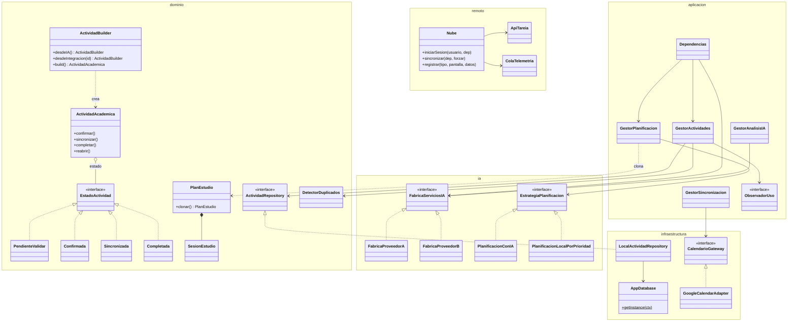

*Figura 2. Diagrama de clases de la app por capas (resumen; el diagrama completo generado desde el código está en
`docs/diagramas/clases-android.md`).*

## 4.2 Capas de la API

| Capa | Responsabilidad | Clases / módulos |
|---|---|---|
| Rutas | HTTP, esquemas JSON (validación y OpenAPI), autenticación y rol. | `routes/index.ts`, `schemas.ts`, decoradores `autenticar` y `requiereRol` en `app.ts` |
| Servicios | Casos de uso y reglas. | `AuthService`, `ActividadService`, `TelemetriaService`, `DashboardService` |
| Dominio | Funciones puras probadas con pruebas unitarias y de mutación. | `dominio/estado.ts`, `sincronizacion.ts`, `privacidad.ts`, `urgencia.ts` |
| Repositorios | SQL parametrizado, siempre filtrado por `usuario_id`. | `AcademicoRepository`, `TelemetriaRepository`, `DashboardRepository` |
| Infraestructura | *Pool* de PostgreSQL, caché, verificación de Google, errores, configuración. | `Database`, `MemoryCache`, `VerificadorFirebase`, `HttpError`/`mapPgError`, `config.ts` |

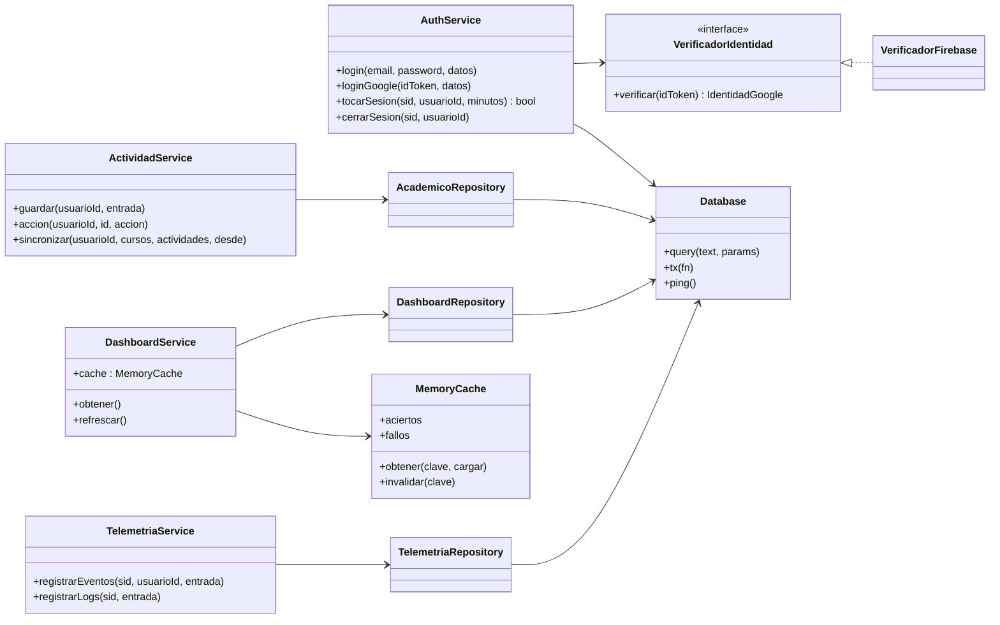

*Figura 3. Clases de la API. `Servicios` en `app.ts` actúa como contenedor de dependencias inyectadas por
constructor; `VerificadorIdentidad` se reemplaza en las pruebas por un verificador falso.*

# 5. Vista de procesos

## 5.1 Inicio de sesión con Google → JWT de la API

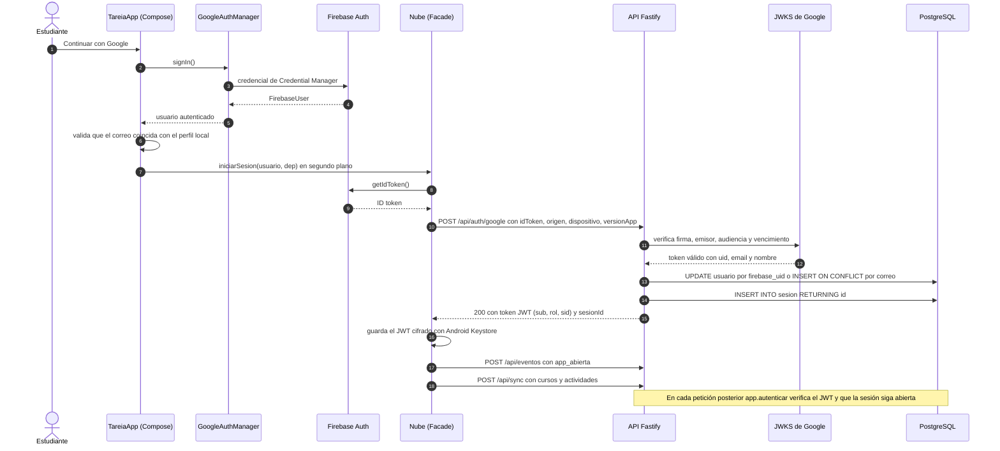

*Figura 4. Secuencia de inicio de sesión. Si la red falla, la app sigue funcionando y registra un WARN.*

## 5.2 Importar apunte → OCR → Gemini → propuestas pendientes → validar

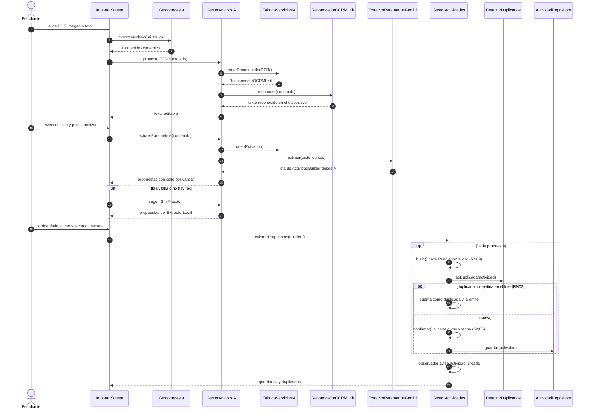

*Figura 5. Secuencia de importación con IA. Las propuestas sin fecha quedan Pendiente de validar y no pueden
enviarse a Google Calendar (RN01).*

## 5.3 Sincronización app → `/api/sync`

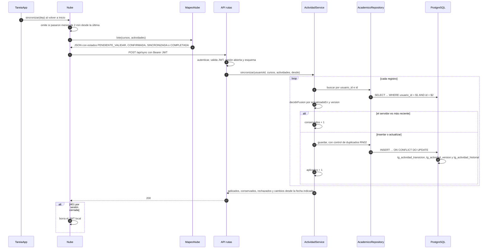

*Figura 6. Secuencia de sincronización. Un registro rechazado (por ejemplo, una transición inválida) no detiene el
lote: se devuelve en `rechazados` y la app lo registra como WARN.*

## 5.4 Telemetría en lotes

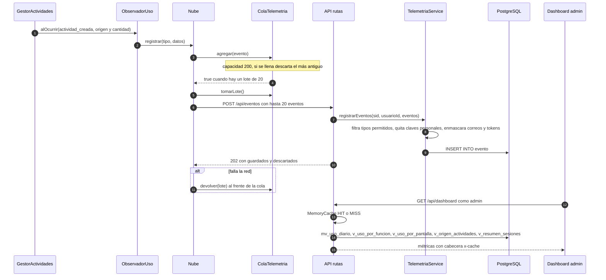

*Figura 7. Secuencia de telemetría. Los logs WARN/ERROR siguen el mismo camino con su propia cola (50 elementos,
lotes de 10) hacia `POST /api/logs`.*

## 5.5 Concurrencia

- **App:** las llamadas de red y de IA corren en corrutinas (`Dispatchers.IO`) con `SupervisorJob`, de modo que un
  fallo no cancela el resto; `AppDatabase` sincroniza lecturas y escrituras (`@Synchronized`) y la cola de telemetría
  es segura entre hilos.
- **API:** cada registro de un lote de sincronización se procesa por separado; las transiciones las valida el
  *trigger* dentro de la misma sentencia; `fn_confirmar_plan` cambia el plan vigente en una sola transacción y el
  índice único parcial `ux_plan_vigente` impide dos planes VIGENTE.

# 6. Vista de implementación (componentes)

## 6.1 Estructura del monorepo

| Carpeta | Contenido |
|---|---|
| `android/app` | App Kotlin/Compose (`src/main`, `src/test`, `src/androidTest`, variantes `debug`/`release` de App Check). |
| `android/verificacion-jvm` | Proyecto Gradle JVM que compila `dominio/` y `remoto/` sin Android para pruebas y Pitest. |
| `backend` | API Fastify (`src/`), pruebas `test/unit`, `test/integracion`, `test/sistema`; Stryker. |
| `dashboard` | React 18 + Vite (`src/`), pruebas Playwright (`e2e/`). |
| `acceptance` | Cucumber: `features/` (Gherkin en español), `steps/`, `support/`, `reports/`. |
| `db/changelog` | Liquibase: `db.changelog-master.yaml` y `sql/001` a `010`, `900`. |
| `integrations/mcp` | Servidor MCP que consume la API (reto de integración). |
| `infra/terraform` | `modules/database-neon`, `modules/app-render` (con `tests/`), `envs/prod`, `cost-reference/aws` y `azure`. |
| `scripts/` | Generadores de diccionario, diagramas Mermaid, README y portada de Pages. |
| `.github/workflows` | 10 *workflows* (sección 13). |

## 6.2 Diagrama de componentes

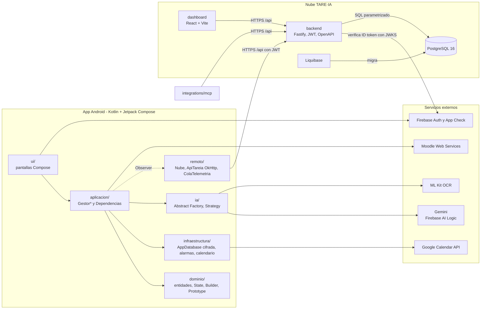

*Figura 8. Componentes (adaptado de `docs/diagramas/componentes.md`, generado desde el código).*

## 6.3 Interfaces de la API

| Grupo | Rutas (prefijo `/api`) | Acceso |
|---|---|---|
| Sistema | `GET /health`, `GET /docs` | Público |
| Autenticación | `POST /auth/login`, `POST /auth/google`, `POST /auth/logout`, `GET /perfil` | Público (login) / JWT |
| Cursos | `GET /cursos`, `PUT /cursos/:id`, `DELETE /cursos/:id` | JWT |
| Actividades | `GET /actividades`, `GET /actividades/pendientes`, `PUT /actividades/:id`, `POST /actividades/:id/estado`, `DELETE /actividades/:id`, `POST /actividades/:id/restaurar`, `GET /actividades/:id/historial` | JWT |
| Sincronización | `POST /sync` | JWT |
| Telemetría | `POST /eventos`, `POST /logs` | JWT |
| Dashboard | `GET /dashboard`, `POST /dashboard/refrescar` | JWT + rol `admin` |

# 7. Vista de despliegue

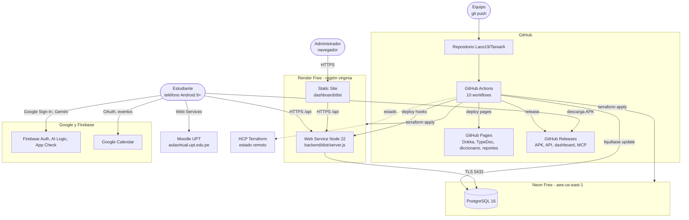

*Figura 9. Despliegue previsto, aprovisionado con Terraform.*

| Nodo | Tecnología | Configuración relevante |
|---|---|---|
| Teléfono del estudiante | Android 9+ (API 28–35) | APK firmado publicado en GitHub Releases; `BuildConfig.API_URL` apunta a la API; `usesCleartextTraffic="false"`; App Check con Play Integrity en *release*. |
| Render Web Service | Node 22, plan Free, región `virginia` | Variables `DATABASE_URL`, `JWT_SECRET` (≥ 32 caracteres), `CORS_ORIGIN`, `FIREBASE_PROJECT_ID`; se suspende sin tráfico. URL prevista: `https://tareia-api.onrender.com`. |
| Render Static Site | `dashboard/dist` | Cabecera `Cache-Control: public, max-age=31536000, immutable` para recursos. URL prevista: `https://tareia-dashboard.onrender.com`. |
| Neon | PostgreSQL 16, plan Free, `aws-us-east-1` | Conexión TLS (la clase `Database` activa SSL para hosts no locales); *pool* de 5 conexiones. |
| Firebase | Auth, AI Logic, App Check | Proyecto `tare-ia` (valor por defecto de `FIREBASE_PROJECT_ID`); la API solo necesita el id del proyecto para verificar tokens. |
| GitHub | Actions, Releases, Pages | *Secrets* en el repositorio; si faltan, los pasos de despliegue se omiten. Pages previsto en `https://laos19.github.io/TareaIA/`. |
| HCP Terraform | Estado remoto | Modo de ejecución local: `plan`/`apply` corren en GitHub Actions. |

**Costo:** USD 0/mes en las capas gratuitas; `infra/terraform/cost-reference` estima con Infracost el equivalente en AWS
y Azure solo como referencia (nunca se aplica).

# 8. Vista de datos

## 8.1 Modelo entidad-relación

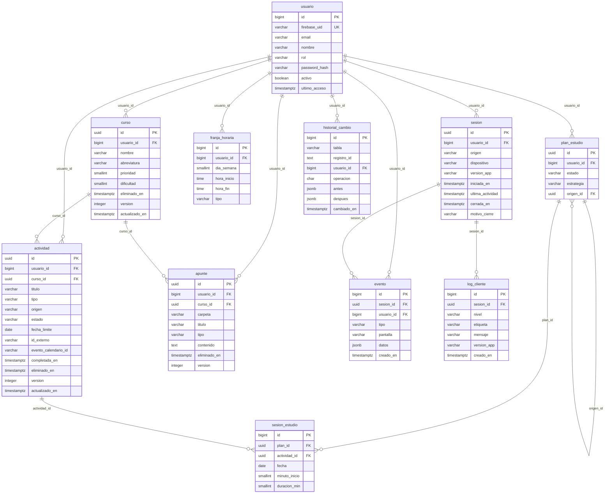

*Figura 10. Modelo entidad-relación (11 tablas; ER completo generado en `docs/diagramas/er.md`).*

## 8.2 Tablas

| Tabla | Propósito | Restricciones e índices destacados |
|---|---|---|
| `usuario` | Estudiante (Google) o administrador (contraseña). | `ux_usuario_email` único sobre `lower(email)`; `ck_usuario_email`; `ck_usuario_credencial`; `rol IN ('estudiante','admin')`. |
| `sesion` | Sesión de uso abierta en cada inicio. | `origen IN ('android','web','mcp','claude')`; `motivo_cierre IN ('logout','expirada','inactividad')`; `ck_sesion_fechas`; BRIN en `iniciada_en`. |
| `curso` | Curso del estudiante (UUID generado por la app). | `ux_curso_nombre` único parcial sobre `(usuario_id, fn_normalizar(nombre)) WHERE eliminado_en IS NULL`; prioridad y dificultad 1–5. |
| `actividad` | Actividad académica; refleja `ActividadAcademica`. | Estados y orígenes por `CHECK`; `ck_actividad_confirmable` (RN05); `ux_actividad_externa` (Moodle); `ix_actividad_pendiente` parcial. |
| `apunte` | Texto OCR o nota; sin curso = Sin clasificar. | Tipo `PDF`, `IMAGEN`, `TEXTO`; versión e historial por *trigger*. |
| `franja_horaria` | Bloque semanal del horario. | `ck_franja_orden (hora_fin > hora_inicio)`. |
| `plan_estudio` | Plan PROPUESTA, VIGENTE o REEMPLAZADO; `origen_id` apunta al plan clonado. | `ux_plan_vigente` único parcial `WHERE estado = 'VIGENTE'`. |
| `sesion_estudio` | Bloque de estudio de un plan para una actividad. | `minuto_inicio` 0–1439; `duracion_min` 15–240. |
| `historial_cambio` | Antes/después de cada cambio. | Índice `(tabla, registro_id, cambiado_en DESC)`; BRIN en `cambiado_en`. |
| `evento` | Telemetría *append-only*. | 15 tipos por `CHECK`; BRIN en `creado_en`; índice `(tipo, creado_en)`. |
| `log_cliente` | Logs WARN/ERROR de la app. | `nivel` por `CHECK`; `mensaje` ≤ 500 caracteres; BRIN en `creado_en`. |

## 8.3 Vistas, funciones y *triggers*

| Objeto | Tipo | Descripción | Usado por |
|---|---|---|---|
| `v_actividad_pendiente` | Vista | Actividades abiertas fuera de la papelera con días restantes y urgencia (mismas reglas que `Urgencia.kt`). | `GET /actividades/pendientes` |
| `mv_uso_diario` | Vista materializada | Sesiones, usuarios activos, eventos, actividades creadas y completadas por día (30 días); índice único por día para `REFRESH ... CONCURRENTLY`. | Dashboard |
| `v_uso_por_funcion` | Vista | Uso de cada tipo de evento en 30 días. | Dashboard |
| `v_uso_por_pantalla` | Vista | Pantallas más visitadas en 30 días. | Dashboard |
| `v_origen_actividades` | Vista | Actividades por origen (IA, MANUAL, INTEGRACION) y estado. | Dashboard |
| `v_resumen_sesiones` | Vista | Sesiones abiertas, de los últimos 7 días y duración media. | Dashboard |
| `fn_normalizar(text)` | Función SQL IMMUTABLE | Minúsculas, sin tildes (`unaccent`) y espacios unificados; usable en índices. | RN02, `ux_curso_nombre` |
| `fn_transicion_valida(text, text)` | Función SQL IMMUTABLE | Tabla de transiciones del patrón State. | `fn_actividad_transicion` |
| `fn_actividad_transicion()` | Función de *trigger* | Rechaza transiciones inválidas con `P0001` y fija `completada_en`. | `tg_actividad_transicion` (BEFORE UPDATE OF estado) |
| `fn_tocar_version()` | Función de *trigger* | Incrementa `version` y actualiza `actualizado_en`. | `tg_curso_version`, `tg_actividad_version`, `tg_apunte_version` |
| `fn_registrar_historial()` | Función de *trigger* | Inserta antes/después en `historial_cambio`; omite el historial cuando el usuario se borra en cascada. | `tg_curso_historial`, `tg_actividad_historial`, `tg_apunte_historial` |
| `fn_cerrar_sesiones_inactivas(int)` | Función PL/pgSQL | Cierra sesiones sin actividad en N minutos; devuelve cuántas. | `POST /dashboard/refrescar` |
| `fn_confirmar_plan(uuid, bigint)` | Función PL/pgSQL | Marca un plan VIGENTE y el anterior REEMPLAZADO en una transacción. | Preparada para el respaldo de planes (aún sin ruta en la API). |

Los errores de PostgreSQL se traducen en la API (`mapPgError`): `P0001` → 409 con el mensaje de la regla, `P0002` →
404, `23505` → 409, `23503`/`23514`/`22P02` → 400.

## 8.4 Migraciones

Orden del *changelog* maestro: extensiones (`001`) → seguridad y sesiones (`002`) → modelo académico (`003`) →
planificación (`004`) → historial (`005`) → telemetría (`006`) → funciones (`007`) → *triggers* (`008`) → vistas
(`009`) → índices (`010`) → datos demo (`900`, `context:demo`: cuentas demo, cursos y telemetría sintética de 30 días).

# 9. Patrones de diseño aplicados

| Patrón | Tipo | Problema que resuelve | Dónde está (clase) |
|---|---|---|---|
| **State** | Comportamiento | Lo que se puede hacer con una actividad depende de su estado (RN01, RN05, RN09) y no se quieren `if` repartidos por la app. | Contexto `ActividadAcademica`; estado `EstadoActividad` con `PendienteValidar`, `Confirmada`, `Sincronizada`, `Completada` (`dominio/EstadoActividad.kt`). Réplica en `backend/src/dominio/estado.ts` y en `fn_transicion_valida` + `tg_actividad_transicion`. |
| **Builder** | Creacional | La IA puede no encontrar todos los datos; la actividad se arma por pasos, se revisa y solo al final se valida y se fija el estado inicial (manual con fecha → Confirmada; IA o Moodle → Pendiente de validar). | `ActividadBuilder` (`conTitulo`, `conFechaLimite`, `desdeIA`, `desdeIntegracion`, `build`); `ExtractorParametros` devuelve *builders*, no actividades. |
| **Prototype** | Creacional | Una replanificación no debe tocar el plan vigente hasta que el estudiante confirme. | `PlanEstudio.clonar()` y `SesionEstudio.clonar()` (copia profunda); cliente `GestorPlanificacion.reorganizar`/`confirmarPlan`; en BD `plan_estudio.origen_id`, `ux_plan_vigente`, `fn_confirmar_plan`. |
| **Strategy** | Comportamiento | Planificar con IA o localmente, cambiando en ejecución y con respaldo si la IA falla. | `EstrategiaPlanificacion` con `PlanificacionConIA` y `PlanificacionLocalPorPrioridad`; `GestorPlanificacion.setEstrategia`; el cambio a local ante fallo está en `TareiaApp.proponerPlan`. |
| **Abstract Factory** | Creacional | OCR, extractor y generador de plan deben venir del mismo proveedor; cambiar de proveedor no debe afectar a los gestores. | `FabricaServiciosIA` (selección en `seleccionar`), `FabricaProveedorA` (Gemini vía Firebase AI Logic + ML Kit), `FabricaProveedorB` (API compatible con OpenAI + ML Kit); productos `ReconocedorOCR`, `ExtractorParametros`, `GeneradorPlanIA`. |
| **Repository** | Arquitectura (DDD) | El dominio guarda y busca objetos como una colección sin conocer la persistencia. | Interfaces `ActividadRepository`, `CursoRepository`, `ContenidoRepository`, `PlanRepository`, `EstudianteRepository` (`dominio/Repositorios.kt`); implementaciones `Local*Repository` (`infraestructura/RepositoriosLocales.kt`). En la API: `AcademicoRepository`, `TelemetriaRepository`, `DashboardRepository`. |
| **Singleton** | Creacional | Una sola instancia de la base local cifrada para evitar escrituras concurrentes inconsistentes. | `AppDatabase.getInstance` (constructor privado, `@Volatile` y doble verificación con `synchronized`). `Nube` es un `object` de Kotlin. |
| **Observer** | Comportamiento | La capa de aplicación debe avisar del uso sin depender de la red ni de la API (y poder probarse con un observador falso). | Sujeto `GestorActividades` (propiedad `observador`); observador `ObservadorUso` (`fun interface`); el observador concreto se conecta en `Dependencias` y llama a `Nube.registrar`. |
| **Facade** | Estructural | Sesión, sincronización, telemetría y logs implican JWT cifrado, colas, OkHttp y reintentos; la UI necesita una interfaz simple. | `remoto/Nube` (`iniciarSesion`, `sincronizar`, `registrar`, `advertir`, `error`, `cerrarSesion`) sobre `ApiTareia`, `ColaTelemetria`, `MapeoNube` y `SecureTokenStore`. |

Patrones complementarios presentes en el código: **Adapter** (`GoogleCalendarAdapter` adapta `GoogleCalendarApi` a la
interfaz `CalendarioGateway`), **Factory Method** (`ImportadorContenido` con `ImportadorPDF`, `ImportadorImagen`,
`ReceptorCompartido`, cliente `GestorIngesta`) e **inyección de dependencias manual** (`Dependencias` en la app,
`Servicios` en `app.ts`).

# 10. Atributos de calidad y tácticas

| Atributo | Tácticas arquitectónicas | Evidencia |
|---|---|---|
| Seguridad | Defensa en profundidad (sección 12): identidad delegada, JWT con sesión, autorización por usuario en cada SQL, validación de esquemas, *rate limit*, cifrado local. | Integración, sistema, Semgrep, Snyk, SonarQube |
| Privacidad | Minimización y saneamiento en el servidor (`sanitizar`, `enmascarar`); cifrado AES-GCM con Keystore; la IA recibe solo texto elegido por el estudiante. | `privacidad.test.ts`, `hu05` |
| Disponibilidad | *Offline-first*; colas con reintento; *health check*; *smoke test* tras desplegar; reversión de estado si falla Google Calendar. | `ColaTelemetriaTest`, `release.yml` |
| Rendimiento | Trabajo de red en segundo plano con tiempos de espera; caché TTL + vista materializada; índices BRIN, parciales y de expresión; caché HTTP de OkHttp; recursos inmutables en CDN. | `cache.test.ts`, integración `x-cache` |
| Integridad | Reglas en tres capas; *trigger* de transición; restricciones `CHECK`; fusión por versión. | Integración «el *trigger* de la BD bloquea…» |
| Modificabilidad | Abstract Factory y Strategy para la IA; Repository; capas; un mismo contrato JSON Schema para validación y OpenAPI. | `PatronesTest` |
| Usabilidad y accesibilidad | Tokens de marca con contraste AA probado; áreas táctiles de 48 dp; semántica TalkBack; vista de tabla y teclado en el dashboard. | `ContrasteTest`, `ComponentesTest`, Playwright |
| Verificabilidad | Lógica pura separada de Android (`verificacion-jvm`); dependencias inyectables (verificador de Google, reloj de la caché y de la telemetría). | Pirámide de pruebas (sección 11) |
| Costo | Capas gratuitas; *pool* reducido; una sola instancia. | Reporte de costos de `infra.yml` |

# 11. Estrategia de pruebas y de calidad estática

## 11.1 Pirámide de pruebas

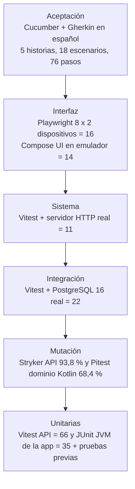

*Figura 11. Pirámide de pruebas con los resultados verificados localmente.*

| Nivel | Herramienta | Qué verifica | Dónde | Resultado | *Workflow* |
|---|---|---|---|---|---|
| Unitarias API | Vitest (+ cobertura lcov) | Máquina de estados, fusión, duplicados, privacidad, telemetría, caché, urgencia, `ActividadService` con repositorio falso. | `backend/test/unit` | 66 en verde | `ci.yml`, `infra.yml` |
| Unitarias app | JUnit en la JVM | Dominio (State, Builder, Prototype, objetos de valor, duplicados, clasificación, papelera), `MapeoNube`, `ColaTelemetria`, `ObservadorUso`; además `PatronesTest`, `UrgenciaTest`, `TiempoTest`, `ContrasteTest`, `GoogleCalendarIdTest`. | `android/app/src/test` | 35 del dominio y capa remota en verde | `android.yml`, `mutacion.yml` |
| Mutación | Stryker (API), Pitest (`dominio` y `remoto` de la app) | Que las pruebas detecten cambios en el código. | `backend/stryker.config.json`, `android/verificacion-jvm` | 93,8 % (umbral 60 %) y 68,4 % (umbral 50 %) | `mutacion.yml` |
| Integración | Vitest + `app.inject` contra PostgreSQL 16 migrado con Liquibase | Rutas, SQL, *triggers*, historial, papelera, sincronización, telemetría, caché, sesiones. | `backend/test/integracion/api.test.ts` | 22 en verde | `ci.yml`, `infra.yml` |
| Sistema | Vitest + servidor HTTP real | Flujo completo estudiante y administrador; CORS, helmet, *rate limit*, Swagger, 404 JSON. | `backend/test/sistema/flujo-completo.test.ts` | 11 en verde | `ci.yml`, `infra.yml` |
| Interfaz web | Playwright (Desktop Chrome y Pixel 7) | Login, control de rol, gráficos, *tooltip* por teclado, vista de tabla, sesión, sin desplazamiento horizontal. | `dashboard/e2e/dashboard.spec.ts` | 16 en verde | `infra.yml` |
| Interfaz app | Compose UI Test, emulador API 34 | Campos de fecha y curso, sello IA, semántica TalkBack, áreas táctiles, flujo de descarte en Importar. | `android/app/src/androidTest` | 14 pruebas | `android.yml` |
| Aceptación | Cucumber (Gherkin en español) contra la API | HU-01 a HU-05. | `acceptance/features` | 18 escenarios / 76 pasos en verde | `infra.yml` |

Las pruebas encontraron y permitieron corregir **3 defectos reales**: el historial al borrar un usuario en cascada,
el cambio de correo con el mismo UID de Google (y la normalización a minúsculas) y la unificación de espacios en la
detección de duplicados en PostgreSQL.

## 11.2 Calidad estática

| Herramienta | Alcance configurado | Salida | *Workflow* |
|---|---|---|---|
| SonarQube Cloud | `backend/src`, `dashboard/src`, `android/app/src/main/java`, `integrations/mcp/src`, `db/changelog`, `infra/terraform`; cobertura lcov de la API (`sonar-project.properties`). | Bugs, vulnerabilidades, *security hotspots* y *quality gate* en el resumen del *workflow* y como artefacto `reporte-sonarqube`. Requiere el *secret* `SONAR_TOKEN`. | `sonarqube.yml` |
| Semgrep | Reglas `p/default`, `p/kotlin`, `p/typescript`, `p/react`, `p/nodejs`, `p/secrets`, `p/terraform`, `p/sql-injection`. | SARIF a GitHub Code Scanning, reporte `reporte-semgrep`; falla si hay hallazgos de severidad ERROR. Semanal y en cada *push*/PR. | `semgrep.yml` |
| Snyk | Open Source (dependencias npm y Gradle de la app), Snyk Code (SAST) e IaC (Terraform). | Reporte `reporte-snyk`. Requiere el *secret* `SNYK_TOKEN`; semanal y en cada *push*/PR. | `snyk.yml` |
| Checkov y tflint | Terraform. | Reporte de calidad IaC (Checkov informativo). | `infra.yml` |
| Android Lint, `tsc`, actionlint, `terraform fmt` | App, TypeScript, *workflows* e IaC. | Resumen en cada ejecución. | `android.yml`, `ci.yml` |

Estas automatizaciones generan sus reportes al ejecutarse en GitHub Actions; los resultados de SonarQube y Snyk
dependen de que los *secrets* correspondientes estén configurados en el repositorio.

# 12. Seguridad

| Riesgo (OWASP Top 10) | Control | Implementación |
|---|---|---|
| A01 Control de acceso roto | **Autorización por usuario en cada consulta SQL**: todas las lecturas y escrituras de `AcademicoRepository` filtran por `usuario_id` tomado del JWT (`WHERE usuario_id = $1 AND id = $2`); un recurso ajeno responde 404. Rol `admin` para el dashboard (`requiereRol`). | `repositories/*.ts`, `app.ts`; integración «404 para recursos de otro usuario» |
| A02 Fallas criptográficas | TLS en tránsito (Render, Neon, Google); solo HTTPS en la app; AES-GCM con clave no exportable de Android Keystore para la base local, el JWT y el *token* de Moodle; bcrypt para administración. | `SecureTokenStore`, `Database` (SSL automático), `AuthService` |
| A03 Inyección | **Consultas parametrizadas** (`$1…`) en todos los repositorios; validación JSON Schema con Ajv (`removeAdditional`, tipos y formatos UUID/fecha); `CHECK` en la BD. Semgrep `p/sql-injection`. | `schemas.ts`, `Database.query` |
| A04 Diseño inseguro | Reglas críticas (RN01, RN05, RN09) también en la BD; la IA solo propone; los eventos de Calendar llevan una huella del dueño y no se sobrescriben eventos de otra cuenta. | `tg_actividad_transicion`, `GestorSincronizacion`, `GoogleCalendarApi` |
| A05 Configuración insegura | **Helmet**; **CORS** restringido a `CORS_ORIGIN` (lista separada por comas); configuración validada con zod al iniciar (*fail fast*); errores 500 sin detalles. | `app.ts`, `config.ts`, `errors.ts` |
| A06 Componentes vulnerables | Snyk Open Source (npm y Gradle) y SonarQube. | `snyk.yml`, `sonarqube.yml` |
| A07 Fallas de identificación y autenticación | **Autenticación** con ID token de Firebase verificado por firma JWKS, emisor y audiencia; JWT con `sid` comprobado contra `sesion` en cada petición; cierre por logout y por 30 min de inactividad; **rate limiting** de 300/min global, 10/min en login, 20/min en login con Google, 60/min en eventos y 30/min en logs. | `VerificadorFirebase`, `AuthService.tocarSesion`, `@fastify/rate-limit` |
| A08 Integridad de software y datos | **Firebase App Check** (Play Integrity en *release*) para los servicios de Firebase; *releases* construidos en GitHub Actions; migraciones versionadas. | `AppCheckInitializer` (variantes debug y release), `release.yml` |
| A09 Registro y monitoreo | Logs JSON (pino) con `authorization`, `password` e `idToken` ocultos; logs de la app enmascarados; historial antes/después; `/api/health`. | `app.ts`, `TelemetriaService`, `fn_registrar_historial` |
| A10 SSRF | La API no hace peticiones a URL elegidas por el cliente (solo al JWKS fijo de Google). | `VerificadorGoogle.ts` |

**Secretos fuera del repositorio:** `JWT_SECRET`, `DATABASE_URL`, *tokens* de Render, Neon, HCP Terraform, SonarQube y
Snyk viven en GitHub Secrets y en las variables de Render; las claves de IA del proveedor B y el *token* de Moodle los
ingresa el estudiante y se guardan cifrados en el dispositivo. Semgrep `p/secrets` revisa que no se filtren.

# 13. Integración y entrega continuas (CI/CD)

| *Workflow* | Disparador | Trabajos principales |
|---|---|---|
| `ci.yml` — CI | PR y *push* a ramas distintas de `main` | Typecheck de API y dashboard, actionlint, `terraform fmt -check`; BD efímera migrada con Liquibase; pruebas unitarias (con cobertura), de integración y de sistema de la API; unitarias del dashboard; reporte `reporte-ci-pruebas`. |
| `android.yml` — Android | *Push*, PR, manual | `assembleDebug`, pruebas JVM, Android Lint; pruebas Compose en emulador API 34 (`connectedDebugAndroidTest`); APK y reportes como artefactos. |
| `mutacion.yml` — Mutación | *Push* a `main`, PR, manual | Stryker (API) y Pitest (dominio Kotlin) con reporte. |
| `sonarqube.yml` | *Push* a `main`, PR, manual | Cobertura lcov, SonarQube Scan, reporte de bugs, vulnerabilidades y *hotspots*. |
| `semgrep.yml` | *Push* a `main`, PR, manual, lunes 06:17 UTC | Escaneo, SARIF a Code Scanning, reporte. |
| `snyk.yml` | *Push* a `main`, PR, manual, lunes 06:41 UTC | Snyk Open Source (npm y Gradle), Snyk Code, Snyk IaC. |
| `infra.yml` — Infraestructura | *Push* y PR a `main`, manual | Terraform fmt, validate, tflint, `terraform test` con proveedores simulados, Checkov; todas las pruebas (unitarias, integración, sistema, Playwright y Cucumber) con reporte de pruebas superadas; reporte de costos (Infracost); `plan`/`apply` de producción. |
| `release.yml` — Release y despliegue | *Push* a `main`, etiquetas `v*`, manual | release-please (versión semántica y CHANGELOG); build de APK (apuntando a la API de producción), API, dashboard y paquete MCP publicados en GitHub Releases; Liquibase en producción; *deploy hooks* de Render (API y dashboard); *smoke test* `GET /api/health`. |
| `docs.yml` — Documentación | *Push* a `main`, manual | BD efímera, tbls (ER y diccionario), diccionario Markdown, diagramas Mermaid y README regenerados y confirmados en el repositorio. |
| `pages.yml` — GitHub Pages | *Push* a `main`, manual, al terminar `infra.yml` | TypeDoc (API), Dokka (Kotlin), diccionario, diagramas, reportes de la última ejecución de cada *workflow*, presentación y PDF; publicación en Pages. |

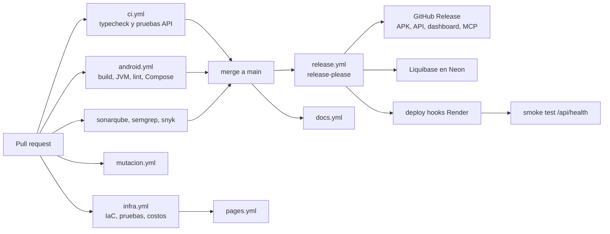

*Figura 12. Flujo de CI/CD. Si faltan los secrets de despliegue, esos pasos se omiten y el resto del flujo continúa.*

# Conclusiones

1. La arquitectura *offline-first* con base local cifrada y nube de respaldo permite que el estudiante trabaje sin
   conexión y, a la vez, que el equipo mida el uso real con telemetría sin datos personales.
2. La regla central del producto —la IA solo propone y el estudiante valida— se aplica en tres capas (patrón State
   en Kotlin, máquina de estados en la API y *trigger* en PostgreSQL), lo que la hace resistente a clientes
   defectuosos o maliciosos.
3. Los nueve patrones solicitados resuelven problemas concretos del dominio (validación, replanificación,
   proveedores de IA, persistencia y telemetría) y están cubiertos por pruebas unitarias y de mutación.
4. La pirámide de pruebas, el análisis estático y los *workflows* de despliegue e infraestructura hacen que cada
   cambio sea verificable y reproducible con costo USD 0.

# Recomendaciones

1. Completar el respaldo en la nube de apuntes, franjas y planes usando las tablas y `fn_confirmar_plan` ya creadas,
   y añadir una restricción de exclusión en `franja_horaria` para RN16.
2. Emitir desde la app los eventos que el catálogo ya admite (`importacion_ia`, `plan_generado`,
   `calendario_sincronizado`, `reporte_pdf`) para que el dashboard mida la adopción de la IA.
3. Ejecutar una prueba de carga sobre la API para fijar con datos la métrica de rendimiento.
4. Evaluar Room con SQLCipher si el volumen local crece, ya que `AppDatabase` reescribe tablas completas.
5. Mantener alineadas las tres copias de la tabla de transiciones con una prueba que compare la de la API con la de
   la BD.

# Bibliografía

Bass, L., Clements, P., & Kazman, R. (2021). *Software architecture in practice* (4.ª ed.). Addison-Wesley.

Gamma, E., Helm, R., Johnson, R., & Vlissides, J. (1994). *Design patterns: Elements of reusable object-oriented software*. Addison-Wesley.

Evans, E. (2003). *Domain-driven design: Tackling complexity in the heart of software*. Addison-Wesley.

ISO/IEC/IEEE. (2022). *ISO/IEC/IEEE 42010:2022 Software, systems and enterprise — Architecture description*. https://www.iso.org/standard/74393.html

Kruchten, P. (1995). Architectural blueprints—The "4+1" view model of software architecture. *IEEE Software, 12*(6), 42–50. https://doi.org/10.1109/52.469759

# Webgrafía

Android Developers. (s. f.). *Guide to app architecture*. https://developer.android.com/topic/architecture

Fastify. (s. f.). *Fastify documentation*. https://fastify.dev/docs/latest/

Firebase. (s. f.). *Firebase App Check*. https://firebase.google.com/docs/app-check

Liquibase. (s. f.). *Liquibase formatted SQL*. https://docs.liquibase.com/concepts/changelogs/sql-format.html

Neon. (2026). *Free plan limits and quotas*. https://neon.com/faqs/free-plan-limits-and-quotas

Nygard, M. (2011). *Documenting architecture decisions*. https://cognitect.com/blog/2011/11/15/documenting-architecture-decisions

OWASP Foundation. (2025). *OWASP Top Ten web application security risks*. https://owasp.org/www-project-top-ten/

Render. (s. f.). *Deploy for free*. https://render.com/docs/free

Semgrep. (s. f.). *Semgrep documentation*. https://semgrep.dev/docs/

Snyk. (s. f.). *Snyk CLI documentation*. https://docs.snyk.io/snyk-cli

SonarSource. (s. f.). *SonarQube Cloud documentation*. https://docs.sonarsource.com/sonarqube-cloud/
