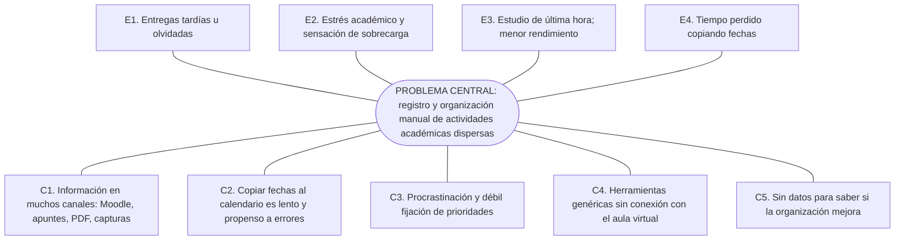

# Problema y objetivos — TARE·IA

> **Proyecto:** TARE·IA · **Curso:** SI-784 Calidad y Pruebas de Software · **Docente:** Ing. Patrick Cuadros Quiroga
> **Integrantes:** Adriana Rafaela Laos González (2023077474) · Antony Piero Solorzano Zegarra (2023078696) · **UPT – FAING – EPIS** · Tacna, semestre 2026-II
> **Versión:** 1.0 (2026-11-21)

# Control de versiones

| Versión | Hecha por | Revisada por | Aprobada por | Fecha | Motivo |
|---|---|---|---|---|---|
| 1.0 | Adriana Laos y Antony Solorzano | Ing. Patrick Cuadros Quiroga (pendiente) | (pendiente) | 2026-11-21 | Versión inicial para la Unidad II de SI-784 |

---

## Nota de verificación de fuentes (leer primero)

Regla del proyecto: **ninguna cifra sin fuente**. Cada dato lleva cita APA 7 y URL. Al preparar este
documento, el entorno de trabajo **no permitió abrir directamente** las páginas de las revistas ni de las
entidades oficiales. Por eso, las cifras se contrastaron con los **fragmentos indexados por el buscador**
de la propia fuente (resumen del artículo, nota de prensa oficial) o de prensa que cita a la fuente oficial
(consulta: 21 de noviembre de 2026). Antes de la entrega final, el equipo debe abrir cada URL y confirmar
la cifra.

| Símbolo | Significado |
|---|---|
| ✔ | Confirmado en el resumen o la nota de la fuente primaria (artículo revisado por pares o entidad oficial) |
| ◐ | Confirmado solo en fuente secundaria (prensa que cita a la fuente oficial, o cita dentro de otro artículo) |
| ✖ | **No verificado**: no se usa como dato; queda como tarea de investigación |

---

## 1. Título final del proyecto

| # | Propuesta | Ventajas | Desventajas |
|---|---|---|---|
| A | **TARE·IA: asistente académico Android que convierte apuntes, documentos y tareas del aula virtual en actividades con fecha, planes de estudio y recordatorios mediante inteligencia artificial** | Dice *qué* es (asistente Android), *qué entra* (apuntes, PDF, capturas, Moodle), *qué sale* (actividades, planes, recordatorios) y *cómo* (IA). | Es largo para una portada. |
| B | TARE·IA: tareas académicas con reconocimiento y ejecución mediante IA | Conserva el título del proyecto original (curso Soluciones Móviles I). | No dice para quién es ni menciona Moodle ni el calendario. |
| C | TARE·IA: de la foto del apunte al calendario — organización académica con IA para universitarios | Atractivo y fácil de recordar. | Menos formal; no menciona el aula virtual. |

**Recomendación: opción A.** Forma corta para encabezados: **TARE·IA** (con punto medio). Nombre del
paquete Android: `com.tareia.app`.

---

## 2. Problema

### 2.1 Contexto

1. **La procrastinación académica es frecuente.** Steel (2007), en un metaanálisis publicado en
   *Psychological Bulletin*, recoge estimaciones según las cuales entre el **80 % y el 95 %** de los
   estudiantes universitarios procrastina (cifra que el autor atribuye a estudios previos de Ellis y Knaus,
   1977, y O'Brien, 2002) ◐. En el Perú, Dominguez-Lara (2017) estudió la prevalencia en **517 estudiantes**
   de Psicología de dos universidades privadas de Lima Metropolitana ✔; trabajos que lo citan reportan una
   prevalencia de **14,1 %** en esa muestra ◐ (el valor depende del instrumento y del punto de corte, por eso
   no se compara con el rango internacional).
2. **La procrastinación se asocia con menor rendimiento.** El metaanálisis de Kim y Seo (2015), con
   **33 estudios y 38 529 participantes**, encontró una correlación **negativa** entre procrastinación y
   rendimiento académico ✔.
3. **La gestión del tiempo se asocia con mejor rendimiento y bienestar.** Britton y Tesser (1991) mostraron,
   con **90 universitarios**, que las prácticas de gestión del tiempo predecían el promedio acumulado
   (R² = 0,21) mejor que el puntaje SAT ✔. El metaanálisis de Aeon, Faber y Panaccio (2021) halló una
   asociación **moderada** de la gestión del tiempo con el logro académico y el bienestar, y una asociación
   negativa con el malestar ✔; según la nota de prensa de la universidad, reunió **158 estudios** con más de
   **53 000** participantes ◐.
4. **Lo que más ayuda es fijar metas y prioridades, no acumular herramientas.** En **494 universitarios**
   colombianos de primer año, la fijación de metas y prioridades y la percepción de control del tiempo
   predijeron el nivel de procrastinación; el uso de herramientas de gestión del tiempo, por sí solo, **no**
   lo predijo (Garzón Umerenkova & Gil Flores, 2017) ✔. Esto orienta el diseño: TARE·IA no es "otra agenda",
   sino un asistente que **reduce el trabajo de registrar** y **ordena por urgencia y prioridad**.
5. **Estrés académico en universitarios peruanos.** Estrada Araoz et al. (2021) aplicaron el inventario
   SISCO a **172 estudiantes** de Educación de una universidad peruana y encontraron **niveles altos de
   estrés académico**, asociados con el sexo, la edad y el año de estudios ✔. Ese estudio y la revisión de
   la literatura peruana señalan la **sobrecarga de tareas** y el poco tiempo para realizarlas entre los
   estresores principales ◐. Cassaretto, Vilela y Gamarra (2021) analizaron la relación entre estrés
   académico, conductas de salud y variables académicas en universitarios peruanos ✔ (su cifra de
   prevalencia no se pudo leer en los fragmentos: ✖).
6. **Interrupción de estudios.** Según el Minedu (sistema SIRIES), la tasa de interrupción de estudios
   universitarios fue de **18,3 %** en 2020-1, **16,2 %** en 2020-2 y **11,5 %** en 2021-1; en ese ciclo
   Tacna tuvo **7,9 %** (El Peruano, 2021) ◐. El Minedu define la tasa como la proporción de estudiantes
   matriculados en un semestre que no están matriculados ni egresados en el siguiente (Ministerio de
   Educación, 2021) ◐. La interrupción tiene muchas causas (la principal reportada es económica); TARE·IA
   **no pretende resolverla**, solo atacar una causa académica controlable: la desorganización de entregas.
7. **El celular es el canal natural.** En el tercer trimestre de 2024, el **80,2 %** de la población
   peruana de 6 años a más usó internet, y entre quienes tienen educación superior universitaria la cifra
   llegó a **98,4 %**; el **90 %** de los usuarios de internet accedió mediante un celular (Instituto
   Nacional de Estadística e Informática [INEI], 2024b; Andina, 2024) ✔. En el primer trimestre de 2024, la
   proporción fue de **91,3 %** (INEI, 2024a) ✔. Esto justifica una **aplicación móvil nativa Android**.
8. **Las tareas llegan por muchos canales.** El aula virtual de la UPT es Moodle (las tareas están en
   `aulavirtual.upt.edu.pe/mod/assign/view.php`). Moodle envía avisos por web, correo o aplicación móvil
   según la configuración de cada usuario (Moodle, s. f.) ✔, pero a ese canal se suman apuntes en papel,
   PDF de sílabos, capturas de WhatsApp y anuncios en clase. El estudiante debe **copiar a mano** cada fecha
   a su calendario. No se encontró un estudio que cuantifique esta sobrecarga en plataformas LMS (✖).

**Datos no verificados (no se usan como cifra):**

- ✖ **% de estudiantes de la EPIS-UPT que usan un calendario o recordatorios** para sus entregas. No se
  encontró un dato publicado → **objetivo de investigación OI-1** (encuesta de línea base).
- ✖ **Tiempo que tarda un estudiante en registrar a mano una tarea** en su calendario. → **OI-2** (prueba
  cronometrada).
- ✖ **Cantidad de entregas tardías u olvidadas** por estudiante y semestre en la UPT. No hay dato público.
- ✖ **Sobrecarga de notificaciones en Moodle** (número de avisos por semana y su efecto en el estudiante).
- ✖ Prevalencia de estrés académico de Cassaretto et al. (2021) y porcentaje de nivel "moderado" de
  Estrada Araoz et al. (2021): deben leerse en el texto completo antes de citarse.
- ✖ Datos bibliográficos menores por confirmar al abrir la fuente: iniciales de los coautores de
  Estrada Araoz et al. (2021) y de Cassaretto et al. (2021), y subtítulo exacto de Dominguez-Lara (2017).

### 2.2 Evidencia sobre la solución propuesta

| Evidencia | Hallazgo | Estado | Cómo la usa TARE·IA |
|---|---|---|---|
| Britton y Tesser (1991) | La planificación de corto plazo predice el promedio mejor que el SAT. | ✔ | Plan de estudio por sesiones (RF-07) y vista "esta semana". |
| Aeon et al. (2021), metaanálisis | Gestión del tiempo ↔ logro académico y bienestar (moderado). | ✔ | Objetivo de completar actividades **antes** de su fecha (OS-3). |
| Garzón Umerenkova y Gil Flores (2017) | Metas, prioridades y control percibido del tiempo predicen menos procrastinación; las herramientas solas no. | ✔ | Priorización por urgencia y por curso (RF-18); bajo esfuerzo de registro (OS-2). |
| Kim y Seo (2015), metaanálisis | Procrastinación ↔ menor rendimiento. | ✔ | Recordatorios y alertas tempranas (RF-09). |
| Estrada Araoz et al. (2021) | Estrés académico alto; la sobrecarga de tareas es un estresor central. | ✔ / ◐ | Ver todo en un solo lugar, ordenado por urgencia. |

**Lectura crítica:** la evidencia apoya la gestión del tiempo, pero muestra que **tener una herramienta no
basta**. Por eso TARE·IA (a) reduce la fricción de registrar (la IA y Moodle proponen la actividad), (b)
exige que el estudiante **valide** lo que propone la IA (RN09) y (c) mide si las actividades se completan a
tiempo. El efecto en el rendimiento académico **no** se medirá en este proyecto (requiere un estudio
longitudinal); se miden indicadores de uso y de puntualidad.

### 2.3 Árbol de problemas

**Problema central:** los estudiantes universitarios de la EPIS-UPT **registran y organizan a mano**
actividades académicas que llegan dispersas (aula virtual Moodle, apuntes, PDF, capturas), lo que provoca
olvidos, entregas tardías y estrés.

| Causas | Efectos |
|---|---|
| C1. La información llega por muchos canales: tareas de Moodle, sílabos en PDF, apuntes en papel, capturas de mensajería (observación del equipo; magnitud ✖ → OI-1). | E1. Entregas tardías u olvidadas (magnitud en la UPT ✖ → OI-1). |
| C2. Copiar cada fecha al calendario es lento y propenso a errores de transcripción (tiempo ✖ → OI-2). | E2. Estrés académico; la sobrecarga de tareas es un estresor central (Estrada Araoz et al., 2021). |
| C3. Procrastinación frecuente (Steel, 2007) y débil fijación de metas y prioridades (Garzón Umerenkova & Gil Flores, 2017). | E3. Estudio de última hora; la procrastinación se asocia con menor rendimiento (Kim & Seo, 2015). |
| C4. Las agendas genéricas no leen el aula virtual ni entienden un apunte; el estudiante hace todo el trabajo. | E4. Horas perdidas en tareas administrativas en lugar de estudiar. |
| C5. El estudiante no tiene datos de su propia organización (qué completó a tiempo, qué se le venció). | E5. No puede corregir sus hábitos; la universidad no puede medir el efecto de una herramienta. |

### 2.4 A quién afecta

| Actor | Cómo le afecta |
|---|---|
| Estudiantes de pregrado de la EPIS-UPT (usuarios principales) | Pierden tiempo copiando fechas, olvidan entregas y estudian a última hora. |
| Docentes de la EPIS | Reciben entregas tardías y más consultas sobre fechas ya publicadas en Moodle. |
| Escuela Profesional / UPT | Interesa reducir el bajo rendimiento y la interrupción de estudios. |
| Equipo de desarrollo y docente de SI-784 | Necesitan un producto con calidad medible (pruebas, análisis estático, telemetría). |

---

## 3. Objetivos

> "S1…S16" = semana del cronograma del proyecto (16 semanas, semestre 2026-II). Las fechas exactas se
> fijan con el docente.

### 3.1 Objetivo general

Desarrollar, probar y documentar en 16 semanas **TARE·IA**, un asistente académico Android con API en la
nube y dashboard de utilización, que convierta apuntes, PDF, capturas y tareas del aula virtual Moodle en
actividades con fecha, planes de estudio y recordatorios mediante IA (Gemini) y Google Calendar, logrando
que al menos el **50 %** de las actividades registradas lleguen por IA o Moodle y que al menos el **80 %**
de las actividades completadas se cierren antes de su fecha límite, con una calidad verificada por
pruebas automatizadas (puntaje de mutación ≥ 60 %) y análisis estático sin bugs ni vulnerabilidades
críticas.

### 3.2 Objetivos de investigación (SMART)

| ID | Objetivo | Indicador | Línea base | Meta | Método / instrumento | Plazo |
|---|---|---|---|---|---|---|
| OI-1 | Diagnosticar cómo registran hoy sus actividades los estudiantes de la EPIS-UPT. | % que usa calendario o recordatorios; n.º de canales por los que recibe tareas; entregas olvidadas en el último ciclo (autorreporte) | No publicada (✖) | Encuesta respondida por n ≥ 30 estudiantes, con resultados tabulados | Encuesta en línea anónima (sin datos personales), aplicada antes del piloto | S4 |
| OI-2 | Comparar el tiempo de registrar una tarea a mano frente a TARE·IA. | Mediana de segundos por tarea registrada | Se mide en S4 (registro manual en Google Calendar) | Reducción ≥ 50 % frente al registro manual | Prueba de tarea cronometrada (n ≥ 10, 5 tareas cada uno) + marcas de tiempo de los eventos `importacion_iniciada` y `actividad_confirmada` | S12 |
| OI-3 | Evaluar la usabilidad percibida de la app. | Puntaje SUS promedio (0–100) | Sin línea base (sistema nuevo) | SUS ≥ 70 | Cuestionario SUS de 10 ítems al final del piloto | S14 |
| OI-4 | Explorar si el uso frecuente se asocia con más actividades completadas a tiempo. | Correlación entre sesiones semanales por usuario y % de actividades completadas antes de su fecha | Sin línea base | Análisis reportado con n ≥ 20 usuarios del piloto (sin afirmar causalidad) | Consulta SQL sobre `sesion` y `actividad` (datos seudonimizados) | S15 |

### 3.3 Objetivos de la solución (SMART)

Todos los indicadores se calculan con datos que la app **ya registra**: tabla `actividad` (origen, estado,
fechas), tabla `evento` (telemetría sin datos personales), tabla `sesion`, tabla `log_cliente`, vistas del
dashboard (`v_origen_actividades`, `v_resumen_sesiones`, `mv_uso_diario`, `v_uso_por_funcion`) y los
reportes que generan los workflows de GitHub Actions al ejecutarse.

| ID | Objetivo | Indicador | Línea base | Meta | Instrumento de medición | Plazo |
|---|---|---|---|---|---|---|
| OS-1 | Que la mayoría de actividades no se escriban a mano. | % de actividades con `origen` = IA o INTEGRACION (Moodle) sobre el total | Versión previa: sin backend ni medición (0 actividades medidas) | ≥ 50 % en el piloto | Vista `v_origen_actividades` y tabla "origen × estado" del dashboard | S14 |
| OS-2 | Registrar una tarea en menos tiempo. | Mediana de segundos entre `importacion_iniciada` y `actividad_confirmada` en la misma sesión | Registro manual medido en OI-2 (S4) | ≤ 60 s por tarea y ≥ 50 % menos que el registro manual | Tabla `evento` (marcas de tiempo `creado_en`) + prueba cronometrada | S12 |
| OS-3 | Que las actividades se completen antes de su fecha. | % de actividades COMPLETADAS con `completada_en` ≤ `fecha_limite` | Sin línea base (sistema nuevo) | ≥ 80 % | Consulta SQL sobre `actividad`; KPI del dashboard | S15 |
| OS-4 | Que la IA nunca cree eventos sin permiso (RN01, RN09). | N.º de actividades que llegan a SINCRONIZADA sin pasar por CONFIRMADA | Garantizado por el trigger `fn_actividad_transicion` | 0 casos | Tabla `historial_cambio` + escenarios HU-03 de Cucumber | S6 |
| OS-5 | Evitar actividades duplicadas (RN02). | N.º de grupos con igual título + curso + fecha normalizados (`fn_normalizar`) | Defecto real hallado y corregido por las pruebas (espacios repetidos) | 0 duplicados | Consulta SQL de control + escenarios HU-02 | S6 |
| OS-6 | Lograr uso recurrente. | Sesiones por usuario activo por semana | Sin línea base | ≥ 3 sesiones/semana (mediana) | Tabla `sesion`; vista `v_resumen_sesiones`; gráfico de sesiones por día del dashboard | S15 |
| OS-7 | Mantener la app estable en uso real. | % de sesiones con al menos un `log_cliente` de nivel ERROR | Sin línea base | ≤ 5 % | Tabla `log_cliente` (correos y tokens enmascarados) | S15 |
| OS-8 | Asegurar pruebas que detecten defectos. | Puntaje de mutación | Medido: Stryker (API) 93,8 %; Pitest (dominio Kotlin) 68,4 % | ≥ 60 % en la API y ≥ 50 % en el dominio, en cada ejecución | Workflow `mutacion.yml` (reportes Stryker y Pitest) | S6 |
| OS-9 | Mantener la batería de pruebas en verde. | % de pruebas automatizadas que pasan | Medido: 99 API (66 unitarias, 22 integración, 11 sistema), 35 JVM y 16 Compose de Android, 16 Playwright, 18 escenarios Cucumber (76 pasos), todas en verde | 100 % en `main` | Workflows `ci.yml` y `android.yml`; reportes de aceptación | S6–S16 |
| OS-10 | Código sin defectos ni vulnerabilidades críticas. | Bugs y vulnerabilidades de severidad *blocker*/*critical* en SonarQube; hallazgos críticos o altos en Semgrep y Snyk sin atender; estado del quality gate | Pendiente de la primera ejecución de los workflows | 0 críticos; quality gate aprobado; 100 % de *security hotspots* revisados | Workflows `sonarqube.yml`, `semgrep.yml` (SARIF en Code Scanning) y `snyk.yml` | S2 |
| OS-11 | Operar sin costo durante el desarrollo y el piloto. | Costo mensual de infraestructura | Versión previa estimaba S/ 720/mes de operación | USD 0/mes (Neon, Render, Firebase Spark, GitHub) | Reporte de costos del workflow `infra.yml` (Infracost) | S16 |

**Fórmulas de los indicadores principales**

- OS-1 = actividades con origen IA o INTEGRACION / actividades no eliminadas × 100
- OS-2 = mediana( `creado_en`(actividad_confirmada) − `creado_en`(importacion_iniciada) ), por sesión
- OS-3 = actividades COMPLETADAS con `completada_en::date` ≤ `fecha_limite` / actividades COMPLETADAS con fecha × 100
- OS-6 = mediana, por usuario activo, de las sesiones iniciadas en los últimos 7 días
- OS-7 = sesiones con ≥ 1 log ERROR / sesiones totales × 100

---

## 4. Referencias (APA 7)

Aeon, B., Faber, A., & Panaccio, A. (2021). Does time management work? A meta-analysis. *PLOS ONE, 16*(1), e0245066. https://doi.org/10.1371/journal.pone.0245066

Andina. (2024). *INEI: uso de internet alcanzó al 80.2% de la población de 6 y más años de edad*. https://andina.pe/agencia/noticia-inei-uso-internet-alcanzo-al-802-de-poblacion-6-y-mas-anos-edad-1012997.aspx

Britton, B. K., & Tesser, A. (1991). Effects of time-management practices on college grades. *Journal of Educational Psychology, 83*(3), 405–410. https://doi.org/10.1037/0022-0663.83.3.405

Cassaretto, M., Vilela, P., & Gamarra, L. (2021). Estrés académico en universitarios peruanos: importancia de las conductas de salud, características sociodemográficas y académicas. *Liberabit, 27*(2), e482. https://www.redalyc.org/articulo.oa?id=68672426006

Dominguez-Lara, S. (2017). Prevalencia de procrastinación académica en estudiantes universitarios de Lima Metropolitana y su relación con variables demográficas. *Revista de Psicología (Arequipa. Universidad Católica San Pablo), 7*(1), 81–95. https://revistas.ucsp.edu.pe/index.php/psicologia/article/download/49/49/148

El Peruano. (2021). *Minedu: tasa de deserción en educación universitaria se redujo a 11.5%*. https://elperuano.pe/noticia/132926-minedu-tasa-de-desercion-en-educacion-universitaria-se-redujo-a-115

Estrada Araoz, E. G., Mamani Roque, M., Gallegos Ramos, N. A., Mamani Uchasara, H. J., & Zuloaga Araoz, M. C. (2021). Estrés académico en estudiantes universitarios peruanos en tiempos de la pandemia del COVID-19. *Archivos Venezolanos de Farmacología y Terapéutica, 40*(1). https://saber.ucv.ve/ojs/index.php/rev_aavft/article/view/22351

Garzón Umerenkova, A., & Gil Flores, J. (2017). Gestión del tiempo y procrastinación en la educación superior. *Universitas Psychologica, 16*(3), 1–13. https://doi.org/10.11144/Javeriana.upsy16-3.gtpe

Instituto Nacional de Estadística e Informática. (2024a). *Nota de prensa N.° 101-2024-INEI* [Uso de internet en el primer trimestre de 2024]. https://m.inei.gob.pe/media/MenuRecursivo/noticias/nota-de-prensa-n-101-2024-inei.pdf

Instituto Nacional de Estadística e Informática. (2024b). *Uso de internet alcanzó al 80,2% de la población de 6 y más años de edad en el tercer trimestre de 2024*. https://www.gob.pe/institucion/inei/noticias/1081936-uso-de-internet-alcanzo-al-80-2-de-la-poblacion-de-6-y-mas-anos-de-edad-en-el-tercer-trimestre-de-2024

Kim, K. R., & Seo, E. H. (2015). The relationship between procrastination and academic performance: A meta-analysis. *Personality and Individual Differences, 82*, 26–33. https://doi.org/10.1016/j.paid.2015.02.038

Ministerio de Educación. (2021). *Reporte sobre la interrupción de estudios universitarios en el Perú, en el contexto del COVID-19*. Repositorio Minedu. https://repositorio.minedu.gob.pe/handle/20.500.12799/7742

Moodle. (s. f.). *Notificaciones*. MoodleDocs. Recuperado el 21 de noviembre de 2026, de https://docs.moodle.org/es/Notificaciones

Steel, P. (2007). The nature of procrastination: A meta-analytic and theoretical review of quintessential self-regulatory failure. *Psychological Bulletin, 133*(1), 65–94. https://doi.org/10.1037/0033-2909.133.1.65
